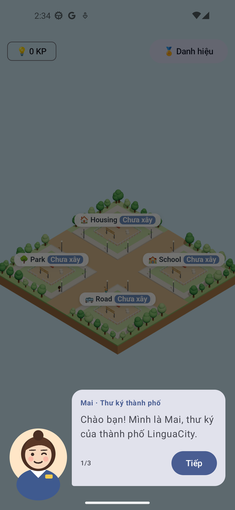
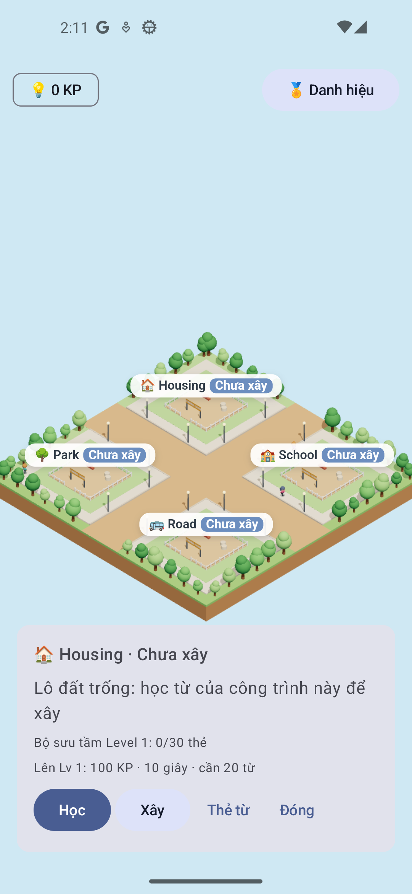
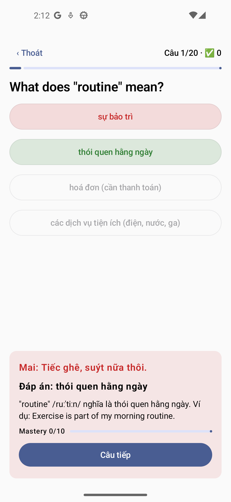
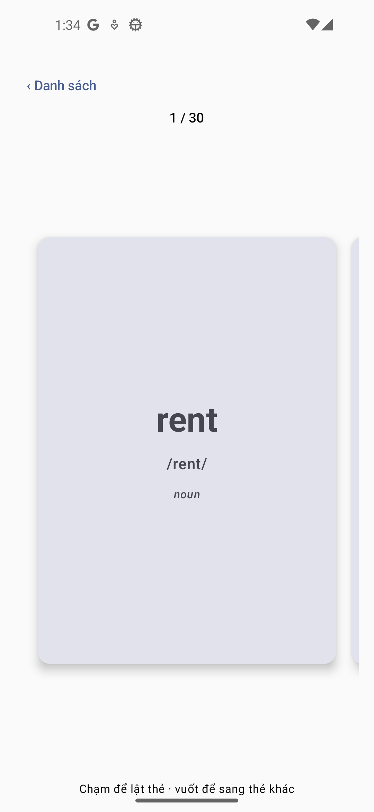
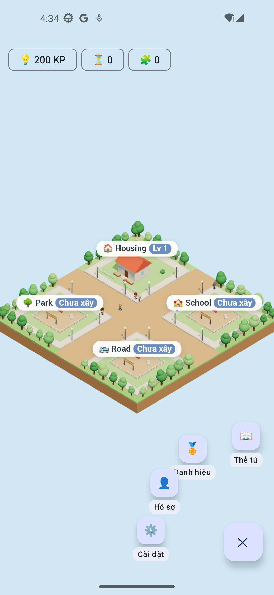
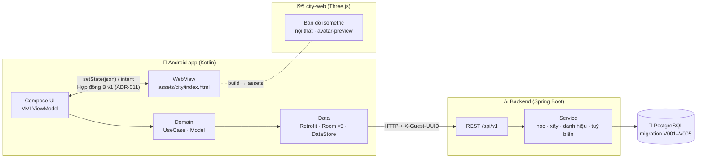

<div align="center">

# 🏙️ LinguaCity

**Học tiếng Anh (TOEIC) bằng cách xây một thành phố của riêng bạn.**

Mỗi từ vựng bạn sưu tầm là một viên gạch: học đủ thì xây nhà, nâng cấp trường học, mở công viên —
và cô thư ký Mai sẽ dẫn bạn đi từ lô đất trống đầu tiên.


</div>

<table>
  <tr>
    <td align="center"><br><sub>Thư ký Mai dẫn đường</sub></td>
    <td align="center"><br><sub>Thành phố & thẻ công trình</sub></td>
    <td align="center"><br><sub>Bài học có phản hồi</sub></td>
    <td align="center"><br><sub>Flashcard lật 3D</sub></td>
    <td align="center"><br><sub>Menu nổi</sub></td>
  </tr>
</table>

---

## Mục lục

- [Tính năng](#-tính-năng)
- [Kiến trúc](#-kiến-trúc)
- [Công nghệ](#-công-nghệ)
- [Cấu trúc thư mục](#-cấu-trúc-thư-mục)
- [Bắt đầu nhanh](#-bắt-đầu-nhanh)
- [API](#-api)
- [Kiểm thử](#-kiểm-thử)
- [Tiến độ](#-tiến-độ)
- [Tài liệu](#-tài-liệu)
- [Sự cố thường gặp](#-sự-cố-thường-gặp)
- [Quy ước làm việc](#-quy-ước-làm-việc)

---

## ✨ Tính năng

| | Tính năng | Mô tả |
| :-: | --- | --- |
| 👤 | **Chơi ngay, không cần đăng ký** | Người chơi khách định danh bằng Guest UUID ([ADR-008](docs/adr/ADR-008-guest-first-no-login.md)). |
| 🧭 | **Tutorial thư ký Mai** | Chân dung 2D, chữ chạy, spotlight chỉ đúng nút; bài kiểm tra trình độ rồi xây House đầu tiên ([ADR-014](docs/adr/ADR-014-secretary-tutorial-placement.md)). |
| 📚 | **Học từ vựng theo công trình** | Mỗi công trình × level là một gói nội dung (House Lv1: 30 từ, 90 câu). Phiên học chạy trên server, chấm 3 tầng: nhận nghĩa → điền từ có gợi ý → điền từ trong ngữ cảnh ([ADR-013](docs/adr/ADR-013-server-learning-session.md)). |
| 🃏 | **Flashcard & bộ sưu tầm** | Danh sách từ, thẻ lật 3D, đánh dấu từ đã sưu tầm; đọc được khi offline ([ADR-004](docs/adr/ADR-004-offline-read-only.md)). |
| 🏗️ | **Xây & nâng cấp thành phố** | Tiêu Knowledge Points (KP), chờ thời gian xây; điều kiện level kế lấy từ gói CORE. |
| 🗺️ | **Bản đồ 3D isometric** | Three.js trong WebView: người dân chibi đi lại, xe dừng đèn đỏ, sự kiện thành phố (!) ([ADR-010](docs/adr/ADR-010-city-view-threejs-webview.md)). |
| 🏠 | **Vào nhà** | Avatar đi tới cửa, camera phóng vào nội thất 3D; chạm sàn để đi lại (M7). |
| 🎨 | **Tuỳ biến** | 39 món: da, tóc, áo, quần, phụ kiện, tường, sàn. Mở bằng KP hoặc danh hiệu, xem trước avatar 3D (M8). |
| 🏅 | **Danh hiệu** | 7 danh hiệu dễ / khó / ẩn, đeo lên HUD; một số món tuỳ biến chỉ mở bằng danh hiệu. KP có trần theo Mastery của từ để chống cày điểm. |
| ⚙️ | **Giao diện hoàn chỉnh** | Splash, loading theo điểm đến, HUD tài nguyên, Hồ sơ, Cài đặt (xoay màn hình, giảm hiệu ứng, xem lại hướng dẫn), shared element (M9). |

**Vòng lặp chính:** học từ → nhận KP + sưu tầm thẻ → xây / nâng cấp công trình → mở gói từ mới → học tiếp.

---

## 🧱 Kiến trúc



**Nguyên tắc chia trách nhiệm**

- **Server là nguồn sự thật** cho điểm, KP, kết quả học, tiến độ xây và món đã mở khoá. App không tự cộng điểm.
- **App** điều phối gọi API, cache nội dung vào Room để đọc offline, và giữ trạng thái màn hình.
- **Bản đồ chỉ vẽ.** Kotlin gửi trạng thái đã tính sẵn qua `LinguaCity.setState(json)`; bản đồ gửi lại *intent* (`BuildingTapped`, `BuildingEntered`, …). Mã cosmetic được dịch sang giá trị vẽ (`asset_key`) ở phía Kotlin ([`LookResolver`](mobile/app/src/main/java/com/project/linguacity/presentation/city/LookResolver.kt)).
- **Nội dung học tải theo gói** (`CORE` + `HOUSING:1`, …), so phiên bản qua `GET /content/manifest` ([ADR-012](docs/adr/ADR-012-content-packs-by-level.md)).

---

## 🛠 Công nghệ

| Phần | Công nghệ |
| --- | --- |
| **Mobile** | Kotlin 2.0, Jetpack Compose (Material 3), Navigation type-safe, Hilt 2.51, Room 2.6 (schema v5), Retrofit 2.11 + kotlinx.serialization, DataStore, AndroidX WebKit, core-splashscreen · minSdk 24, targetSdk 36 |
| **City View** | Three.js 0.160, TypeScript 5.6, Vite 5.4, lil-gui (bảng giả lập) — mọi mô hình dựng bằng code, không dùng file 3D |
| **Backend** | Java 17, Spring Boot 4.1 (Web MVC, Data JPA), Jackson 3, khoá lạc quan `@Version` |
| **Database** | PostgreSQL 17, migration SQL viết tay (`database/migration`); test dùng H2 in-memory |
| **Tài liệu** | Markdown, Mermaid, draw.io, Enterprise Architect |

---

## 📁 Cấu trúc thư mục

```text
LinguaCity/
├── backend/                 Spring Boot — chia package theo nghiệp vụ
│   └── src/main/java/com/linguacity/backend/
│       ├── identity/        Guest UUID, onboarding, hồ sơ
│       ├── content/         manifest, gói CORE, gói theo công trình × level
│       ├── learning/        phiên học trên server, bài kiểm tra trình độ, Mastery
│       ├── city/            thành phố, xây / nâng cấp công trình
│       ├── player/          /users/me, bước tutorial, tiến độ từ, danh hiệu đang đeo
│       ├── achievement/     danh hiệu
│       ├── cosmetic/        danh mục tuỳ biến, mở khoá bằng KP, avatar, kiểu nhà
│       └── common/          lỗi API, cấu hình cân bằng game, đồng hồ hệ thống
├── mobile/                  Android app (Clean Architecture + MVI)
│   └── app/src/main/java/com/project/linguacity/
│       ├── presentation/    màn hình Compose + ViewModel (city, lesson, vocabulary, tutorial, customize, …)
│       ├── domain/          model, UseCase, interface Repository
│       ├── data/            Retrofit API, Room (DAO, entity), mapper, Repository
│       └── di/              module Hilt
├── city-web/                Bản đồ thành phố 3D (Three.js) — xem city-web/README.md
├── database/
│   ├── migration/           V001 → V005 (chạy theo thứ tự)
│   └── seed/                housing_level1.py — sinh phần seed của V003
└── docs/                    yêu cầu, GDD, kiến trúc, UI, test plan, ADR — mục lục ở docs/README.md
```

`backend/` và `mobile/` là **hai dự án Gradle độc lập**: mở riêng từng thư mục trong IDE.

---

## 🚀 Bắt đầu nhanh

### Yêu cầu

| Công cụ | Phiên bản |
| --- | --- |
| JDK | 17 |
| PostgreSQL | 17 (chạy ở `localhost:5432`) |
| Node.js | 18 trở lên (cho `city-web`) |
| Android Studio | bản mới, có Android SDK Platform 36 và một emulator (vd. Pixel 5) |

> Các lệnh dưới viết cho **PowerShell trên Windows**, chạy từ thư mục gốc của repo.

### 1. Tạo database

```powershell
$psql = "C:\Program Files\PostgreSQL\17\bin\psql.exe"   # đổi nếu cài chỗ khác
$env:PGCLIENTENCODING = "UTF8"                          # bắt buộc: migration có tiếng Việt

& $psql -U postgres -c "CREATE DATABASE linguacity_db;"
Get-ChildItem database\migration\V*.sql | Sort-Object Name | ForEach-Object {
    & $psql -U postgres -d linguacity_db -v ON_ERROR_STOP=1 -f $_.FullName
}
```

Migration **không** chạy tự động (Hibernate để `ddl-auto=none`, chưa dùng Flyway). Khi có file `V00N` mới, chạy riêng file đó. Mỗi file bọc trong `BEGIN … COMMIT`, lỗi giữa chừng sẽ không ghi gì.

### 2. Chạy backend

```powershell
$env:SPRING_DATASOURCE_PASSWORD = Read-Host "Mật khẩu postgres"
cd backend
.\gradlew.bat bootRun
```

Backend chạy ở `http://localhost:8080`. Thay cho biến môi trường, có thể tạo `backend/config/local.properties` (Git bỏ qua) với dòng `spring.datasource.password=...`. URL và user ghi đè được bằng `SPRING_DATASOURCE_URL`, `SPRING_DATASOURCE_USERNAME`.

Thử nhanh ở một cửa sổ PowerShell khác:

```powershell
$h = @{ 'X-Guest-UUID' = [guid]::NewGuid().ToString() }
Invoke-RestMethod -Method Post http://localhost:8080/api/v1/users/onboard -Headers $h
Invoke-RestMethod http://localhost:8080/api/v1/users/me/cosmetics -Headers $h
```

### 3. Build bản đồ (city-web)

```powershell
cd city-web
npm install
npm run build      # tạo city-web/dist — app Android chép thư mục này vào assets khi build
npm run dev        # (tuỳ chọn) xem bản đồ ở http://localhost:5173 với bảng giả lập
```

Tham số URL hữu ích: `?debug=0` ẩn bảng giả lập, `?mode=avatar-preview` chỉ hiện avatar trên bệ xoay. Chi tiết trong [city-web/README.md](city-web/README.md).

### 4. Chạy app Android

1. Mở thư mục `mobile/` bằng Android Studio, chọn **Gradle JDK 17**, đồng bộ Gradle.
2. Chạy backend (bước 2) và đã build city-web (bước 3).
3. Mở emulator, Run cấu hình `app`.

Hoặc build bằng dòng lệnh:

```powershell
cd mobile
.\gradlew.bat assembleDebug     # APK: mobile/app/build/outputs/apk/debug/app-debug.apk
```

App gọi backend qua `http://10.0.2.2:8080/` — địa chỉ của máy host khi nhìn từ emulator ([`NetworkModule`](mobile/app/src/main/java/com/project/linguacity/di/NetworkModule.kt)). Chạy trên điện thoại thật thì đổi thành IP LAN của máy chạy backend. HTTP cleartext chỉ bật cho môi trường local.

---

## 🔌 API

Mọi endpoint nằm dưới `/api/v1` và định danh người chơi bằng header **`X-Guest-UUID`**. Lỗi trả dạng `{ "code", "message", "details" }`.

| Nhóm | Method | Đường dẫn | Việc |
| --- | :-: | --- | --- |
| **Người chơi** | `POST` | `/users/onboard` | Tạo hoặc lấy lại hồ sơ khách |
| | `GET` | `/users/me` | Hồ sơ, tài nguyên, danh hiệu đang đeo, avatar, kiểu nhà, thống kê |
| | `PUT` | `/users/me/tutorial/step` | Lưu bước tutorial |
| | `POST` | `/users/me/tutorial/complete` | Hoàn thành tutorial |
| | `GET` | `/users/me/vocab-progress` | Tiến độ từng từ |
| | `GET` | `/users/me/achievements` | Danh hiệu đã có |
| | `PUT` | `/users/me/equipped-title` | Đeo danh hiệu |
| **Nội dung** | `GET` | `/content/manifest` | Phiên bản từng gói |
| | `GET` | `/content/core` | Dữ liệu thế giới: công trình, level, danh hiệu, danh mục tuỳ biến |
| | `GET` | `/content/packs/{building}/{level}` | Gói từ vựng + câu hỏi |
| **Học** | `POST` | `/learning/sessions` | Bắt đầu phiên học |
| | `GET` | `/learning/sessions/{id}` | Trạng thái phiên |
| | `POST` | `/learning/sessions/{id}/items/{no}/answer` | Nộp câu trả lời |
| | `POST` | `/learning/sessions/{id}/complete` | Kết thúc, nhận KP |
| | `POST` | `/tutorial/placement` | Bài kiểm tra trình độ |
| **Thành phố** | `GET` | `/city` | Công trình và tiến độ xây |
| | `POST` | `/buildings/{code}/build` | Xây / nâng cấp |
| **Tuỳ biến** | `GET` | `/users/me/cosmetics` | Món đã mở, avatar, kiểu nhà, KP |
| | `POST` | `/cosmetics/{code}/unlock` | Mua món bằng KP (`409 INSUFFICIENT_KP` khi thiếu) |
| | `PUT` | `/users/me/avatar` | Lưu ngoại hình |
| | `PUT` | `/users/me/house-style` | Lưu tường + sàn |

Đặc tả đầy đủ (body, mã lỗi, quy tắc nghiệp vụ): [system-design.md §10](docs/03-architecture/system-design.md).

---

## 🧪 Kiểm thử

| Phần | Lệnh | Phạm vi |
| --- | --- | --- |
| Backend | `cd backend; .\gradlew.bat test` | Integration với H2: onboarding, gói nội dung, phiên học, Mastery, tutorial, danh hiệu, tuỳ biến |
| Mobile | `cd mobile; .\gradlew.bat testDebugUnitTest assembleDebug` | Unit: mapper nội dung, chọn gói, hợp đồng JSON với bản đồ, dịch mã cosmetic, lời thoại và kịch bản của Mai, menu nổi |
| City View | `cd city-web; npm run typecheck; npm run build` | Kiểm tra kiểu + build |

Test case thủ công, E2E trên emulator và PostgreSQL thật được ghi kèm kết quả thực tế (Đạt / Không đạt / Chưa kiểm) trong [docs/06-testing/test-plan.md](docs/06-testing/test-plan.md).

---

## 📈 Tiến độ

| Hạng mục | Nội dung | Trạng thái |
| --- | --- | :-: |
| VS1 | Guest onboarding | ✅ |
| VS2 | Gói nội dung theo level, đọc offline | ✅ |
| VS3 | Học từ vựng (phiên học trên server) | ✅ |
| City View | Bản đồ Three.js + WebView, dữ liệu thật từ `GET /city` | ✅ |
| M6 | Tutorial thư ký Mai + bài kiểm tra trình độ | ✅ |
| M7 | Vào nhà: avatar, nội thất 3D House | 🟡 chờ E2E emulator |
| M8 | Tuỳ biến nhân vật & nhà (V005, Room v5) | 🟡 chờ E2E emulator |
| M9 | Giao diện: splash, loading, HUD, menu nổi, Hồ sơ, Cài đặt | ✅ |
| VS4 | Thi (Exam Center) | ⬜ |
| VS5 | Nâng cấp công trình đầy đủ | ⬜ |

✅ xong · 🟡 đang hoàn thiện · ⬜ chưa bắt đầu — chi tiết từng màn hình ở [screen-catalog.md](docs/04-ui/screen-catalog.md).

---

## 📚 Tài liệu

| Tài liệu | Nội dung |
| --- | --- |
| [docs/README.md](docs/README.md) | Mục lục, thứ tự đọc, quy tắc cập nhật |
| [Tổng quan dự án](docs/00-overview/project-overview.md) · [Lộ trình](docs/00-overview/learning-roadmap.md) | Dự án là gì, làm gì tiếp |
| [SRS](docs/01-requirements/srs-mvp.md) · [Use case](docs/01-requirements/use-cases.md) | Hệ thống phải làm gì |
| [GDD](docs/02-game-design/gdd.md) | Core loop, tài nguyên, cân bằng game |
| [System Design](docs/03-architecture/system-design.md) | ERD, API, Room, hợp đồng bản đồ |
| [Danh mục màn hình](docs/04-ui/screen-catalog.md) | SCR-01 → SCR-22 |
| [Tích hợp WebView](docs/05-implementation/city-webview-integration.md) | Bài học khi nhúng bản đồ vào app |
| [Test plan](docs/06-testing/test-plan.md) | Test case và kết quả |
| [ADR](docs/adr/README.md) · [Nhật ký sự cố](docs/adr/troubleshooting-log.md) | Vì sao chọn như vậy, lỗi đã gặp |

---

## 🩹 Sự cố thường gặp

| Triệu chứng | Cách xử lý |
| --- | --- |
| `psql : The term 'psql' is not recognized` | Gọi bằng đường dẫn đầy đủ `& "C:\Program Files\PostgreSQL\17\bin\psql.exe" …`, hoặc thêm thư mục `bin` vào PATH. |
| Migration báo `has no equivalent in encoding` hoặc chữ Việt bị lỗi | Đặt `$env:PGCLIENTENCODING = "UTF8"` trước khi chạy psql. |
| Backend: `SCRAM-based authentication, but no password was provided` | Chưa đặt `SPRING_DATASOURCE_PASSWORD` trong cửa sổ đang chạy `bootRun`. |
| Đúng mật khẩu ở terminal nhưng sai ở pgAdmin | Tắt bộ gõ tiếng Việt (Unikey/EVKey) khi gõ mật khẩu; kiểm tra Caps Lock. |
| `Port 8080 was already in use` | Còn một backend khác đang chạy (vd. từ IntelliJ hoặc bản clone khác): dừng nó trước. |
| API mới trả `404` | Backend đang chạy là bản cũ; kiểm tra đúng thư mục / đúng nhánh. |
| Gradle: `SDK location not found` | Đặt `ANDROID_HOME` hoặc tạo `mobile/local.properties` với `sdk.dir=...`. |
| Bản đồ trong app trắng / `City View: chưa có city-web/dist` | Chạy `npm run build` trong `city-web` rồi build lại app. |

Danh sách đầy đủ: [troubleshooting-log.md](docs/adr/troubleshooting-log.md).

---

## 🤝 Quy ước làm việc

- **Nhánh:** `feat/<mô-tả>` tách từ `main`, gộp qua Pull Request.
- **Commit:** `feat(backend,mobile): …`, `fix: …`, `docs: …` — tiếng Việt, mô tả *làm gì và vì sao*.
- **Database:** không sửa migration đã chạy; thay đổi schema hoặc nội dung bằng file `V00N` mới, và tăng `content_packs.version` của gói bị đổi.
- **Hợp đồng bản đồ:** giữ `v1` (ADR-011), chỉ thêm trường tuỳ chọn.
- **Tài liệu đi cùng code:** đổi API → cập nhật `system-design.md`; xong một test case → ghi kết quả thật vào `test-plan.md`; quyết định mới → ADR mới.
- **Không commit file build:** `city-web/dist`, `build/`, `local.properties`, `backend/config/local.properties`.
