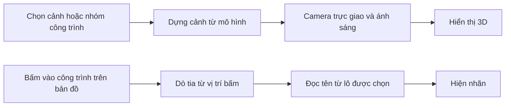

# 02. Kiến trúc và luồng

## Địa hình bước 1

[terrain.js](../preview/terrain.js) sinh lưới đất, lòng suối, mặt nước và vật trang trí. Hàm lấy mẫu bề mặt đọc chính các tam giác đã dựng để đường và chân nhân vật khớp cao độ. [terrain-view.js](../preview/terrain-view.js) dùng chung camera trực giao, góc xem, kéo và thu phóng.

## Bản đồ thị trấn hiện tại

[index.js](../index.js) dựng địa hình trước, sau đó đặt công trình theo cao độ bề mặt và gắn mạng đường cùng công cụ chỉnh đường.

| Cần sửa | Tệp |
| --- | --- |
| Mặt đất, nước, cây đá | [terrain.js](../preview/terrain.js) |
| Chọn địa hình dùng cho bản đồ chính và trang xem riêng | [town-terrain.js](../preview/town-terrain.js) |
| Vị trí, hướng và kích thước công trình | [town-layout.js](../preview/town-layout.js) |
| Hình học của từng mẫu công trình | [models](../models) và [preview/models](../preview/models) |
| Các dải đường mẫu và điểm đi, điểm đến của xe | [town-roads.js](../preview/town-roads.js) |
| Đường mòn, cầu và cao độ dọc tuyến lên đồi | [town-paths.js](../preview/town-paths.js) |

[Trang địa hình](../preview/terrain.html) mở cùng địa hình với bản đồ chính. Bản đồ chính cung cấp thêm vùng chừa cây đá cho đường và công trình. [Địa hình gốc](../preview/terrain.html?dia-hinh=1) mở lại cấu hình ở bước 1.

## Bản quy hoạch trước

- [planning-layout.js](../preview/planning-layout.js) xác định lô, cổng, vùng đất và giới hạn độ dốc. [hill-road.js](../preview/hill-road.js) tạo đường xe cong với cao độ theo chiều dài. [west-bank.js](../preview/west-bank.js) định vị thềm mở rộng, hai đầu cầu và đường đi bộ.
- [town-fences.js](../preview/town-fences.js) kiểm tra độ chênh cao, khoảng cách tới đường và chướng ngại để đặt [mẫu hàng rào](../models/fence.js) ở mép dốc. [Mẫu biển gỗ](../models/direction-sign.js) nhận các hướng đi tiếp từ cụm nút giao.
- [roads.js](../preview/roads.js) lưu ô theo hướng dải và mặt đường, ghép các dải song song, tìm cụm nút giao và sinh mạng đi bộ, mạng xe. Tuyến cong nối vào các làn ở đầu đường lưới.
- [streets.js](../preview/streets.js) dựng mặt đường, đầu chuyển vật liệu, đường lên đồi, cầu và biển đèn. [planning-traffic.js](../preview/planning-traffic.js) di chuyển tác nhân theo mạng tương ứng và dành lượt qua các vùng xung đột.
- [planning-preview.js](../preview/planning-preview.js) xử lý chế độ xem, vẽ, xóa, đổi mặt và cập nhật đồ họa. Trình duyệt lưu các ô đường và cấp bến xe của bản xem thử.

## Bản xem trước công trình dùng làm tham chiếu

| Thành phần | Vai trò |
| --- | --- |
| [preview/index.html](../preview/index.html) và [styles.css](../preview/styles.css) | Màn hình hai cảnh, bốn bộ công trình, chế độ ngày đêm và tên công trình. |
| [preview.js](../preview/preview.js) | Camera trực giao, dựng cảnh, bắt điểm bấm bằng tia, đổi cấp xem và đổi ánh sáng. |
| [town.js](../preview/town.js) | Vị trí lô, địa hình, suối, đường và hoạt ảnh cư dân theo các tuyến hoặc điểm ngồi dựng sẵn. |
| [preview/models](../preview/models) | Các mẫu House, School, Park, Bus Station theo cấp và nhóm công trình bổ sung ở cảnh đô thị. Một số mẫu dùng lại phần hình học trong [models](../models). |
| [build.cjs](../preview/build.cjs) | Đóng gói `preview.bundle.js` cho bản tham chiếu và `terrain.bundle.js` cho bản địa hình. |

Ở cảnh khởi đầu, cấp nhà thị trưởng được giữ trong phiên. Chọn lô Lv0 rồi bấm xây sẽ dựng lại cảnh với mẫu Lv1 tại cùng vị trí. Các hoạt ảnh cư dân trong bản xem trước dùng các mốc đặt sẵn để xem tỷ lệ và dáng hoạt động.

## Demo sắp xếp nhà

Điểm vào của bản thử nền phẳng là [arrange.html](../arrange.html).

[arrange.html](../arrange.html) tải [model.js](../model.js), `world.bundle.js` và [app.js](../app.js). `app.js` xử lý thao tác và giữ trạng thái lô nhà, nét vẽ. `model.js` kiểm tra đất, lô công trình, đường và tìm đường trên lưới. [world.js](../world.js) dựng cảnh Three.js, cập nhật nhân vật, cửa và xe ở từng khung hình. [build.cjs](../build.cjs) đóng gói `world.js` cho trang sắp xếp nhà và `index.js` cho bản đồ thị trấn.

Các bước ghép mẫu, mở khóa vật liệu theo bến xe và sinh làn xe từ mạng đường được mô tả trong [kế hoạch](00-ke-hoach.md).
