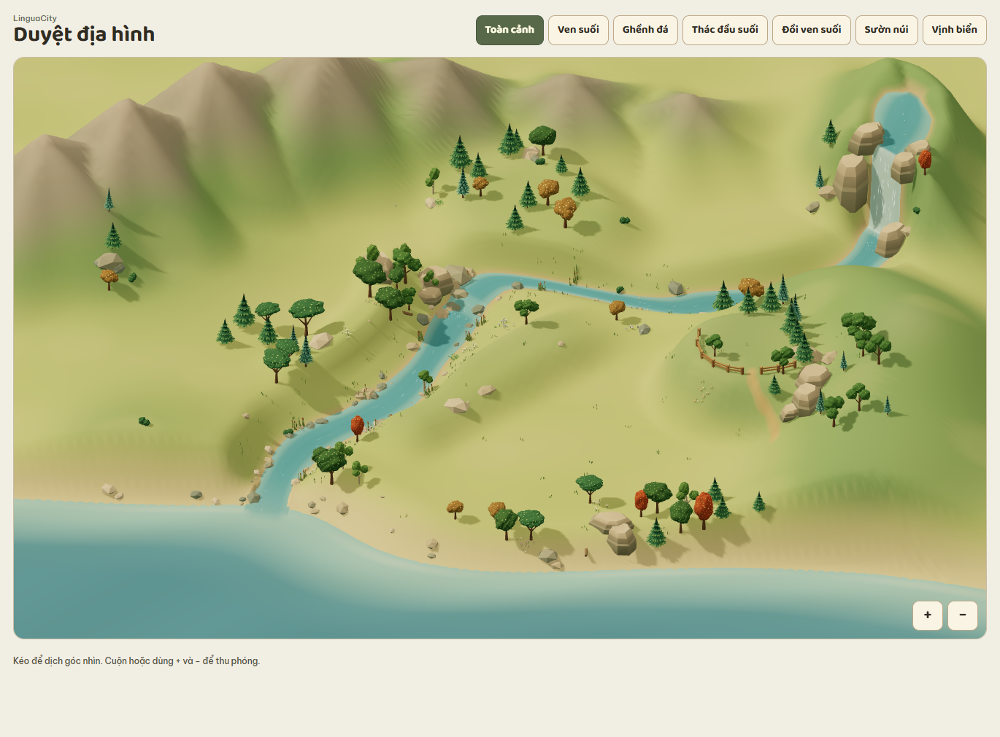
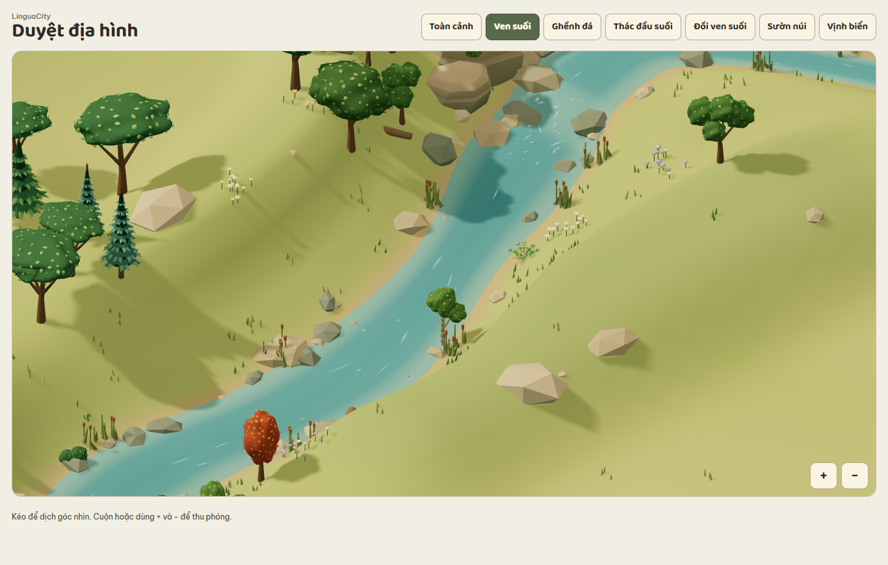
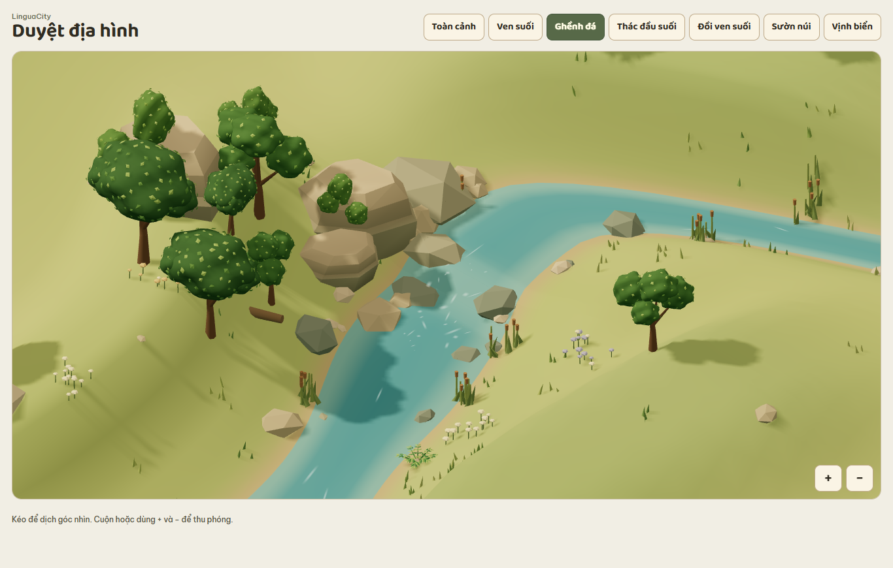
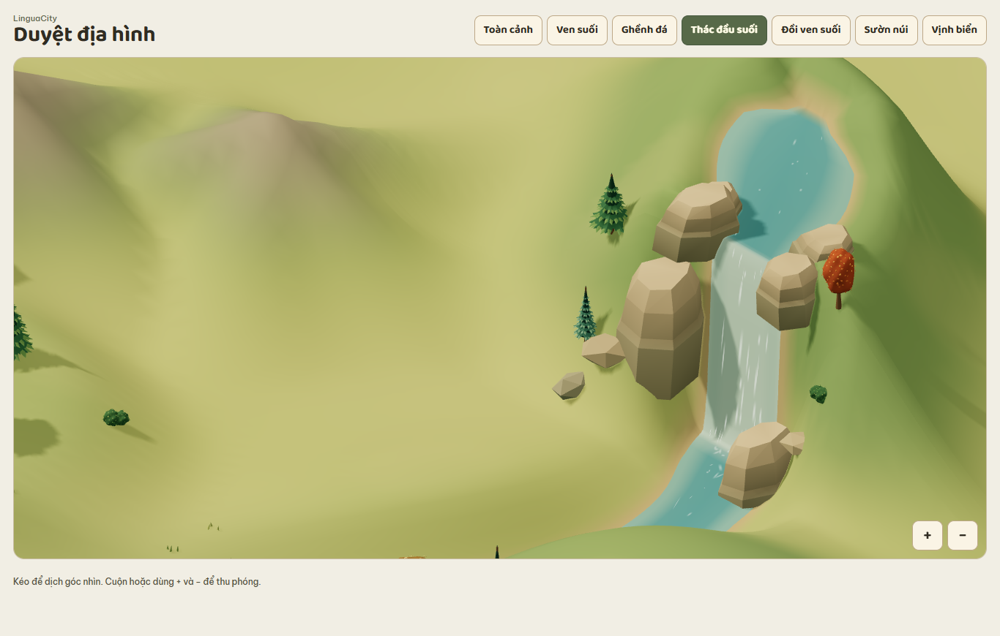
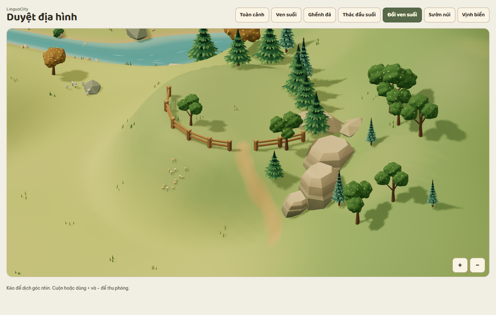

# Báo cáo bước 1 — Địa hình trống

**Trạng thái** — Đã chốt địa hình demo. Xem [báo cáo bước 2](05-bao-cao-buoc-2-quy-hoach.md) để duyệt các chỉnh sửa phục vụ quy hoạch.

[Mở địa hình đã chốt](../preview/terrain.html?dia-hinh=1) · [Kế hoạch](00-ke-hoach.md)

## Bố cục

Dãy núi lùi về góc trên bên trái, mở rộng khoảng đất thoải giữa chân núi và suối ở phía trên bản đồ. Thác cao hơn và nằm xa về góc trên bên phải. Từ hồ đầu nguồn, nước đổ qua thác, chạy sau một phần đồi mới rồi uốn về vịnh biển.

## Các chi tiết đã dựng

| Hạng mục | Cách thể hiện |
| --- | --- |
| Cao độ | Các sống núi dọc rìa trái nối về phía trên khung hình. Đồi mới bên phải suối có đỉnh bằng và sườn chuyển dần xuống vùng thấp. |
| Dòng suối và biển | Nước đổ giữa hai bờ đá, với các vệt nước chuyển động trên mặt thác và bọt ở chân thác. Qua ghềnh, suối uốn về vịnh nhỏ và hòa vào dải nước biển nông cạnh bãi cát. |
| Cảnh quan | Hàng rào gỗ men theo mép trái và mép dưới của đồi. Lối mòn từ chân đồi đi qua khoảng mở giữa hàng rào. Đá và cụm cây tập trung quanh mép thềm để chừa khoảng thoáng ở giữa. |
| Góc xem | Camera trực giao. Có **Toàn cảnh**, **Ven suối**, **Ghềnh đá**, **Thác đầu suối**, **Đồi ven suối**, **Sườn núi** và **Vịnh biển**. Camera giới hạn toàn bộ khung nhìn trong bốn mép của ảnh tham chiếu khi kéo, thu phóng hoặc đổi kích thước cửa sổ. |

[Xem sườn núi](image/dia-hinh-suon-nui.png) · [Xem cửa suối đổ ra vịnh](image/dia-hinh-vinh-bien.png)

## Đề xuất đường ở bước 2

Đường trong mỗi thềm đi trên vùng thoải. Giữa hai thềm, thử một đoạn đường xe men sườn qua đầu thềm để tăng chiều dài đoạn lên cao. Khi duyệt tuyến, xem mặt cắt dọc để kiểm tra độ dốc và điểm đổi dốc. Tại giao lộ, các nhánh cần cùng cao độ ở điểm nối. Nếu dốc ngang lớn, mặt đường cần một băng nền riêng bám sườn. Lối đi bộ 1× có thể đi thẳng hơn bằng bậc để làm lối tắt.

Khi có tuyến đi bộ ở chân dốc, thử xem từ góc camera mặc định. Phần sườn nằm giữa camera và nhân vật có thể che chân trước rồi che dần thân. Nếu cần theo dõi nhân vật khi bị khuất hoàn toàn, có thể dùng avatar và mũi tên trên lớp giao diện như cơ chế che khuất của kế hoạch.

## Kiểm tra và duyệt

Đã mở trực tiếp bản HTML trong Chrome và thử cả bảy góc xem, kéo hết biên và thu phóng. Đã kiểm tra khổ ảnh tham chiếu, màn hình ngang rộng và màn hình điện thoại dọc.

Chủ dự án đã chốt địa hình hiện tại làm nền cho demo và cho chuyển sang quy hoạch khu xây dựng, đường và các điểm nối cao độ.
