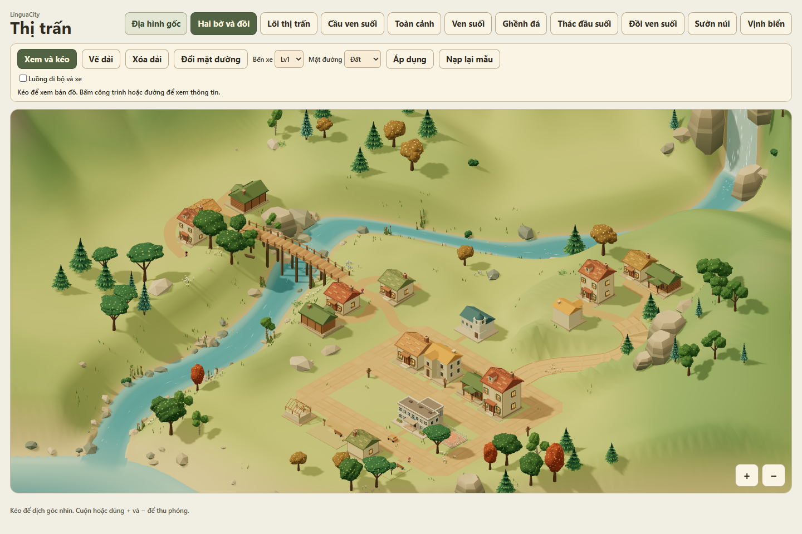
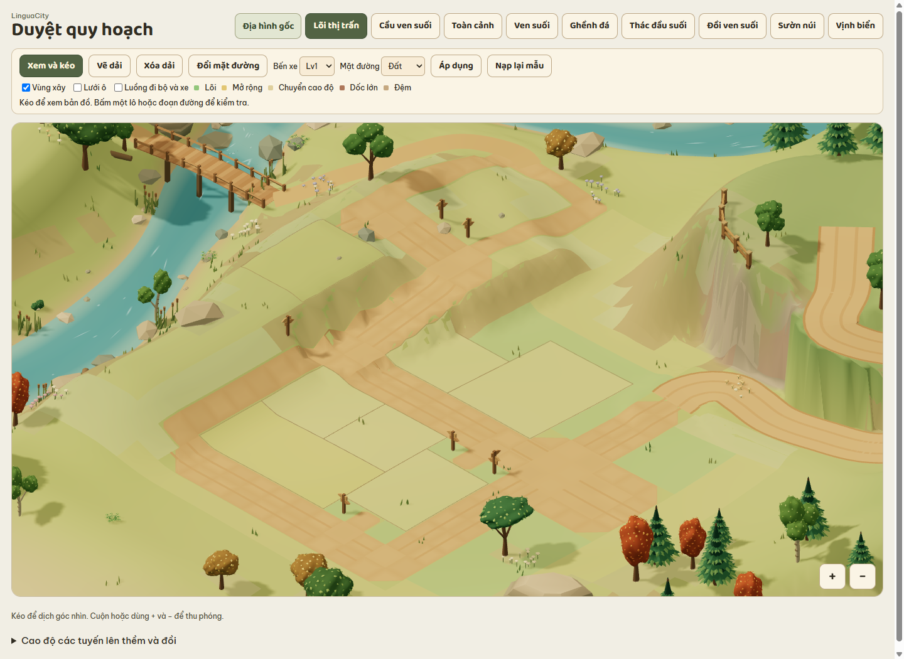
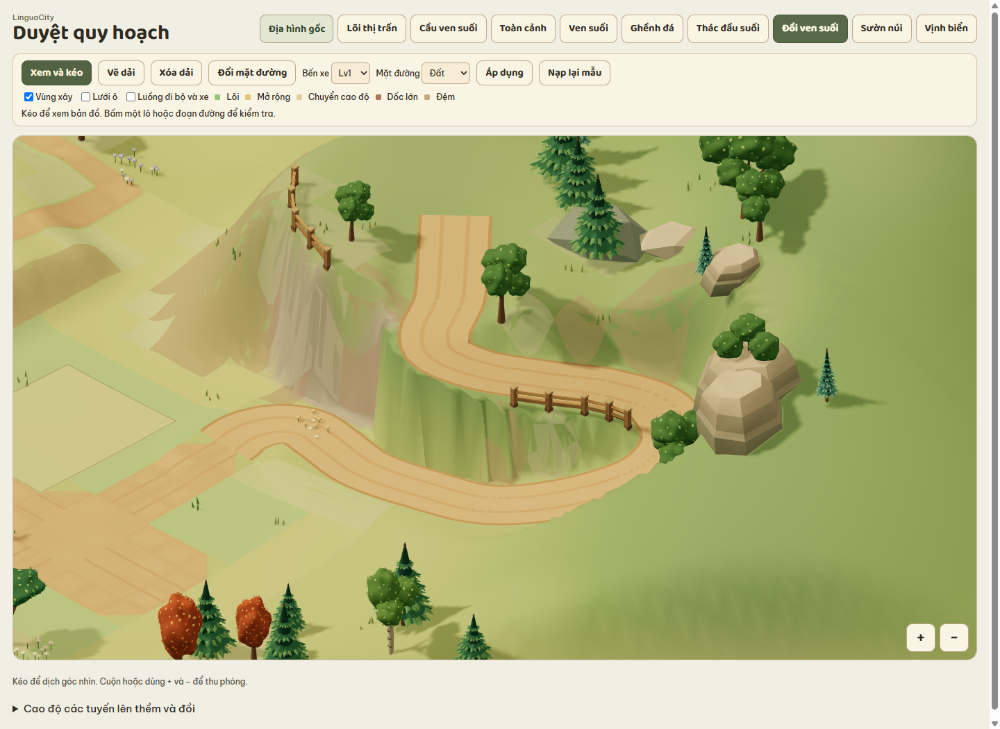
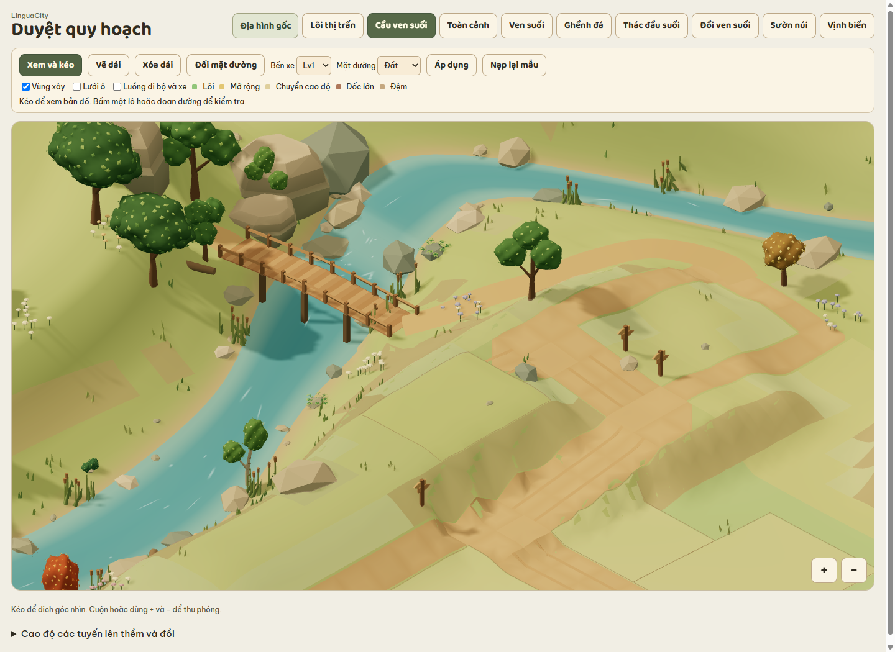
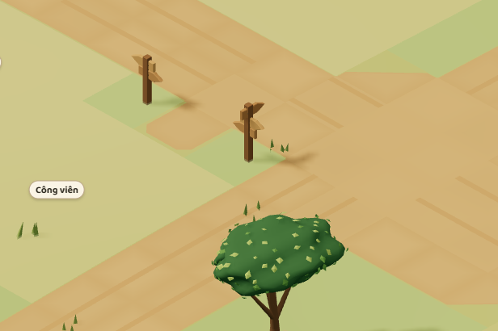
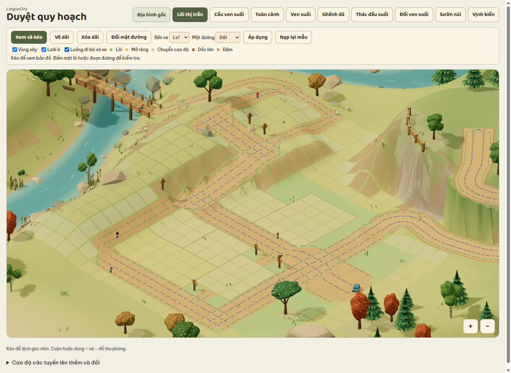

# Báo cáo bước 2 — Quy hoạch và đường

**Trạng thái** — Bản xem trước để duyệt bố cục và quy tắc đường.

[Mở bản đồ thị trấn](../index.html) · [Địa hình gốc](../preview/terrain.html?dia-hinh=1) · [Kế hoạch](00-ke-hoach.md)

## Bản đồ thị trấn hiện tại

Thị trấn phát triển từ địa hình đã duyệt ở bước 1. Lõi thung lũng có mặt bằng gần phẳng, với một khoảng 5 × 4 ô liền nhau sát đường để mở rộng. Nhà thị trưởng, trường, sân bóng, bến xe và công viên nằm quanh trục đường đất. Tên công trình hiện khi bấm chọn.

Hai bờ có dải đất thoải để đặt nhà và nối đường mòn tới cầu gỗ đi bộ. Trên đồi và sau đồi, bốn căn nhà cùng dùng một thềm rộng. Đường đất 2× lên thềm bằng một khúc cua dài và nối vào vòng xe trong lõi phố. Xe dừng ngắn tại đích rồi quay về theo đúng chiều làn. Bến xe khởi đầu Lv1. Bật **Luồng đi bộ và xe** để xem các tuyến.

[Xem lõi thung lũng](image/thi-tran-loi-thung-lung.png) · [Xem cầu gỗ](image/thi-tran-cau-go.png) · [Xem thềm trên đồi](image/thi-tran-tren-doi.png) · [Xem toàn cảnh](image/thi-tran-toan-canh.png)

## Bản quy hoạch trước

[Mở bản quy hoạch cũ](../preview/terrain.html?quy-hoach=1). Phần dưới ghi lại kết quả của lần thử phân lô và làm đường trên thềm.

## Lõi thị trấn

Mạng đường mẫu mở ở **Bến xe Lv1**, với mặt đất cho cả trục xe 2×–4× và lối đi bộ 1×. Đường xe 2× nối từ trục chính lên thềm ven suối. Chỉnh cao độ cục bộ ở lòng đường để đi lên thềm. Bấm trực tiếp vào một lô để xem kích thước và loại đường tới lối vào.

Bật **Vùng xây** và **Lưới ô** để xem ranh giới các lô trống, vùng chuyển cao độ, dốc lớn và phần đệm. Các lô chỉ lưu kích thước và lối vào. Việc chọn vị trí cho từng loại công trình thuộc bước đặt công trình sau này.

[Xem toàn cảnh](image/quy-hoach-toan-canh.png) · [Xem lưới vùng xây](image/quy-hoach-luoi-xay.png)

## Đồi ven suối

Mép trái đồi được dựng thành vách dốc. Đường xe 2× nối nhánh phố, chạy vòng dưới chân vách rồi đổi hướng để lên đỉnh. Hàng rào gỗ dùng chung một mẫu, đặt thành hai đoạn ngắn ở mép vách và lề khúc cua có đất tụt cao độ. Tuyến xe dài khoảng 27,5 ô, chênh cao 4,33 đơn vị. Độ dốc dọc lớn nhất khoảng 19% theo tỷ lệ bản demo. Có hai chiều xe và một đầu quay xe trên đỉnh.

## Cầu ven suối và quỹ đất mở rộng

Thềm phía trên nhà thị trưởng là một phần của vùng mở rộng. Từ điểm nối trên đường 1×, lối đi men xuống bờ rồi nối cầu gỗ qua nước. Cầu có lan can riêng cho luồng đi bộ, còn bờ suối để thoáng.

## Biển chỉ đường

Mỗi ngã ba có một cột với hai mũi tên, mỗi ngã tư có một cột với ba mũi tên. Các mũi tên chỉ theo những nhánh có thể đi tiếp từ hướng tiếp cận của biển. Góc cua, đường thẳng và đầu cụt không đặt biển chỉ hướng.

## Thử quy tắc đường

1. Chọn **Vẽ dải**, kéo một nét thẳng rồi kéo dải song song sát cạnh. Phần trùng chiều dài sẽ ghép, tối đa bốn ô bề rộng. Dùng **Xóa dải** để thu bề rộng.
2. Chọn **Đổi mặt đường**, bấm một đoạn giữa hai nút rồi chọn vật liệu và **Áp dụng**. Cấp bến xe mở lần lượt đất, đá lát và nhựa. Đổi cấp chỉ đổi giới hạn vật liệu đang xem, còn từng tuyến đổi mặt khi áp dụng. **Nạp lại mẫu** thay mạng đang chỉnh bằng bố cục mẫu của cấp đã chọn.
3. Bật **Luồng đi bộ và xe** để xem hai luồng trên đường 1×, các làn từ 2× và cách nhập vào tuyến hẹp hơn. Vạch sang đường và đèn xuất hiện theo loại mặt đường và độ rộng nút. Các đường cong lên đồi và qua cầu được bố trí sẵn theo địa hình, còn công cụ vẽ dải dùng lưới.

Hai xe thử xuất phát ở đầu trục phía đông. Một xe đi lên đỉnh đồi, xe kia tới thềm ven suối. Mỗi xe dừng ở điểm quay đầu rồi chạy về theo làn hợp lệ. Nếu tuyến bị cắt trong lúc thử chỉnh đường, xe đang chạy dừng khi không còn đường hợp lệ.

Đã thử thao tác vẽ và xóa, đổi mặt từng đoạn, chặn nước, mở khóa theo cấp, tải lại bản đã lưu và bố cục điện thoại trong Chrome. Kiểm tra tự động bao phủ ghép dải 1×–4×, hai xe đi và về theo điểm đến, lối đi bộ qua cầu và cao độ mặt đường.
