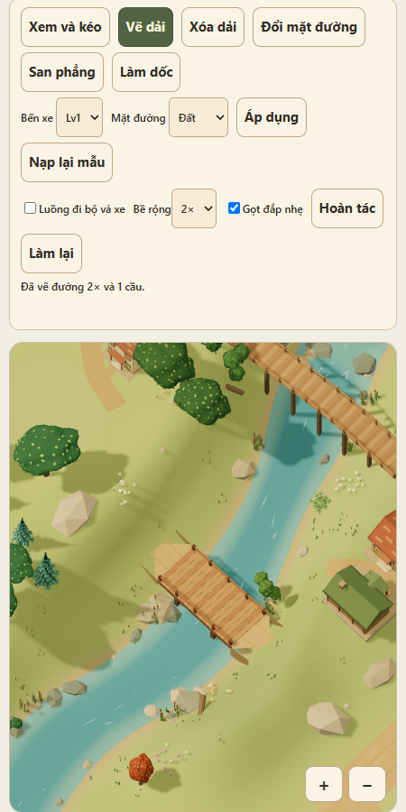

# 06. Vẽ đường, bắc cầu và chỉnh địa hình

Bản thử chạy trên [bản đồ thị trấn](../index.html). Mục tiêu là kéo được một nét liền trên đất dốc nhẹ, vượt suối bằng cầu thẳng và biết chính xác đoạn nào cần đổi hướng hoặc chỉnh nền.

## Cách thử

1. Mở bản đồ thị trấn và chọn góc **Vẽ qua suối**. Góc này nhìn dốc xuống để bờ cao ít che điểm chạm.
2. Chọn **Vẽ dải**, bề rộng **2×**, rồi kéo từ bờ trên trái sang bờ dưới phải như ảnh. Vị trí đã kiểm tra đi từ ô `(-14, 2)` tới `(-9, 2)`. Thả tay để xem mô hình dự kiến rồi bấm **Xác nhận**. Trên máy tính có thể dùng **V** hoặc **Esc** để xác nhận hoặc hủy.
3. Bấm **Hoàn tác** hoặc **Làm lại**. Để xóa cầu, chọn **Xóa dải**, chạm mặt cầu rồi xác nhận. Thao tác xóa gồm cả nhịp và đường dẫn của cầu.
4. Chọn **San phẳng** và chạm để dùng cỡ **1×1**, **3×3** hoặc **4×4**. Kéo từ ô đầu đến ô cuối để san cả hình chữ nhật, tối đa **12×12**, lấy cao độ từ ô đầu. Ô cần đắp có màu trắng, ô gần cao độ đích có màu xanh cyan và ô cần đào có màu cam đậm dần theo chênh lệch. Dấu X đỏ đánh dấu ô bị bỏ qua.
5. Chọn **Làm dốc**, chọn bề rộng **1×–4×** rồi kéo từ đầu thấp tới đầu cao hoặc ngược lại. **Vẽ tự do** cho phép uốn tuyến theo nét tay. Dốc dài tối đa **20 đơn vị**, giới hạn **35%** dọc tuyến. Bản xem trước dùng cyan, trắng và cam để chỉ phần gần cao độ đích, cần đắp và cần đào.
6. Chọn **Vẽ dải → Kéo tay**, bề rộng **2×** hoặc **3×**, chọn **Vẽ tự do** rồi kéo chéo trên đất khô. Xem dải ô đã chọn, thả tay, chọn **Đường theo ô** và xác nhận. **Bắt trục** hỗ trợ nét gần song song với lưới.
7. Chọn **Vẽ dải → Chấm A–B**. Chạm A để hiện vòng phạm vi 60 đơn vị cắt theo biên vùng chỉnh đường. Bạn có thể kéo để dịch camera rồi chạm B. Kiểm tra số đo và tập ô trên bản xem trước trước khi xác nhận. Phím **Esc** xóa A để chọn lại.
8. Bật **Hiện làn giao thông**. Xanh lục là đi bộ, cam là xe máy riêng, xanh lam là ô tô hoặc làn cơ giới dùng chung. Ở 1×, người đi bộ bám mép và xe máy chạy hai chiều gần tim. Ở 2×, vạch xanh lam cũng là luồng xe máy. Ở 3×, vạch cam nằm ngoài làn ô tô và bên phải theo từng hướng lưu thông.
9. Vẽ một tuyến vuông góc rộng 2× cắt qua toàn bộ tuyến 2× khác trên đất khô. Khi giao lộ có đủ chỗ, thả tay và đổi giữa **Vòng xoay** và **Giao cùng mức** trước khi xác nhận. Khi nối dài đường cùng hướng, bắt đầu gần đầu tuyến cũ để thử bắt dính vào giữa mặt đường.
10. Chọn **Vẽ dải → Chấm A–B**, bật **Tự đề xuất san nền** rồi chọn hai điểm trên bãi đất trống dốc nhẹ ven suối. Nếu nền hiện tại vượt độ dốc cho phép, thử thẻ **Làm dốc dưới đường** hoặc **San phẳng dưới đường** khi có. Màu và viền giống công cụ **San phẳng**. Chọn **Xác nhận** rồi **Hoàn tác** để kiểm tra cả đường và nền.
11. Kéo một nét bắt đầu trên đất trống và đi qua công trình. Demo đánh dấu đoạn phía sau bằng màu đỏ mờ và cho xác nhận đoạn liền trước chỗ vướng nếu hợp lệ. Thử chấm A và B hai bên công trình để xem đường vòng.

Khi có nhiều phương án hợp lệ, thanh dưới bản đồ cho đổi bản xem trước. Có thể kéo camera hoặc thu phóng trong lúc chọn. Điểm hiển thị là ước tính của demo, tính cả việc dọn cây đá. Dấu đỏ đánh dấu cây đá cần dọn khi xác nhận.

Sau khi thả tay ở chế độ **San phẳng**, mặt phẳng xanh nhạt hiện đúng cao độ đích và chỉ phủ các ô có thể san. Viền lõi nét liền ở phần nhìn thấy và nét đứt ở phần bị đất hiện tại che. Viền taluy dùng nét đứt và thẻ **San và chuyển tiếp thoải** thêm sọc vàng trên các ô taluy. Mỗi thẻ ghi số ô san và số ô taluy để dễ so sánh.

## Quy tắc vẽ đường

- Lọc tim tuyến XZ bằng Ramer–Douglas–Peucker rồi chọn đúng số ô theo từng lát thường. Chỗ cua gắt giữ cụm góc để hai nhánh nối kín. Giới hạn 60 đơn vị là tổng chiều dài hình học của tim, gồm cả phần căn cầu và đường dẫn khi dùng bộ cầu hiện tại. Công cụ **Làm dốc** vẫn dùng giới hạn riêng.
- Bản duyệt mốc 3 hiển thị và lưu mặt đường theo ô. Đường cùng hướng dùng lại ô và mặt đường cũ. Với đầu dải cong đã lưu, điểm nối phù hợp giữ nguyên các ô của dải cũ. Bo tròn thuộc mốc 4 trong [kế hoạch](07-ke-hoach-ve-duong-theo-lat.md).
- Khi dải ô gặp nước hoặc đầu cầu có sẵn, demo chuyển sang bộ tính cầu hiện tại để thử nhịp và đường dẫn.
- Giao lộ mới có thể chọn vòng xoay hoặc giao cùng mức khi đủ diện tích, có từ ba nhánh và mọi nhánh đều rộng ít nhất 2×. Vòng xoay dùng luồng cơ giới ngược chiều kim đồng hồ. Mặt đường dùng khoảng nâng hiển thị và độ lệch bộ đệm chiều sâu để giảm nhấp nháy.
- Tô đỏ tại chỗ vướng và ghi nguyên nhân. Chế độ chấm A–B tự thử tìm đường vòng trên đất khô khi tuyến trực tiếp bị chặn. Giới hạn 60 đơn vị áp dụng cả đường vòng. Kéo tay vướng công trình giữ đoạn trước chỗ vướng.
- Khi bật **Tự đề xuất san nền**, demo có thể làm dốc hoặc san nền theo hành lang đường và gọt đắp taluy. Bản xem trước kiểm tra lại độ dốc dọc, độ nghiêng ngang và toàn bề rộng trước khi cho xác nhận.

## Cầu và đường dẫn

- Nhịp cầu nằm trên một đoạn thẳng, rộng đều và có đất khô ở hai đầu. Giới hạn mẫu là 6 ô. Biển và chân thác thuộc vùng cấm bắc cầu.
- Cao độ mặt cầu xét cả hai bờ và mực nước cao nhất dưới toàn bề rộng nhịp. Gầm cầu chừa ít nhất 0,3 đơn vị. Cần cộng độ dày dầm khi tính cao độ mặt cầu. Chân trụ lấy mẫu từ đáy tại vị trí trụ.
- Căn lại nét vuốt lệch tới hai ô nếu tìm được nhịp thẳng theo trục lưới. Có thể kéo dài đường dẫn hoặc lùi đầu nhịp tối đa ba ô khi đất khô và độ dốc cho phép. Đường nối cầu cũ có thể thu hoặc nới bề rộng để gặp đúng tim cầu.
- Phương án **Đường trên trụ** áp dụng được với một khoảng trũng ngắn giữa hai đầu đất khô. Kiểm tra cả chiều dài nhịp và giới hạn trụ cao 4 đơn vị.

## Địa hình và lịch sử thao tác

- San phẳng đưa mọi tam giác dưới các ô hợp lệ về cùng cao độ. Phương án **San và chuyển tiếp thoải** cho phép mở rộng vùng chuyển tiếp từ một lên hai ô khi có chỗ. Làm dốc nội suy cao độ theo chiều dài nét đã vẽ.
- Khi san phẳng, cây đá trong vùng chọn và các vật trang trí có chân nằm trên phần viền thực sự đổi cao độ được dọn. Cây đá ngoài phạm vi đó vẫn đứng ở vị trí cũ. Hoàn tác và Làm lại cập nhật cả địa hình lẫn cảnh quan.
- Công trình, đường, cầu, bờ nước và lối có sẵn bảo vệ các đỉnh của chúng. San phẳng bỏ qua từng ô cần tới đỉnh khóa và tiếp tục san những ô còn lại. Làm dốc có thể đề xuất giữ lại phần vai dốc bị khóa, nếu phần tim tuyến vẫn khả thi. Đất hạ sát đường thông thường có thể sinh tường chắn ở mép hở. Móng thích nghi và lối vào tự nối thuộc luồng đặt công trình.
- Lớp lưới xem trước dùng cao độ dự kiến, tách khỏi mesh địa hình thật. Khi xác nhận, demo cập nhật vị trí, pháp tuyến, màu sườn dốc và giới hạn hình học dùng cho raycasting. Một lần hoàn tác khôi phục cùng lúc chênh lệch của đường, cầu, địa hình và cảnh quan.
- Lịch sử hoàn tác giữ tối đa 40 thao tác trong phiên. Dữ liệu đường và chênh lệch cao độ đã áp dụng được lưu trong trình duyệt. Tải lại trang giữ bản đồ đã sửa và bắt đầu lịch sử thao tác mới.

## Thứ tự thực hiện

1. Vẽ liền nét, đo hai loại độ dốc và thử tuyến vòng cục bộ.
2. Ghép cầu thẳng, đường dẫn và mạng làn.
3. Thêm san phẳng, làm dốc, gọt đắp nhẹ và lịch sử thao tác.
4. Kiểm tra bản đồ thật, thử mô phỏng thao tác chạm và ghi rõ kết quả chạy trên điện thoại.

## Kết quả kiểm tra

- Mốc 3 thử bằng sự kiện chạm trên Chrome WebGL ở khung nhìn 450 × 900. Một tuyến ven suối bị chặn vì nghiêng ngang đã hiện thẻ **Làm dốc dưới đường**. Xác nhận tạo 92 thay đổi cao độ và hoàn tác đưa số đó về 0. Đã thử thêm đường vòng A–B tới đích và nét kéo dừng trước móng.
- Lần chạy bộ kiểm thử cuối trên workspace đạt 65/65.
- Mốc 2 qua 55 kiểm thử Node, gồm chuyển làn 1×–2×–3×, xe máy chạy hai chiều, vòng xoay và giao cùng mức, nối vào đầu đường cong cũ, và các chuyến xe mẫu đi về.
- Chrome WebGL ở khung nhìn 450 × 900 đã kiểm tra nút **Hiện làn giao thông**, chú giải ba luồng và thao tác chấm A–B rồi xác nhận trên bản đồ thị trấn.
- Mốc 1 đã build lại demo và qua 50 kiểm thử Node. Các ca gồm giới hạn 59/60/61 đơn vị, 42/43 bước chéo, cắt phạm vi chọn B, lát 1×–4×, cua chữ L và chữ S, móng chắn góc và bàn giao tuyến qua nước cho bộ cầu cũ.
- Chrome WebGL ở khung nhìn 450 × 900 đã mô phỏng thao tác chạm của mốc 1, gồm chọn A, chạm lại A, chọn B, xác nhận tuyến và kéo tay để xem trước.

- Kiểm tra tự động bao gồm đo bề rộng dải chéo 2×, va chạm ở ô mép, cao độ ngang của dốc, mặt phẳng đích chừa ô bị khóa, dốc cong, chỉnh đầu cầu, cầu cạn và luồng xe vòng xoay.
- Chrome WebGL ở khung nhìn điện thoại 450 × 900 đã thử bằng sự kiện chạm. Đã xác minh xem trước dốc 2×, xác nhận và tải lại đường chéo 2×, cùng các luồng cầu và san nền.
- Hiệu năng và tương tác trên Android WebView thật còn cần xác minh.
