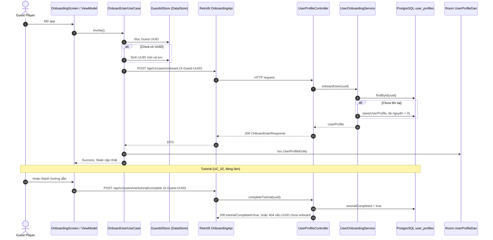
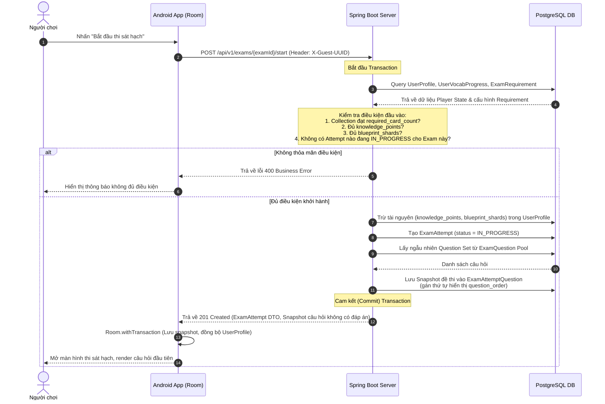
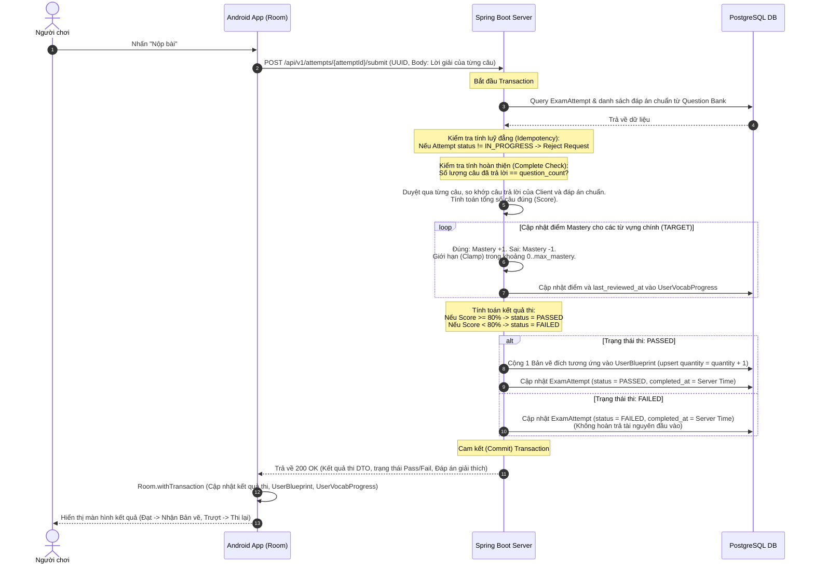
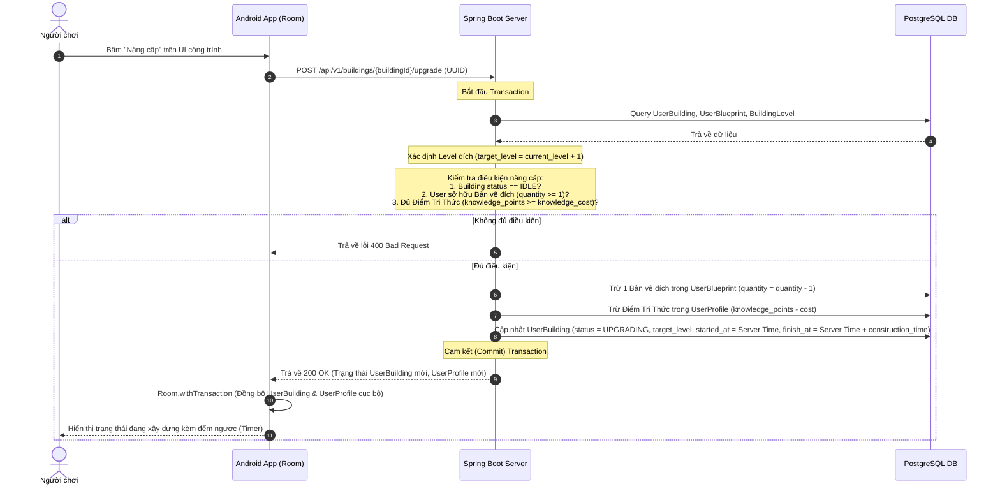
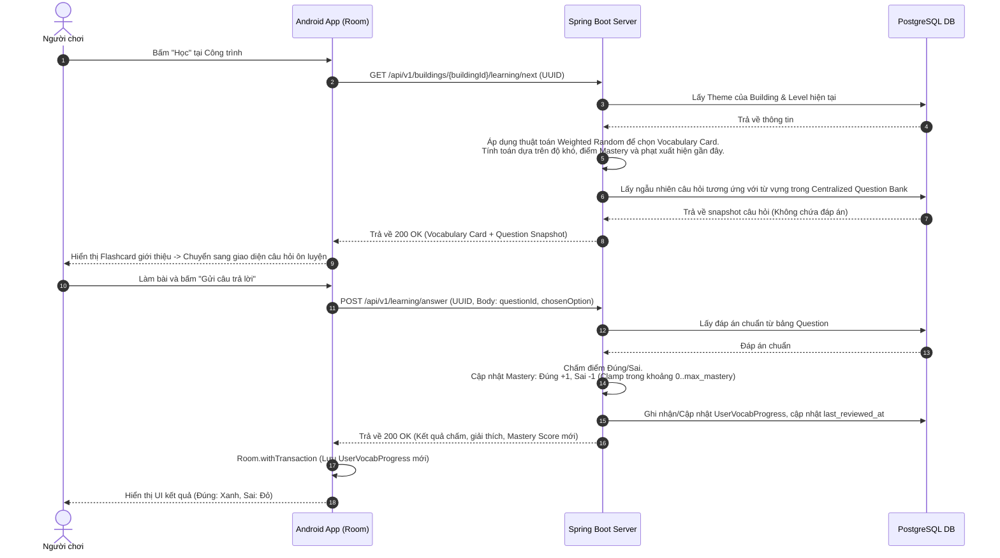

# LINGUACITY — 02. SYSTEM DESIGN SPECIFICATION (CONSOLIDATED)

**Tên dự án:** LinguaCity (Thành phố Ngôn ngữ)
**Loại tài liệu:** System Design / Architecture Specification (Đặc tả thiết kế hệ thống)
**Giai đoạn:** Giai đoạn 2 — Thiết kế Hệ thống
**Trạng thái:** HOÀN THÀNH - ĐÃ ĐÓNG BĂNG BASELINE MVP (v4 Consolidated)
**Phiên bản:** 3.0 (Bản nâng cấp nhất quán hệ thống & API)
**Người thực hiện:** Nông Hoàng Anh
**Ngày tạo:** 19/08/2026
**Ngày cập nhật cuối cùng:** 08/11/2026 — v3.3: thêm Chương 10 (gói nội dung theo Level, phiên học, tutorial thư ký, danh hiệu, tuỳ biến — ADR-012/013/014). 07/11/2026 — v3.2: Chương 9 viết lại cho City View WebView (ADR-010) với hai hợp đồng (A)/(B) (ADR-011); thêm `GET /api/v1/city` (§7.2.8) và trường `serverTime` cho §7.2.7. (v3.1, 20/10/2026: luồng Onboarding/Tutorial §4.0, chuẩn hóa mã UC §8.2.)

> **Ghi chú v3.1:** Các chương 3–7 vẫn là baseline đã đóng băng. Thay đổi mới chỉ **bổ sung**, không sửa mô hình dữ liệu.
> **Ghi chú v3.2:** §7.2.7 chỉ **thêm** trường `serverTime`, §7.2.8 là endpoint mới. Bảng `user_buildings` không đổi.
> **Ghi chú v3.3:** Chương 10 **thay thế** một số mục baseline (§3.3 trần Mastery, §4.4, §5.1.2 `theme_id`, §7.2.2, §7.2.3) và bổ sung bảng/cột/API mới. Mỗi mục bị thay có ghi chú "→ §10" ngay tại chỗ.

---

## CHƯƠNG 1: MỤC ĐÍCH TÀI LIỆU & PHẠM VI THIẾT KẾ

Tài liệu này là tài liệu trung tâm của **Giai đoạn 2 — System Design** cho dự án **LinguaCity**. Mục tiêu tối thượng của tài liệu là chuyển hóa các yêu cầu chức năng và phi chức năng đã được thống nhất trong tài liệu `srs-mvp.md` thành các đặc tả thiết kế kỹ thuật chi tiết, có khả năng triển khai thực tế trên cả hai nền tảng: **Backend (Spring Boot + PostgreSQL)** và **Mobile App (Kotlin Jetpack Compose + Room DB)**.

Tài liệu này đóng vai trò là chiếc cầu nối kỹ thuật quan trọng trong chuỗi tài liệu dự án:
*   **File 01 (srs-mvp.md) trả lời:** *Hệ thống phải làm gì?* (Requirements Specification)
*   **File 02 (tài liệu này) trả lời:** *Hệ thống sẽ được thiết kế kỹ thuật như thế nào?* (System Architecture & Design Blueprint)
*   **File 03 (Nhật ký ADR & Codebase) ghi lại:** *Thiết kế đã được chuyển đổi thành mã nguồn và quyết định thực tế như thế nào?* (Implementation & ADR)

Toàn bộ tài liệu được cấu trúc hóa theo các góc nhìn (Views) tiêu chuẩn của **Enterprise Architect (EA)** để hỗ trợ lập trình viên dễ dàng nhập dữ liệu, vẽ sơ đồ lớp, thiết kế lược đồ ERD vật lý và theo dõi tính truy vết (Traceability) của toàn bộ hệ thống.

---

## CHƯƠNG 2: BẢNG TRẠNG THÁI TIẾN ĐỘ THIẾT KẾ (GIAI ĐOẠN 2)

Để phục vụ khả năng tự học và theo dõi tiến độ chặt chẽ của dự án, dưới đây là bảng quản lý trạng thái của các cấu phần thiết kế hệ thống trong bản hợp nhất này:

| Mục thiết kế | Trạng thái kỹ thuật | Mức độ đóng băng | Tương ứng trong Enterprise Architect |
| :--- | :--- | :--- | :--- |
| **2.1 Domain Entities** | ✅ Hoàn thành | ❄️ Frozen (Bản v4) | Logical View -> Class Diagram (Conceptual) |
| **2.2 Database ERD 3NF** | ✅ Hoàn thành | ❄️ Frozen (Bản v4) | Physical/Database View -> ERD PostgreSQL |
| **2.3 Data Flow & Sequences** | ✅ Hoàn thành | ❄️ Frozen | Process View -> Sequence & Activity Diagrams |
| **2.4 API Endpoint Contract** | ✅ Hoàn thành | ❄️ Frozen | Component View -> Interfaces / API Controller |
| **2.5 Room Database Schema** | ✅ Hoàn thành | ❄️ Frozen | Physical/Mobile View -> Room Entity Schema |
| **2.6 Repository & Clean Arch**| ✅ Hoàn thành | ❄️ Frozen | Logical View -> Repository & UseCase Design |
| **2.7 Traceability & Matrix** | ✅ Hoàn thành | ❄️ Frozen | Requirement Model -> Relationship Matrix |

---

## CHƯƠNG 3: LOGICAL VIEW - DOMAIN ENTITIES (GÓC NHÌN MÔ HÌNH MIỀN)

### 3.1. Nguyên tắc phân chia dữ liệu (Data Architecture Principles)

Mô hình miền của LinguaCity được thiết kế xoay quanh một nguyên tắc phân chia dữ liệu cốt lõi và nhất quán:

> **"Static Content mô tả thế giới và nội dung học tập; Player State mô tả trạng thái hiện tại của từng người chơi trong thế giới đó."**

#### 3.1.1. Nhóm nội dung tĩnh (Static Content)
Đây là dữ liệu giáo dục và định nghĩa thế giới game do hệ thống quản lý. Người chơi chỉ có quyền truy cập **Read-Only** đối với nhóm dữ liệu này. 
*   *Đặc trưng kỹ thuật:* Dữ liệu tĩnh không thay đổi theo hành động của người chơi. Chúng được Backend phân phối xuống Mobile App và lưu trong Room Database dưới dạng bộ nhớ cache cục bộ hiệu năng cao để hỗ trợ tính năng **Offline Read-Only**.
*   *Các thực thể tiêu biểu:* `Theme`, `Building`, `BuildingLevel`, `Blueprint`, `Vocabulary`, `Question`, `Exam`, `ExamRequirement`.

#### 3.1.2. Nhóm trạng thái người chơi (Player State)
Đây là dữ liệu phản ánh tiến trình, tài nguyên, và lịch sử tương tác của từng người học thực tế trong game.
*   *Đặc trưng kỹ thuật:* Mọi dữ liệu thuộc nhóm này có tính chất động và nhạy cảm (Gameplay-critical). Để chống gian lận (cheat/hack), Backend đóng vai trò là **Server Authority (Nguồn sự thật tối cao)**. Mọi thao tác làm thay đổi dữ liệu này bắt buộc phải thực hiện trực tuyến (Online Transaction) và được xác thực, tính toán trực tiếp tại Server trước khi cập nhật ngược lại Room DB cục bộ trên thiết bị.
*   *Các thực thể tiêu biểu:* `UserProfile`, `UserBuilding`, `UserBlueprint`, `UserVocabProgress`, `ExamAttempt`, `ExamAttemptQuestion`.

---


### 3.2. Từ điển dữ liệu thực thể miền (Domain Data Dictionary)

#### 3.2.1. Nhóm thực thể tĩnh (Static Content Entities)
*   **Theme:** Xác định chủ đề học tập cốt lõi (ví dụ: `DAILY_LIFE`, `TRANSPORTATION`). Giúp gỡ bỏ mối quan hệ thắt nút cứng giữa từ vựng và công trình.
*   **Building:** Khai báo loại công trình ảo (`HOUSING`, `ROAD`, `PARK`, `SCHOOL`). Không lưu trạng thái động của người dùng.
*   **BuildingLevel:** Cấu hình tĩnh chỉ số nâng cấp cho từng Level đích của công trình. *Lưu ý:* Bỏ hoàn toàn cột `blueprint_id` để tránh dư thừa; mối quan hệ này được xác định một cách logic dựa trên cặp `(building_id, target_level)`.
*   **Blueprint:** Định nghĩa mã bản vẽ kỹ thuật (ví dụ: `BLUEPRINT_HOUSING_LV2`). Mỗi bản vẽ gắn cứng duy nhất với một công trình và Level mục tiêu cụ thể.
*   **Vocabulary:** Thẻ từ vựng tĩnh (Vocabulary Card).examples lưu dưới dạng mảng JSONB trong PostgreSQL và List<String> trong Java.
*   **Question:** Ngân hàng câu hỏi tập trung. metadata lưu cấu hình đặc thù của từng loại Mini-game (ví dụ: mảng phương án nhiễu của trắc nghiệm, các cặp nối của matching game). answer lưu đáp án chuẩn và được giữ kín tại Server để chống hack.
*   **QuestionVocabulary:** Thực thể liên kết hỗ trợ phân tách mối quan hệ N-N giữa từ vựng và câu hỏi bài tập. `relation_type` nhận hai giá trị: `TARGET` (từ vựng chính được kiểm tra) hoặc `CONTEXT` (từ vựng làm nền ngữ cảnh).
*   **Exam:** Cấu hình bài thi sát hạch cho từng công trình khi nâng cấp. Khớp cứng `target_level` của Exam với `target_level` của `reward_blueprint_id`.
*   **ExamRequirement:** Định nghĩa điều kiện đầu vào trước khi mở khóa đề thi (số thẻ tối thiểu đã gặp, lượng Điểm Tri Thức tiêu hao, số mảnh bản vẽ cần thiết).
*   **ExamQuestion:** Định nghĩa Pool câu hỏi tĩnh của đề thi, không lưu `question_order` vì thứ tự câu hỏi thay đổi theo từng lượt thi.

#### 3.2.2. Nhóm thực thể động (Player State Entities)
*   **UserProfile:** Thực thể gốc lưu trữ tài nguyên người chơi (Guest UUID, Điểm Tri Thức, số Đồng hồ cát sở hữu, số mảnh Bản vẽ sở hữu).
*   **UserBuilding:** Trạng thái xây dựng thực tế của từng người chơi cho mỗi công trình (Cấp độ hiện tại, Cấp độ mục tiêu, Trạng thái `IDLE`/`UPGRADING`, Thời điểm bắt đầu/hoàn thành xây dựng).
*   **UserBlueprint:** Kho lưu trữ Bản vẽ cụ thể của từng người chơi dạng Inventory. Tăng lên khi Pass bài thi và trừ đi khi tiến hành nâng cấp.
*   **UserVocabProgress:** Nhật ký học tập của từng thẻ từ vựng với người chơi (Điểm thông thạo `mastery_score`, Thời điểm gặp lần đầu `first_seen_at`, Thời điểm ôn tập gần nhất `last_reviewed_at`).
*   **ExamAttempt:** Ghi nhận lịch sử và trạng thái lượt thi sát hạch thực tế (`IN_PROGRESS`, `PASSED`, `FAILED`).
*   **ExamAttemptQuestion:** Bản ghi Snapshot lưu bộ câu hỏi thực tế được cấp phát cho lượt thi hiện tại, thứ tự hiển thị (`question_order`), câu trả lời của người học (`answer_payload`) và kết quả chấm điểm (`is_correct`).

### 3.3. Cơ chế hoạt động của Mastery Engine (Động cơ Thông thạo)

Để tránh hiểu nhầm rằng điểm thông thạo (`mastery_score`) chỉ thay đổi khi người học thi sát hạch (Exam), hệ thống LinguaCity thiết lập một **MasteryEngine** tập trung dùng chung cho cả hai luồng học tập:

```text
[Vòng lặp Học từ vựng] (Daily Learning Loop) ──┐
                                             ├──> [MasteryEngine] ──> Cập nhật UserVocabProgress (mastery_score)
[Vòng lặp Thi sát hạch] (Exam Loop) ─────────┘
```

*   **Nguyên tắc vận hành:**
    *   **Học từ vựng hàng ngày (Learning Question):** Khi người chơi hoàn thành câu hỏi ôn tập, kết quả trả lời (Đúng/Sai) được chuyển đến `MasteryEngine` để điều chỉnh `mastery_score` của từ vựng tương ứng (Đúng +1, Sai -1).
    *   **Thi sát hạch nâng cấp (Exam Question):** Khi chấm điểm bài thi tại Server, hệ thống lọc ra các từ vựng chính (TARGET) được kiểm tra trong đề thi. Kết quả đúng/sai của từng câu hỏi thi cũng được gửi tới `MasteryEngine` để cộng hoặc trừ điểm Mastery tương ứng.
    *   **Giới hạn biên (Clamping):** `MasteryEngine` đảm bảo `mastery_score` luôn nằm trong ranh giới an toàn từ `0` đến `max_mastery` (cấu hình động theo từng Level).

> **→ §10 (v3.3, ADR-013):** `max_mastery` lấy theo **độ khó của từ** (D=10, C=15, B=20, A=25), không theo Level. Mastery chỉ áp cho từ `TARGET`.

---

## CHƯƠNG 4: BEHAVIORAL & PROCESS VIEW (GÓC NHÌN ĐỘNG / TUẦN TỰ)

Trong Enterprise Architect, **Process View** mô tả hoạt động runtime của hệ thống qua các Biểu đồ tuần tự (Sequence Diagram). Dưới đây là đặc tả chi tiết của các luồng xử lý nghiệp vụ cốt lõi trong LinguaCity.

### 4.0. Luồng Khởi tạo người chơi khách & Hoàn thành Tutorial (VS1 — đã triển khai)



> ⬜ Vẽ lại sơ đồ này trong EA (`04_Behavioral_Model`) nếu chưa khớp, export PNG vào `diagrams/images/seq-onboarding.png` cho Chương 5 của báo cáo.

### 4.1. Luồng Bắt đầu thi sát hạch (Start Exam Flow)
Đảm bảo tính nguyên tử (Atomic) trong việc trừ tài nguyên đầu vào và cấp phát Snapshot đề thi bảo mật.



### 4.2. Luồng Nộp bài thi & Chấm điểm (Submit Exam Flow)
Xử lý chấm điểm tập trung tại Server (Server Authority) để ngăn chặn hack điểm từ Client.



### 4.3. Luồng Nâng cấp công trình (Upgrade Building Flow)



### 4.4. Luồng Học từ vựng thông thạo (Vocabulary Learning Flow)

> **→ §10.3.2 (v3.3, ADR-013):** luồng từng câu bên dưới được thay bằng **phiên học** 10 từ / 20 câu do server quản lý. Giữ lại để đối chiếu.



---

## CHƯƠNG 5: PHYSICAL VIEW - POSTGRESQL TARGET SCHEMA (GÓC NHÌN VẬT LÝ)

Trong Enterprise Architect, **Physical View** được biểu diễn bằng sơ đồ cơ sở dữ liệu vật lý (Data Modeling Diagram) cho PostgreSQL. Dưới đây là đặc tả chi tiết 16 bảng đạt chuẩn hóa 3NF, đi kèm các ràng buộc cơ sở dữ liệu tối thượng để bảo toàn tính toàn vẹn dữ liệu.

### 5.1. Định nghĩa chi tiết các bảng cơ sở dữ liệu (PostgreSQL Schema)

#### 5.1.1. Bảng `themes` (Static Content)
*   `id`: `BIGSERIAL` (PK, NOT NULL)
*   `code`: `VARCHAR(50)` (UNIQUE, NOT NULL) - Ví dụ: `DAILY_LIFE`, `TRANSPORTATION`
*   `name`: `VARCHAR(100)` (NOT NULL) - Tên hiển thị chủ đề
*   `description`: `TEXT` (NULL) - Mô tả chủ đề

#### 5.1.2. Bảng `buildings` (Static Content)
*   `id`: `BIGSERIAL` (PK, NOT NULL)
*   `code`: `VARCHAR(50)` (UNIQUE, NOT NULL) - Ví dụ: `HOUSING`, `ROAD`, `PARK`, `SCHOOL`
*   `theme_id`: `BIGINT` (FK, NOT NULL) - Tham chiếu `themes(id)` ON DELETE RESTRICT — **→ §10.2.1 (v3.3): bỏ cột này, thay bằng bảng `building_themes` (n-n)**
*   `max_level`: `INT` (NOT NULL, CHECK `max_level > 0`)

#### 5.1.3. Bảng `building_levels` (Static Content)
*   `building_id`: `BIGINT` (PFK, NOT NULL) - Tham chiếu `buildings(id)` ON DELETE CASCADE
*   `level`: `INT` (PK, NOT NULL, CHECK `level > 0`)
*   `knowledge_cost`: `INT` (NOT NULL, CHECK `knowledge_cost >= 0`)
*   `construction_time`: `BIGINT` (NOT NULL, CHECK `construction_time >= 0`) - Đơn vị: giây
*   *Ràng buộc khóa chính phức hợp:* `PRIMARY KEY(building_id, level)`

#### 5.1.4. Bảng `blueprints` (Static Content)
*   `id`: `BIGSERIAL` (PK, NOT NULL)
*   `code`: `VARCHAR(50)` (UNIQUE, NOT NULL) - Ví dụ: `BLUEPRINT_HOUSING_LV2`
*   `building_id`: `BIGINT` (FK, NOT NULL) - Tham chiếu `buildings(id)` ON DELETE CASCADE
*   `target_level`: `INT` (NOT NULL, CHECK `target_level > 1`)
*   *Ràng buộc duy nhất:* `UNIQUE(building_id, target_level)` - Đảm bảo tính duy nhất của Bản vẽ đích.

#### 5.1.5. Bảng `vocabularies` (Static Content)
*   `id`: `BIGSERIAL` (PK, NOT NULL)
*   `word`: `VARCHAR(100)` (NOT NULL)
*   `meaning`: `TEXT` (NOT NULL)
*   `word_type`: `VARCHAR(20)` (NOT NULL) - Lưu tên Enum: `NOUN`, `VERB`, `ADJECTIVE`,...
*   `ipa`: `VARCHAR(100)` (NULL) - Phiên âm IPA
*   `examples`: `JSONB` (NULL) - Lưu danh sách câu ví dụ tĩnh
*   `image_url`: `VARCHAR(255)` (NULL)
*   `theme_id`: `BIGINT` (FK, NOT NULL) - Tham chiếu `themes(id)` ON DELETE RESTRICT
*   `level`: `INT` (NOT NULL, CHECK `level > 0`)
*   `difficulty_rank`: `VARCHAR(5)` (NOT NULL) - Lưu Enum: `D`, `C`, `B`, `A`,...

#### 5.1.6. Bảng `questions` (Static Content)
*   `id`: `BIGSERIAL` (PK, NOT NULL)
*   `content_type`: `VARCHAR(20)` (NOT NULL) - Enum: `VOCABULARY`, `GRAMMAR`
*   `skill`: `VARCHAR(20)` (NOT NULL) - Enum: `READING`, `WRITING` (MVP chỉ tập trung vào 2 kỹ năng này)
*   `question_type`: `VARCHAR(30)` (NOT NULL) - Enum: `MULT_CHOICE`, `FILL_BLANK`
*   `question_text`: `TEXT` (NULL)
*   `answer`: `TEXT` (NOT NULL) - Đáp án chuẩn (Bảo mật tại Server)
*   `explanation`: `TEXT` (NULL)
*   `audio_url`: `VARCHAR(255)` (NULL)
*   `metadata`: `JSONB` (NULL) - Cấu hình phương án nhiễu, dữ liệu game-play của câu hỏi

#### 5.1.7. Bảng `question_vocabularies` (Static Content)
*   `question_id`: `BIGINT` (PFK, NOT NULL) - Tham chiếu `questions(id)` ON DELETE CASCADE
*   `vocabulary_id`: `BIGINT` (PFK, NOT NULL) - Tham chiếu `vocabularies(id)` ON DELETE CASCADE
*   `relation_type`: `VARCHAR(20)` (NOT NULL) - Enum: `TARGET`, `CONTEXT`
*   *Ràng buộc khóa chính phức hợp:* `PRIMARY KEY(question_id, vocabulary_id)`

#### 5.1.8. Bảng `exams` (Static Content)
*   `id`: `BIGSERIAL` (PK, NOT NULL)
*   `code`: `VARCHAR(50)` (UNIQUE, NOT NULL) - Ví dụ: `EXAM_HOUSING_LV2`
*   `building_id`: `BIGINT` (FK, NOT NULL) - Tham chiếu `buildings(id)` ON DELETE RESTRICT
*   `target_level`: `INT` (NOT NULL)
*   `reward_blueprint_id`: `BIGINT` (FK, NOT NULL) - Tham chiếu `blueprints(id)` ON DELETE RESTRICT
*   `question_count`: `INT` (NOT NULL, DEFAULT 10, CHECK `question_count > 0`)
*   *Ràng buộc toàn vẹn đặc biệt (Composite Foreign Key):*  
    `FOREIGN KEY(building_id, target_level) REFERENCES blueprints(building_id, target_level)`  
    Đảm bảo Bản vẽ phần thưởng của đề thi phải trùng khớp với loại công trình và cấp độ đích của đề thi đó.

#### 5.1.9. Bảng `exam_requirements` (Static Content)
*   `id`: `BIGSERIAL` (PK, NOT NULL)
*   `exam_id`: `BIGINT` (FK, NOT NULL) - Tham chiếu `exams(id)` ON DELETE CASCADE
*   `required_card_count`: `INT` (NOT NULL, DEFAULT 0, CHECK `required_card_count >= 0`)
*   `required_knowledge`: `INT` (NOT NULL, DEFAULT 0, CHECK `required_knowledge >= 0`)
*   `required_blueprint_shards`: `INT` (NOT NULL, DEFAULT 0, CHECK `required_blueprint_shards >= 0`)
*   *Ràng buộc duy nhất:* `UNIQUE(exam_id)` - Đảm bảo mối quan hệ 1-1 giữa đề thi và điều kiện.

#### 5.1.10. Bảng `exam_questions` (Static Content)
*   `exam_id`: `BIGINT` (PFK, NOT NULL) - Tham chiếu `exams(id)` ON DELETE CASCADE
*   `question_id`: `BIGINT` (PFK, NOT NULL) - Tham chiếu `questions(id)` ON DELETE CASCADE
*   *Ràng buộc khóa chính phức hợp:* `PRIMARY KEY(exam_id, question_id)` - Xác định Question Pool của đề thi.

#### 5.1.11. Bảng `user_profiles` (Player State)
*   `id`: `UUID` (PK, NOT NULL) - UUID Guest sinh tự động từ thiết bị Client
*   `knowledge_points`: `INT` (NOT NULL, DEFAULT 0, CHECK `knowledge_points >= 0`)
*   `hourglass_count`: `INT` (NOT NULL, DEFAULT 0, CHECK `hourglass_count >= 0`)
*   `blueprint_shards`: `INT` (NOT NULL, DEFAULT 0, CHECK `blueprint_shards >= 0`)

#### 5.1.12. Bảng `user_buildings` (Player State)
*   `id`: `BIGSERIAL` (PK, NOT NULL)
*   `user_id`: `UUID` (FK, NOT NULL) - Tham chiếu `user_profiles(id)` ON DELETE CASCADE
*   `building_id`: `BIGINT` (FK, NOT NULL) - Tham chiếu `buildings(id)` ON DELETE RESTRICT
*   `current_level`: `INT` (NOT NULL, DEFAULT 0, CHECK `current_level >= 0`)
*   `target_level`: `INT` (NULL, CHECK `target_level > current_level`)
*   `is_unlocked`: `BOOLEAN` (NOT NULL, DEFAULT FALSE)
*   `status`: `VARCHAR(20)` (NOT NULL, DEFAULT 'IDLE') - Enum: `IDLE`, `UPGRADING`
*   `started_at`: `TIMESTAMP` (NULL)
*   `finish_at`: `TIMESTAMP` (NULL)
*   *Ràng buộc duy nhất:* `UNIQUE(user_id, building_id)` - Tránh trùng lặp trạng thái của cùng một công trình đối với một User.

#### 5.1.13. Bảng `user_blueprints` (Player State)
*   `id`: `BIGSERIAL` (PK, NOT NULL)
*   `user_id`: `UUID` (FK, NOT NULL) - Tham chiếu `user_profiles(id)` ON DELETE CASCADE
*   `blueprint_id`: `BIGINT` (FK, NOT NULL) - Tham chiếu `blueprints(id)` ON DELETE RESTRICT
*   `quantity`: `INT` (NOT NULL, DEFAULT 0, CHECK `quantity >= 0`)
*   *Ràng buộc duy nhất:* `UNIQUE(user_id, blueprint_id)` - Quản lý kho đồ theo cơ chế tăng giảm số lượng (Quantity) thay vì tạo mới dòng dữ liệu.

#### 5.1.14. Bảng `user_vocab_progress` (Player State)
*   `id`: `BIGSERIAL` (PK, NOT NULL)
*   `user_id`: `UUID` (FK, NOT NULL) - Tham chiếu `user_profiles(id)` ON DELETE CASCADE
*   `vocabulary_id`: `BIGINT` (FK, NOT NULL) - Tham chiếu `vocabularies(id)` ON DELETE RESTRICT
*   `mastery_score`: `INT` (NOT NULL, DEFAULT 0, CHECK `mastery_score >= 0`)
*   `first_seen_at`: `TIMESTAMP` (NULL)
*   `last_reviewed_at`: `TIMESTAMP` (NULL)
*   *Ràng buộc duy nhất:* `UNIQUE(user_id, vocabulary_id)` - Đảm bảo mỗi từ vựng chỉ có duy nhất một bản ghi tiến độ cho một người chơi.

#### 5.1.15. Bảng `exam_attempts` (Player State)
*   `id`: `BIGSERIAL` (PK, NOT NULL)
*   `user_id`: `UUID` (FK, NOT NULL) - Tham chiếu `user_profiles(id)` ON DELETE CASCADE
*   `exam_id`: `BIGINT` (FK, NOT NULL) - Tham chiếu `exams(id)` ON DELETE RESTRICT
*   `status`: `VARCHAR(20)` (NOT NULL, DEFAULT 'IN_PROGRESS') - Enum: `IN_PROGRESS`, `PASSED`, `FAILED`
*   `started_at`: `TIMESTAMP` (NOT NULL)
*   `completed_at`: `TIMESTAMP` (NULL)

#### 5.1.16. Bảng `exam_attempt_questions` (Player State)
*   `attempt_id`: `BIGINT` (PFK, NOT NULL) - Tham chiếu `exam_attempts(id)` ON DELETE CASCADE
*   `question_id`: `BIGINT` (PFK, NOT NULL) - Tham chiếu `questions(id)` ON DELETE RESTRICT
*   `question_order`: `INT` (NOT NULL, CHECK `question_order > 0`)
*   `answer_payload`: `JSONB` (NULL) - Lưu câu trả lời thực tế của người chơi cho từng loại câu hỏi
*   `is_correct`: `BOOLEAN` (NULL)
*   `answered_at`: `TIMESTAMP` (NULL)
*   *Ràng buộc khóa chính phức hợp:* `PRIMARY KEY(attempt_id, question_id)`
*   *Ràng buộc duy nhất:* `UNIQUE(attempt_id, question_order)` - Đảm bảo thứ tự câu hỏi trong đề thi không bị gán trùng lặp.


### 5.2. Thiết kế chỉ mục tối ưu (Index Design)
Để đảm bảo hiệu năng truy cập cao trong điều kiện tải lớn của cơ chế game, hệ thống thiết kế chính xác 10 chỉ mục sau đây, tránh việc "over-indexing" làm chậm các thao tác INSERT/UPDATE.

| STT | Tên Index | Bảng áp dụng | Cột áp dụng | Mục đích nghiệp vụ |
| :--- | :--- | :--- | :--- | :--- |
| 1 | `idx_building_theme` | `buildings` | `(theme_id)` | Tối ưu phép JOIN lấy thông tin công trình ảo theo Theme học tập. |
| 2 | `idx_vocab_pool` | `vocabularies` | `(theme_id, level, difficulty_rank)` | **Chỉ mục cốt lõi 1:** Hỗ trợ nạp nhanh chóng Card Pool của một Theme + Level, đồng thời lọc theo độ khó phục vụ thuật toán ngẫu nhiên. |
| 3 | `idx_question_filter` | `questions` | `(content_type, skill, question_type)` | Hỗ trợ lọc ngẫu nhiên câu hỏi ôn luyện hoặc thi sát hạch từ ngân hàng tập trung. |
| 4 | `idx_exam_lookup` | `exams` | `(building_id, target_level)` | Xác định bài thi sát hạch tương ứng cho công trình ảo khi nâng cấp cấp độ. |
| 5 | `uq_user_building` | `user_buildings` | `(user_id, building_id)` | Tự động tạo chỉ mục Composite UNIQUE giúp xác định nhanh tiến trình xây dựng của User. |
| 6 | `uq_user_vocab` | `user_vocab_progress` | `(user_id, vocabulary_id)` | **Chỉ mục cốt lõi 2:** Xác định trạng thái thông thạo của một thẻ từ vựng đối với một người chơi cụ thể. |
| 7 | `idx_attempt_ordered_q` | `exam_attempt_questions` | `(attempt_id, question_order)` | **Chỉ mục cốt lõi 3:** Hỗ trợ render đề thi và chấm điểm theo đúng trình tự câu hỏi của lượt thi. |
| 8 | `idx_q_vocab_reverse` | `question_vocabularies` | `(vocabulary_id)` | **Chỉ mục cốt lõi 4:** Loại bỏ điểm mù tra cứu ngược (tìm xem từ vựng nằm trong các câu hỏi nào) cho Learning Analytics. |
| 9 | `uq_active_attempt` | `exam_attempts` | `(user_id, exam_id)` WHERE `status = 'IN_PROGRESS'` | **Partial Unique Index:** Bảo vệ chống Race Condition. Đảm bảo một User chỉ có duy nhất một lượt thi đang chạy cho cùng một đề thi. |
| 10 | `uq_user_blueprint` | `user_blueprints` | `(user_id, blueprint_id)` | Quản lý kho đồ Blueprint dạng Inventory, tối ưu hóa các thao tác cộng dồn số lượng sở hữu. |

---

### 5.3. Chiến lược ánh xạ JPA (PostgreSQL / JPA Mapping)

Để chuyển đổi sơ đồ cơ sở dữ liệu vật lý PostgreSQL thành các Entity trong Java Spring Boot, hệ thống áp dụng nghiêm ngặt các nguyên tắc sau:

1.  **Quy tắc Đặt tên (Naming Strategy):** 
    *   Tất cả các Entity JPA viết dạng PascalCase số ít (ví dụ: `UserBuilding`). Tên bảng PostgreSQL tương ứng viết snake_case số nhiều (ví dụ: `user_buildings`).
    *   Mọi field dùng camelCase (ví dụ: `masteryScore`), Spring Boot tự động ánh xạ xuống database dạng snake_case (`mastery_score`).
2.  **Chiến lược Tải dữ liệu (Fetch Strategy - LAZY-first):**
    *   Mọi mối quan hệ `@ManyToOne`, `@OneToMany` bắt buộc phải cấu hình rõ ràng `fetch = FetchType.LAZY` để tránh lỗi *N+1 Query*.
    *   Ví dụ thiết lập LAZY trong class `Building`:
        ```java
        @ManyToOne(fetch = FetchType.LAZY)
        @JoinColumn(name = "theme_id", nullable = false)
        private Theme theme;
        ```
    *   Khi cần nạp Eager dữ liệu liên quan để trả về DTO, sử dụng câu lệnh JPQL `JOIN FETCH` trong Repository.
3.  **Ánh xạ Enum (Enum Mapping):**
    *   Các cột trạng thái được ánh xạ bằng `@Enumerated(EnumType.STRING)` để lưu trữ dạng chuỗi chữ (ví dụ: `PASSED`, `FAILED`). 
    *   Tuyệt đối không dùng `EnumType.ORDINAL` (lưu bằng số 0, 1, 2) vì nếu lập trình viên thay đổi thứ tự khai báo Enum trong code sẽ làm sai lệch hoàn toàn dữ liệu trong Database.
4.  **Ánh xạ JSONB (PostgreSQL JSONB Mapping):**
    *   Trường `examples` trong `Vocabulary` và `metadata` trong `Question` được lưu dưới dạng JSONB.
    *   Trong Java (Spring Boot 3 + Hibernate 6), sử dụng tính năng ánh xạ JSON nguyên bản của Hibernate:
        ```java
        @JdbcTypeCode(SqlTypes.JSON)
        @Column(name = "examples", columnDefinition = "jsonb")
        private List<String> examples;
        ```
5.  **Mô hình hóa Khóa chính Phức hợp (Composite Key Mapping):**
    *   Bảng `building_levels` sử dụng Khóa Composite `(building_id, level)`. JPA mô hình hóa class khóa thông qua `@Embeddable` và nhúng vào Entity bằng `@EmbeddedId`.
    *   Ví dụ khóa phức hợp:
        ```java
        @Embeddable
        public class BuildingLevelId implements Serializable {
            private Long buildingId;
            private Integer level;
            // Equals & HashCode
        }
        ```
6.  **Đóng gói giao tiếp API (DTO Pattern):**
    *   Tuyệt đối không trả trực tiếp các JPA Entity ra ngoài REST Controller. Mọi Request/Response đều phải được chuyển hóa thành các lớp DTO để ẩn các thông tin bảo mật (như đáp án chuẩn `answer` của bảng `questions`) và thu gọn payload khi truyền qua mạng cho thiết bị Mobile.

---

## CHƯƠNG 6: PHYSICAL VIEW - LOCAL ROOM DATABASE SCHEMA (GÓC NHÌN VẬT LÝ DI ĐỘNG)

Trong Enterprise Architect, **Local Database View** nằm ngang hàng với PostgreSQL Physical View. Room Database đóng vai trò là **Local Operational SSOT** hỗ trợ hiển thị mượt mà tức thì và khả năng đọc Offline cho người học.

### 6.1. Room Entities & Mapping Constraints

Room Database cấu trúc lại PostgreSQL Schema để tối ưu cho SQLite và môi trường di động:

```text
Android Mobile (Room DB)
├── Static Content (Cache Read-Only từ Backend)
│   ├── ThemeEntity
│   ├── BuildingEntity
│   ├── BuildingLevelEntity
│   ├── BlueprintEntity
│   ├── VocabularyEntity
│   ├── QuestionEntity (Bỏ cột answer bảo mật)
│   ├── ExamEntity
│   ├── ExamRequirementEntity
│   ├── ExamQuestionEntity
│   └── QuestionVocabularyEntity
└── Player State (Đồng bộ trạng thái người chơi sau khi Server xác nhận)
    ├── UserProfileEntity
    ├── UserBuildingEntity
    ├── UserBlueprintEntity
    ├── UserVocabProgressEntity
    ├── ExamAttemptEntity
    └── ExamAttemptQuestionEntity
```

#### 6.1.1. Sự khác biệt có chủ ý giữa Room và PostgreSQL
1.  **Bảo mật Đáp án (Bỏ cột `answer` trong `QuestionEntity`):**  
    Để ngăn chặn triệt để hành vi dịch ngược (Decompile) mã nguồn ứng dụng Android hoặc giải mã tập tin SQLite trên thiết bị để hack đáp án, bảng `QuestionEntity` trong Room **không lưu cột `answer`**. Toàn bộ hoạt động chấm điểm đều phải gửi payload câu trả lời lên Server để tính toán.
2.  **Khóa ngoại (Foreign Key Constraints) cục bộ:**  
    Room chỉ thiết lập Foreign Key giữa các bảng Player State và Static Content cục bộ để giữ tính nhất quán tham chiếu SQLite (ví dụ: `UserVocabProgressEntity` tham chiếu `VocabularyEntity`). Việc bảo vệ tính toàn vẹn sâu sắc (như Composite Foreign Key giữa `Exam` và `Blueprint`) sẽ được nhường lại hoàn toàn cho Backend PostgreSQL thực thi.
3.  **Tải dữ liệu đồng bộ (MVI StateFlow):**  
    Mọi truy vấn lấy dữ liệu từ Room DAO được bọc trong Kotlin `Flow<List<T>>` để tự động stream trạng thái mới nhất lên tầng giao diện (Compose) theo cơ chế Unidirectional Data Flow.

### 6.2. Chiến lược TypeConverter (JSON Serialization cục bộ)
 SQLite không hỗ trợ sẵn kiểu dữ liệu List hay JSON. Room giải quyết bằng cách chuyển đổi qua lại dạng String sử dụng thư viện **Kotlinx Serialization**:
*   `examples` (List<String>) trong `VocabularyEntity` được serialize thành String khi ghi vào SQLite, và deserialize ngược lại thành List<String> khi đọc ra UI.
*   `metadata` và `answerPayload` được Room lưu trực tiếp dưới dạng `String?` thô trong Database. Việc ép kiểu thành các đối tượng cụ thể (như cấu hình Mini-game) sẽ do tầng **Repository/Mapper** đảm nhiệm một cách linh hoạt bằng Kotlinx Serialization để kiểm soát chặt chẽ quá trình biên dịch.

### 6.3. Kiến trúc Transaction & DAO cục bộ
*   **Sử dụng `@Upsert` cho Static Content:** Khi nạp dữ liệu tĩnh từ Backend xuống Room (On-Demand Sync), sử dụng `@Upsert` thay vì `@Insert(onConflict = REPLACE)`. `@Upsert` tự động nhận diện nếu bản ghi đã tồn tại thì UPDATE các cột thay đổi, tránh việc SQLite âm thầm DELETE rồi INSERT lại từ đầu làm đứt gãy khóa ngoại và kích hoạt các Cascade ngoài mong muốn.
*   **Điều phối Transaction tại Repository Layer:** Mọi hoạt động cập nhật nhiều thực thể đồng thời (ví dụ: nộp bài thi thành công cần cập nhật cả `UserBlueprint`, `UserProfile` và `UserVocabProgress` cục bộ) bắt buộc phải bọc trong một khối Room Transaction duy nhất thông qua hàm:
    ```kotlin
    roomDatabase.withTransaction {
        // Thực hiện tuần tự các cập nhật trên từng DAO
    }
    ```
    Điều này ngăn chặn tình trạng giao diện UI quan sát thấy các trạng thái trung gian không nhất quán (lỗi đứt gãy UI State).


---

## CHƯƠNG 7: COMPONENT & API VIEW (GÓC NHÌN THÀNH PHẦN & API CONTRACT)

Trong Enterprise Architect, **Component View** định hình cấu trúc module của phần mềm và giao thức truyền tải API. 

### 7.1. Cấu trúc Package Android Clean Architecture

Ứng dụng Android của LinguaCity được chia thành 3 lớp riêng biệt để cô lập logic nghiệp vụ khỏi giao diện và thư viện lưu trữ:

```text
com.linguacity.app/
├── domain/                    # LỚP NGHIỆP VỤ TRUNG TÂM (Chỉ chứa Kotlin thuần, độc lập thư viện)
│   ├── model/                 # Các thực thể thuần túy (UserProfile, Vocabulary, Building)
│   ├── repository/            # Định nghĩa các Interface giao tiếp
│   │   ├── VocabularyRepository # Flashcard / Collection / Vocabulary Read
│   │   ├── LearningRepository   # Get Learning Item / Submit Answer / Mastery
│   │   ├── ExamRepository       # Start / Submit Exam
│   │   └── BuildingRepository   # Upgrade / Manage buildings
│   └── usecase/               # Các nghiệp vụ lõi (StartExamUseCase, UpgradeBuildingUseCase)
│
├── data/                      # LỚP DỮ LIỆU & KIÊN QUYẾT (Phụ thuộc Room, Retrofit, OkHttp)
│   ├── local/                 # Room Database, Room Entities, các lớp DAO
│   ├── remote/                # Retrofit API Services, các lớp DTO
│   ├── mapper/                # Chuyển đổi qua lại giữa Entity DB, Network DTO và Domain Model
│   └── repository/            # Triển khai thực tế các Interface (VocabularyRepositoryImpl, LearningRepositoryImpl, etc.)
│
└── presentation/              # LỚP GIAO DIỆN (Jetpack Compose, ViewModels, Navigation)
    ├── city/                  # Giao diện thành phố ảo (MVI State, ViewModel, CityScreen)
    ├── learning/              # Giao diện học từ vựng (LearningState, LearningScreen)
    ├── exam/                  # Giao diện thi sát hạch (ExamState, ExamScreen)
    └── navigation/            # Cấu hình Navigation Type-Safe (không dùng String Route)
```

#### Luồng dữ liệu một chiều (MVI Unidirectional Data Flow)
*   **Intent (Hành vi):** Người dùng tương tác trên màn hình (nhấn nút Xây nhà) -> sinh ra một `Intent` (ví dụ: `CityIntent.UpgradeBuilding(id)`).
*   **ViewModel:** ViewModel tiếp nhận `Intent`, gọi `UseCase` tương ứng ở Domain Layer.
*   **State Update:** UseCase tương tác với `Repository` để gọi API, cập nhật kết quả vào Room DB.
*   **View Render:** Trạng thái mới (ví dụ: `CityState.Upgrading`) được Stream từ Room qua `StateFlow` ngược lại Compose UI để render tức thì giao diện mới.

---

### 7.2. Đặc tả chi tiết Hợp đồng API (API Endpoint Contract)

Toàn bộ các API đều bắt buộc đính kèm Header: `X-Guest-UUID: <UUID>` để xác định Guest User cục bộ.

#### 7.2.1. Khởi động và Khởi tạo User (User Onboarding)
*   **HTTP Method & Endpoint:** `POST /api/v1/users/onboard`
*   **Mục đích:** Khởi tạo tài khoản Guest mới hoặc nạp tài khoản hiện tại dựa trên UUID của thiết bị.
*   **Request Body:** *(Trống)*
*   **Response (200 OK):**
    ```json
    {
      "userId": "e4c5b369-798c-4a3b-967e-123456789abc",
      "knowledgePoints": 100,
      "hourglassCount": 5,
      "blueprintShards": 2
    }
    ```

#### 7.2.2. Lấy Bài tập Tiếp theo (Get Learning Item)
> **→ §10.4.2 (v3.3):** thay bằng API phiên học. Không cài đặt endpoint này.

*   **HTTP Method & Endpoint:** `GET /api/v1/buildings/{buildingId}/learning/next`
*   **Mục đích:** Lấy một từ vựng ngẫu nhiên kèm snapshot bài tập tương ứng dựa trên thuật toán Weighted Random.
*   **Response (200 OK):** (Đáp án chuẩn `answer` hoàn toàn ẩn đi để tránh gian lận)
    ```json
    {
      "vocabularyCard": {
        "id": 45,
        "word": "Establish",
        "meaning": "Thiết lập, thành lập",
        "wordType": "VERB",
        "ipa": "/ɪˈstæblɪʃ/",
        "examples": [
          "The company was established in 2026."
        ],
        "imageUrl": "https://cdn.linguacity.com/vocab/establish.png"
      },
      "question": {
        "id": 1024,
        "contentType": "VOCABULARY",
        "skill": "READING",
        "questionType": "MULT_CHOICE",
        "questionText": "The committee decided to ___ a new branch in Hanoi.",
        "metadata": {
          "options": [
            "establish",
            "establishing",
            "established",
            "establishment"
          ]
        }
      }
    }
    ```

#### 7.2.3. Chấm điểm học từ vựng (Submit Answer)
> **→ §10.4.2 (v3.3):** thay bằng `POST /learning/sessions/{id}/items/{itemNo}/answer`. Nguyên tắc tách DTO bên dưới vẫn áp dụng.

*   **HTTP Method & Endpoint:** `POST /api/v1/learning/answer`
*   **Mục đích:** Kiểm tra đáp án chuẩn tại Server, cập nhật điểm Mastery của người chơi thông qua Mastery Engine.
*   **Thiết kế Bảo mật và Tiện lợi UI (Thiết kế DTO riêng biệt):**
    *   *Thách thức:* Nếu dùng chung class `Question` cho cả việc hiển thị câu hỏi và nộp kết quả, đáp án đúng (`correctAnswer`) có thể bị lộ trong API GET câu hỏi.
    *   *Giải pháp:* Hệ thống áp dụng kỷ luật code nghiêm ngặt với việc phân tách DTO (Data Transfer Object) rõ ràng tại Backend (Spring Boot):
        1.  `QuestionDisplayDTO` (Dùng cho API `GET .../learning/next`): Chỉ có ID, nội dung câu hỏi, và các lựa chọn gây nhiễu. Tuyệt đối không chứa đáp án đúng (`correctAnswer`).
        2.  `SubmitResultDTO` (Dùng cho API `POST .../learning/answer`): Chứa kết quả kiểm tra (`isCorrect`), đáp án chính xác (`correctAnswer`), giải thích chi tiết (`explanation`) để vẽ giao diện nổi bật (highlight) trên Mobile mà không sợ lộ đáp án trước đó.
*   **Request Body:**
    ```json
    {
      "questionId": 1024,
      "chosenOption": "establish"
    }
    ```
*   **Response (200 OK):**
    ```json
    {
      "isCorrect": true,
      "correctAnswer": "establish",
      "explanation": "Chọn 'establish' vì sau 'decided to' cộng động từ nguyên mẫu (V-inf).",
      "newMasteryScore": 5
    }
    ```

#### 7.2.4. Lấy danh sách Đề thi (Get Exams)
*   **HTTP Method & Endpoint:** `GET /api/v1/exams`
*   **Mục đích:** Trả về danh sách đề thi kèm cờ tính toán động `isAvailable` (được tính bằng cách kiểm tra: Collection Progress >= yêu cầu AND Tài nguyên đủ).
*   **Response (200 OK):**
    ```json
    {
      "exams": [
        {
          "examId": 12,
          "code": "EXAM_HOUSING_LV2",
          "buildingId": 1,
          "targetLevel": 2,
          "isAvailable": true,
          "requirements": {
            "requiredCardCount": 40,
            "requiredKnowledge": 150,
            "requiredBlueprintShards": 2
          }
        }
      ]
    }
    ```

#### 7.2.5. Bắt đầu thi sát hạch (Start Exam)
*   **HTTP Method & Endpoint:** `POST /api/v1/exams/12/start`
*   **Mục đích:** Khấu trừ tài nguyên ngay lập tức và sinh Snapshot đề thi bảo mật. Chống Race Condition bằng Partial Unique Index.
*   **Response (201 Created):**
    ```json
    {
      "attemptId": 501,
      "examId": 12,
      "status": "IN_PROGRESS",
      "questions": [
        {
          "questionId": 880,
          "questionOrder": 1,
          "questionText": "Choose the synonym of 'Significant':",
          "metadata": {
            "options": ["Important", "Minor", "Trivial", "Useless"]
          }
        }
      ]
    }
    ```

#### 7.2.6. Nộp bài thi sát hạch (Submit Exam)
*   **HTTP Method & Endpoint:** `POST /api/v1/attempts/{attemptId}/submit`
*   **Mục đích:** Chấm điểm, quyết định Pass/Fail, cộng dồn Bản vẽ thưởng vào kho đồ của người chơi. Yêu cầu nộp đầy đủ số câu của bài thi.
*   **Request Body:**
    ```json
    {
      "attemptId": 501,
      "answers": [
        {
          "questionId": 880,
          "answerPayload": "Important"
        }
      ]
    }
    ```
*   **Response (200 OK):**
    ```json
    {
      "attemptId": 501,
      "status": "PASSED",
      "score": 10,
      "totalQuestions": 10,
      "rewardBlueprint": {
        "blueprintId": 5,
        "code": "BLUEPRINT_HOUSING_LV2"
      }
    }
    ```

#### 7.2.7. Nâng cấp công trình (Upgrade Building)
*   **HTTP Method & Endpoint:** `POST /api/v1/buildings/1/upgrade`
*   **Mục đích:** Trừ 1 Bản vẽ đích và Điểm Tri Thức, chuyển trạng thái công trình ảo sang `UPGRADING` có hẹn giờ kết thúc đồng bộ theo Server Time.
*   **Response (200 OK):**
    ```json
    {
      "userBuildingId": 23,
      "buildingId": 1,
      "currentLevel": 1,
      "targetLevel": 2,
      "status": "UPGRADING",
      "startedAt": "2026-08-25T20:00:00Z",
      "finishAt": "2026-08-25T20:03:00Z",
      "serverTime": "2026-08-25T20:00:00Z"
    }
    ```
*   **v3.2:** thêm `serverTime` để app đo độ lệch đồng hồ và hiển thị tiến độ đúng (§9.2.1).

#### 7.2.8. Lấy trạng thái thành phố (Get City) — v3.2, VS5
*   **HTTP Method & Endpoint:** `GET /api/v1/city` (header `X-Guest-UUID`)
*   **Mục đích:** Trả trạng thái 4 công trình của người chơi cho City View. Trước khi trả, server **hoàn tất** những công trình `UPGRADING` có `finish_at ≤ now` (`current_level = target_level`, `status = IDLE`). Đây là lazy completion theo giờ server (FR-SYS-04).
*   **Response (200 OK):**
    ```json
    {
      "serverTime": "2026-08-25T20:01:30Z",
      "buildings": [
        { "buildingId": 1, "code": "HOUSING", "currentLevel": 1, "targetLevel": null, "maxLevel": 3, "status": "IDLE",
          "startedAt": null, "finishAt": null },
        { "buildingId": 4, "code": "SCHOOL", "currentLevel": 1, "targetLevel": 2, "maxLevel": 3, "status": "UPGRADING",
          "startedAt": "2026-08-25T20:00:00Z", "finishAt": "2026-08-25T20:03:00Z" },
        { "buildingId": 3, "code": "PARK", "currentLevel": 0, "targetLevel": null, "maxLevel": 3, "status": "IDLE",
          "startedAt": null, "finishAt": null }
      ],
      "events": []
    }
    ```
*   Công trình chưa có dòng `user_buildings` vẫn được trả với `currentLevel = 0`. `events` để trống cho tới khi có FR-CITY-06.
*   App lưu vào Room rồi dịch sang hợp đồng bản đồ (B) theo §9.2.

---

## CHƯƠNG 8: BẢN ĐỒ TRUY VẾT & HƯỚNG DẪN TỰ HỌC TRÊN ENTERPRISE ARCHITECT

Để việc học tập thông qua dự án đạt hiệu quả tối đa, bạn hãy sử dụng tệp tài liệu này để thiết lập dự án trực quan trên công cụ **Enterprise Architect (EA)** theo lộ trình 3 bước dưới đây.

### 8.1. Hướng dẫn thiết lập Package Structure trên Enterprise Architect

Khi mở EA, tại mục **Project Browser**, bạn hãy tạo cấu trúc cây Package khớp chính xác với cấu trúc dưới đây để dễ quản lý:

```text
LinguaCity Project Model (Root)
├── 01_Requirements_Model (Package)
│   └── Mở Diagram: Requirements Diagram (Nạp danh sách yêu cầu từ requirements-catalog.md)
├── 02_Use_Case_Model (Package)
│   └── Mở Diagram: Use Case Diagram (Khai báo 2 Actor và 10 Use Case lõi)
├── 03_Logical_Model (Package)
│   └── Mở Diagram: Domain Class Diagram (Thiết kế sơ đồ 16 Class nghiệp vụ)
├── 04_Behavioral_Model (Package)
│   └── Mở Diagram: Sequence Diagrams (Vẽ 4 luồng tuần tự Start Exam, Submit Exam, Upgrade, Learning)
├── 05_Physical_Database_Model (Package)
│   └── Mở Diagram: Data Modeling Diagram (Chọn DBMS là PostgreSQL, khai báo 16 bảng 3NF)
└── 06_Component_API_Model (Package)
    └── Mở Diagram: Component & REST API Diagram (Đặc tả cấu hình REST DTOs)
```

---

### 8.2. Ma trận truy vết hệ thống (Traceability Matrix)

Đây là ma trận vô cùng quan trọng thể hiện sự kết nối liền mạch từ Yêu cầu nghiệp vụ (SRS) \(\rightarrow\) Use Case \(\rightarrow\) Tầng API xử lý \(\rightarrow\) Thiết kế cơ sở dữ liệu vật lý. Hãy tự tay thực hiện việc nối dây liên kết (Trace) các Element này trên EA.

| Mã yêu cầu | Mô tả Nghiệp vụ | Use Case liên kết | REST API Endpoint | Thực thể miền (Class) | Bảng DB PostgreSQL | Bảng Room di động |
| :--- | :--- | :--- | :--- | :--- | :--- | :--- |
| **FR-USER-01, 02** | Người chơi có mã định danh không cần đăng nhập | `UC_01` (Onboard User) | `POST /api/v1/users/onboard` | `UserProfile` | `user_profiles` | `UserProfileEntity` |
| **FR-USER-04** | Hoàn thành Tutorial lần đầu | `UC_02` (Complete Tutorial) | `POST /api/v1/users/me/tutorial/complete` | `UserProfile` | `user_profiles.tutorial_completed` | `UserProfileEntity` |
| **FR-SYS-02, FR-LEARN-01/02** | Tải nội dung tĩnh, xem từ vựng/Flashcard offline | `UC_03`, `UC_04` | `/api/v1/content/…` (§10.4.1) | `Theme`, `Building`, `Vocabulary` | `themes`, `buildings`, `vocabularies` | `VocabularyEntity`… |
| **FR-LEARN-03** | Học từ vựng theo Theme ngẫu nhiên có trọng số | `UC_05` (Take Learning Session) | `GET /api/v1/buildings/{buildingId}/learning/next` | `Vocabulary`, `Question` | `vocabularies`, `questions` | `VocabularyEntity`, `QuestionEntity` |
| **FR-LEARN-04** | Chấm điểm học từ vựng bảo mật tại Server | `UC_05` (Take Learning Session) | `POST /api/v1/learning/answer` | `UserVocabProgress` | `user_vocab_progress` | `UserVocabProgressEntity` |
| **FR-EXAM-02** | Cho phép thi sát hạch nâng cấp công trình | `UC_07` (Start Exam) | `POST /api/v1/exams/{id}/start` | `ExamAttempt`, `Exam` | `exam_attempts`, `exams` | `ExamAttemptEntity`, `ExamEntity` |
| **FR-EXAM-03** | Nộp bài thi sát hạch nhận Bản vẽ cụ thể | `UC_08` (Submit Exam) | `POST /api/v1/attempts/{attemptId}/submit` | `ExamAttemptQuestion` | `exam_attempt_questions` | `ExamAttemptQuestionEntity` |
| **FR-CITY-03** | Dùng Bản vẽ và Điểm Tri thức để nâng cấp nhà | `UC_10` (Upgrade Building) | `POST /api/v1/buildings/{id}/upgrade`| `UserBuilding`, `UserBlueprint`| `user_buildings`, `user_blueprints`| `UserBuildingEntity`, `UserBlueprintEntity`|

> **v3.1:** Mã `REQ_0x` cũ được thay bằng mã trong [requirements-catalog.md](../01-requirements/requirements-catalog.md); mã UC theo [use-cases.md](../01-requirements/use-cases.md). Đã sửa `UC_00 → UC_01` theo quyết định trong handover §2.2. Ánh xạ cũ → mới: REQ_01→FR-USER-01/02 · REQ_02→FR-LEARN-03 · REQ_03→FR-LEARN-04 · REQ_04→FR-EXAM-02 · REQ_05→FR-EXAM-03 · REQ_06→FR-CITY-03. **Cần cập nhật lại tên/mã các element tương ứng trong EA.**

---

### 8.3. Hướng dẫn theo dõi tiến độ & Học tập qua dự án (Visual Progress Guide)

Để biến EA thành một "Dashboard" theo dõi tiến trình học tập và lập trình của riêng bạn:

1.  **Sử dụng Element Status (Trạng thái phần tử):**  
    EA cho phép bạn gán thuộc tính `Status` cho từng Element (ví dụ: Class, Table, Use Case). Hãy cài đặt cấu hình màu sắc hiển thị (Appearance) tự động theo trạng thái của phần tử:
    *   **Màu đỏ (Status = Proposed):** Tính năng/Bảng dữ liệu mới chỉ nằm trên bản vẽ, chưa viết code.
    *   **Màu vàng (Status = Approved/In-Progress):** Đang tiến hành viết code Spring Boot hoặc Android.
    *   **Màu xanh lá (Status = Implemented/Verified):** Đã code xong, chạy kiểm thử thành công, đạt tiêu chuẩn nghiệm thu (DoD).
2.  **Sử dụng Diagram Legends (Chú giải biểu đồ):**  
    Thêm một Element loại `Legend` vào sơ đồ Class Diagram và Database ERD Diagram trong EA. Thiết lập Legend tự động đổi màu đường viền hoặc màu nền của các Class/Table theo thuộc tính `Status`.  
    *Nhìn vào sơ đồ, bạn sẽ biết ngay mảng nghiệp vụ nào của mình đã hoàn tất và mảng nào còn đang dang dở.*
3.  **Học hỏi qua sự thay đổi thiết kế:**  
    Mỗi khi bạn phát hiện thiết kế ban đầu bị lỗi hoặc không tối ưu trong quá trình code thực tế:
    *   **Bước 1:** Cập nhật lại sơ đồ tương ứng trong Enterprise Architect để phản ánh đúng thực tế mã nguồn.
    *   **Bước 2:** Viết thêm một mục nhật ký quyết định (ADR) mới vào thư mục `docs/adr/` (một file `ADR-0xx-*.md` mới, xem mẫu trong `adr/README.md`) để ghi nhận: *Bối cảnh lỗi là gì, quyết định thay đổi ra sao và bài học kinh nghiệm rút ra là gì*.  
    *Phương pháp học lặp này sẽ nhanh chóng rèn luyện cho bạn tư duy thiết kế hệ thống nhạy bén của một Kiến trúc sư phần mềm chuyên nghiệp.*

---

## CHƯƠNG 9: KIẾN TRÚC CLIENT — KOTLIN CHỦ + CITY VIEW WEBVIEW (v3.2, 🟡 Proposed)

> Quyết định: [ADR-010](../adr/ADR-010-city-view-threejs-webview.md) (công nghệ) và [ADR-011](../adr/ADR-011-city-state-contract.md) (hợp đồng dữ liệu). Bản v3.1 của chương này mô tả phương án Unity ([ADR-009](../adr/ADR-009-unity-as-library.md)); xem lịch sử Git nếu cần đối chiếu.
> Bài học từng bước: [`05-implementation/city-webview-integration.md`](../05-implementation/city-webview-integration.md).

### 9.1. Sơ đồ thành phần

```text
┌──────────────────────── Android App (Kotlin — ứng dụng chủ) ─────────────────────────────┐
│  presentation/city/                       domain/                 data/                   │
│  ├── CityViewModel (MVI) ◄── CityState (A) ◄── CityRepository ◄── Room · Retrofit         │
│  │        │ toRenderState(serverNow)                                 │ REST (hợp đồng A)  │
│  │        ▼                                                          ▼                    │
│  │   CityRenderState (B)                                   Spring Boot Backend            │
│  └── CityRenderer (interface)                              (Server Authority)             │
│       ├── ComposeCityRenderer (đường lui)                                                 │
│       └── WebCityRenderer ── WebView + WebViewAssetLoader (assets/city/ = city-web/dist)  │
└──────────────────────────────┼────────────────────────────────────────────────────────────┘
                               │ Kotlin → Web: evaluateJavascript("LinguaCity.setState(json)")
                               │ Web → Kotlin: AndroidBridge.postMessage(json) (WebMessageListener)
┌──────────────────────────────▼──────────── city-web (Three.js + TypeScript) ──────────────┐
│  bridge/cityState.ts → normalizeState()  ·  world/city.ts → vẽ theo level  ·  people/      │
│  ✘ Không HTTP · ✘ Không lưu tài nguyên · ✘ Không tính thời gian xây                         │
└───────────────────────────────────────────────────────────────────────────────────────────┘
```

### 9.2. Hai hợp đồng và lớp dịch ở giữa

Thành phố đi qua **hai hợp đồng khác nhau**, mỗi cái phục vụ một mục đích:

| | (A) API — Backend → Kotlin | (B) Bridge — Kotlin → bản đồ |
| :--- | :--- | :--- |
| Mục đích | Sự thật nghiệp vụ | Chỉ những gì cần để **vẽ** |
| Đặc tả | §7.2.7, §7.2.8 | mục này (v1) |
| Thời gian | `startedAt`, `finishAt`, `serverTime` | không có, chỉ `progress` 0..1 |
| Code | DTO Retrofit → `domain/model/city/City.kt` | `CityRenderState.kt`, `CityBridgeJson.kt` ⇄ `city-web/src/bridge/cityState.ts` |

**Lớp dịch (A) → (B):** `CityState.toRenderState(serverNow)` trong `presentation/city/CityRenderState.kt`. Đây là nơi **duy nhất** tính tiến độ.

#### 9.2.1. Bảng ánh xạ

| (A) `user_buildings` / API | (B) `CityState` v1 | Quy tắc |
| :--- | :--- | :--- |
| `building.code` | `code` | `HOUSING` · `SCHOOL` · `PARK` · `ROAD` |
| `currentLevel` | `level` | Kẹp 0..3. **0 = chưa xây**: bản đồ hiện lô đất trống. |
| `status` | `upgrading` | `upgrading = (status == "UPGRADING")` |
| `startedAt`, `finishAt`, `serverTime` | `progress` | `serverNow = giờ máy + (serverTime − giờ máy lúc nhận)`; `progress = clamp((serverNow − startedAt) / (finishAt − startedAt), 0, 1)`; `finishAt ≤ startedAt` → 1 |
| `targetLevel`, `maxLevel` | *(không gửi)* | Dùng cho UI Compose (thẻ công trình), không cần để vẽ. |
| events (id số hoặc chuỗi) | `events[].id` (chuỗi), `kind` | Id là chuỗi mờ (opaque). Bản đồ tự chọn người dân mang dấu (!), không có toạ độ. |

#### 9.2.2. Kotlin → bản đồ: `CityState` v1
```json
{
  "v": 1,
  "buildings": [
    { "code": "HOUSING", "level": 1, "upgrading": false, "progress": 0 },
    { "code": "SCHOOL",  "level": 1, "upgrading": true,  "progress": 0.42 },
    { "code": "PARK",    "level": 0, "upgrading": false, "progress": 0 },
    { "code": "ROAD",    "level": 2, "upgrading": false, "progress": 0 }
  ],
  "events": [ { "id": "evt-12", "kind": "GRAMMAR" } ]
}
```
Kotlin gửi lại khoảng 1 giây/lần khi có công trình đang xây. Bản đồ tự làm mượt thanh tiến độ giữa các lần gửi.

#### 9.2.3. Bản đồ → Kotlin: intent
```json
{ "type": "Ready" }
{ "type": "BuildingTapped", "buildingCode": "HOUSING" }
{ "type": "CityEventTapped", "eventId": "evt-12" }
```
- `Ready`: chỉ sau khi nhận intent này Kotlin mới gửi `setState` (trước đó `window.LinguaCity` chưa tồn tại).
- Không có `UpgradeRequested`: nút nâng cấp nằm trong UI Compose (thẻ công trình).
- Không có `BackPressed`: phím Back do Compose Navigation xử lý.

#### 9.2.4. Nguyên tắc
1. **Server Authority:** (A) chỉ đến từ Backend (qua Room). Bản đồ chỉ hiển thị.
2. **Thời gian chỉ để hiển thị:** `progress = 1` mà server chưa xác nhận thì vẫn là `upgrading: true`. App gọi lại `GET /api/v1/city`, Backend tự hoàn tất công trình đã quá `finish_at` (lazy completion, FR-SYS-04).
3. **Không tin dữ liệu bên kia:**
   - Bản đồ dùng `normalizeState()` (kẹp level, bỏ mã lạ).
   - Kotlin dùng `CityBridgeJson.decodeIntent()`: dữ liệu sai thì trả `null` và ghi log, không crash.
4. **Tiến hoá:** chỉ thêm trường tuỳ chọn. Hai bên bỏ qua trường lạ. Đổi nghĩa một trường thì tăng `v`.
5. **Test giữ hợp đồng:** `CityBridgeJsonTest` (chuỗi JSON chính xác) và `CityRenderStateTest` (tính tiến độ).

### 9.3. Ảnh hưởng tới cấu trúc repository

```text
LinguaCity/
├── backend/        (không đổi)
├── city-web/       MỚI: bản đồ Three.js (Vite + TypeScript); `npm run build` → dist/
├── mobile/         + presentation/city/ ; Gradle task `syncCityWeb` chép city-web/dist → assets/city/ (thư mục sinh ra, không commit)
├── database/
└── docs/
```

### 9.4. Việc còn mở
- ⬜ Đo FPS và bộ nhớ trên máy Android thật (điều kiện để ADR-010 chuyển sang Accepted).
- ⬜ Tạo lại WebView khi hệ thống kill render process (`onRenderProcessGone`).
- ⬜ VS5: code `GET /api/v1/city` (§7.2.8), `CityRepositoryImpl` (Retrofit + Room) thay cho `FakeCityRepository`.
- ⬜ Bảng và API cho City Events (FR-CITY-06, sau MVP).

---

## CHƯƠNG 10: MỞ RỘNG v3.3: NỘI DUNG THEO GÓI, PHIÊN HỌC, TUTORIAL THƯ KÝ, DANH HIỆU, TUỲ BIẾN (🟡 Proposed)

> **Phạm vi:** VS2, VS3, Tutorial mới, Danh hiệu và Tuỳ biến (kế hoạch 08/11/2026). Các quyết định nằm ở ADR-012, ADR-013 và ADR-014.
> **Quy tắc đọc:** chương này **thay thế** các mục được ghi chú "→ xem §10" ở chương 3–7. Những mục không bị đánh dấu vẫn giữ nguyên.

### 10.1. Tóm tắt thay đổi so với baseline

| Mục baseline | Thay đổi | Lý do |
| :--- | :--- | :--- |
| §3.3 `max_mastery` "theo Level" | Theo **độ khó** của từ: D=10, C=15, B=20, A=25 (cấu hình) | ADR-013 |
| §4.4 Học từng câu | **Phiên học** 10 từ / 20 câu (§10.3.2) | ADR-013 |
| §5.1.2 `buildings.theme_id` (1 theme) | Bỏ cột này, thêm bảng nối **`building_themes`** (n-n) | GDD: mỗi công trình nhiều chủ đề |
| §5.1.6 `questions` | Thêm `tier` (1 dễ … 3 khó) và `accepted_answers` (chỉ ở server) | Bài kiểm tra trình độ, chấm điền từ |
| §5.1.3 `building_levels` | Thêm `required_collected` | Điều kiện xây Lv0→1 (ADR-014) |
| §5.1.11 `user_profiles` | Thêm `version`, `tutorial_step`, `equipped_achievement_code`, `avatar_config`, `house_style` | Optimistic Locking, Tutorial, Danh hiệu, Tuỳ biến |
| §5.1.14 `user_vocab_progress` | Thêm `collected_at`, `updated_at` | "Sưu tầm" = đúng lần đầu; đồng bộ theo mốc |
| §7.2.2, §7.2.3 | Thay bằng API phiên học (§10.4.2) | ADR-013 |
| ADR-005 | Collection Progress dựa trên `collected_at` | ADR-013 |

### 10.2. Bảng mới và cột mới (PostgreSQL)

Migration viết tay là **nguồn sự thật duy nhất của schema** (`ddl-auto=none` từ 08/11/2026, troubleshooting #10): `V003__content_packs.sql` (VS2, seed sinh bởi `database/seed/housing_level1.py`), `V004__learning_tutorial_achievements.sql` (VS3 + Tutorial), `V005__cosmetics.sql` (Tuỳ biến).

#### 10.2.1. Nội dung tĩnh (V003)
*   **`buildings`**: bỏ `theme_id`. Thêm `name VARCHAR(100) NOT NULL` (tên hiển thị) và `sort_order INT NOT NULL DEFAULT 0`.
*   **`building_themes`** (mới): `building_id BIGINT` PFK → `buildings(id)` ON DELETE CASCADE · `theme_id BIGINT` PFK → `themes(id)` ON DELETE RESTRICT · `PRIMARY KEY(building_id, theme_id)`.
*   **`building_levels`**: thêm `required_collected INT NOT NULL DEFAULT 0 CHECK >= 0`. Đây là số từ **của chính Level đó** phải được sưu tầm trước khi xây lên Level đó.
*   **`questions`**:
    *   Thêm `tier SMALLINT NOT NULL DEFAULT 1 CHECK (tier BETWEEN 1 AND 3)`.
    *   Thêm `accepted_answers JSONB NULL` (mảng chuỗi, **chỉ ở server**).
    *   `metadata` **không bao giờ** chứa đáp án.
    *   Quy ước `metadata`:
        *   `MULT_CHOICE`: `{"options": ["…", "…", "…", "…"]}`.
        *   `FILL_BLANK`: `{"hint": "r _ _ t", "sentence": "…___…"}`. `hint` có thể không có ở tier 3.
*   **`content_packs`** (mới):
    *   `id BIGSERIAL PK`
    *   `code VARCHAR(80) UNIQUE NOT NULL`, ví dụ `CORE` hoặc `HOUSING:1`
    *   `scope VARCHAR(50) NOT NULL DEFAULT 'GLOBAL'` (sau này là mã lớp)
    *   `building_id BIGINT NULL` FK → `buildings(id)`
    *   `level INT NULL`
    *   `version INT NOT NULL DEFAULT 1 CHECK > 0`
    *   `updated_at TIMESTAMP NOT NULL DEFAULT now()`
    *   `CHECK ((building_id IS NULL) = (level IS NULL))`
    *   `UNIQUE(scope, building_id, level)`
*   **Thành phần một gói `(building, level)`:**
    *   từ vựng `v` có `v.level = level` và `v.theme_id ∈ building_themes(building)`;
    *   câu hỏi có ít nhất một liên kết `TARGET` tới các từ đó;
    *   các dòng `question_vocabularies` của những câu hỏi đó;
    *   bài thi có `building_id = building` và `target_level = level + 1`, kèm `exam_requirements` và `exam_questions`.
*   **Gói `CORE`:** themes, buildings, building_themes, building_levels, blueprints, achievements, cosmetic_items.

#### 10.2.2. Trạng thái người chơi và phiên học (V004)
*   **`user_profiles`**:
    *   `version BIGINT NOT NULL DEFAULT 0` (`@Version`)
    *   `tutorial_step VARCHAR(30) NOT NULL DEFAULT 'INTRO'`; hồ sơ cũ có `tutorial_completed = true` thì đặt `'DONE'`
    *   `equipped_achievement_code VARCHAR(50) NULL` FK → `achievements(code)`
    *   `avatar_config JSONB NULL`
    *   `house_style JSONB NULL`
*   **`user_buildings`**: tạo đúng theo §5.1.12. Dòng được tạo lười cho đủ 4 công trình khi gọi `GET /city` hoặc `build` lần đầu.
*   **`user_vocab_progress`**: tạo theo §5.1.14, thêm:
    *   `collected_at TIMESTAMP NULL`: lần đầu trả lời đúng.
    *   `updated_at TIMESTAMP NOT NULL DEFAULT now()`.
    *   Index `(user_id, updated_at)`.
*   **`learning_sessions`** (mới):
    *   `id UUID PK`
    *   `user_id UUID NOT NULL` FK → `user_profiles(id)` ON DELETE CASCADE
    *   `building_id BIGINT NOT NULL` FK
    *   `vocab_level INT NOT NULL`
    *   `type VARCHAR(20) NOT NULL`: `LEARNING` | `PLACEMENT`
    *   `status VARCHAR(20) NOT NULL DEFAULT 'ACTIVE'`: `ACTIVE` | `COMPLETED` | `EXPIRED`
    *   `started_at`, `expires_at TIMESTAMP NOT NULL`
    *   `completed_at TIMESTAMP NULL`
    *   `total_count INT NOT NULL`
    *   `correct_count INT NOT NULL DEFAULT 0`
    *   `current_streak INT NOT NULL DEFAULT 0`
    *   `best_streak INT NOT NULL DEFAULT 0`
    *   `kp_awarded INT NULL`
    *   Partial unique index `uq_active_session (user_id, building_id, type) WHERE status = 'ACTIVE'`.
*   **`learning_session_items`** (mới):
    *   `session_id UUID` PFK → `learning_sessions(id)` ON DELETE CASCADE
    *   `item_no INT` PK (bắt đầu từ 1)
    *   `question_id BIGINT NOT NULL` FK
    *   `vocabulary_id BIGINT NOT NULL` FK
    *   `answer_given TEXT NULL`
    *   `is_correct BOOLEAN NULL`
    *   `answered_at TIMESTAMP NULL`
*   **`achievements`** (nội dung tĩnh, thuộc gói CORE):
    *   `code VARCHAR(50) PK`
    *   `name VARCHAR(100) NOT NULL`
    *   `description TEXT NOT NULL`
    *   `tier VARCHAR(10) NOT NULL`: `EASY` | `HARD` | `HIDDEN`
    *   `condition_type VARCHAR(40) NOT NULL`
    *   `threshold INT NOT NULL DEFAULT 0`
    *   `sort_order INT NOT NULL DEFAULT 0`
*   **`user_achievements`**: `user_id UUID` PFK ON DELETE CASCADE · `achievement_code VARCHAR(50)` PFK · `earned_at TIMESTAMP NOT NULL`.

#### 10.2.3. Tuỳ biến (V005)
*   **`cosmetic_items`** (nội dung tĩnh, thuộc CORE):
    *   `code VARCHAR(50) PK`
    *   `category VARCHAR(20) NOT NULL`: `SKIN` | `HAIR_STYLE` | `HAIR_COLOR` | `SHIRT_COLOR` | `PANTS_COLOR` | `ACCESSORY` | `WALL` | `FLOOR`
    *   `name VARCHAR(100) NOT NULL`
    *   `unlock_type VARCHAR(20) NOT NULL`: `FREE` | `KP` | `ACHIEVEMENT`
    *   `price_kp INT NOT NULL DEFAULT 0`
    *   `achievement_code VARCHAR(50) NULL` FK
    *   `asset_key VARCHAR(100) NOT NULL`: mã màu `#rrggbb` hoặc mã kiểu dáng để city-web vẽ
    *   `sort_order INT`
*   **`user_cosmetics`**: `user_id` PFK · `item_code` PFK · `unlocked_at`. Chỉ lưu những món mở bằng KP. Món FREE mặc định đã có. Món ACHIEVEMENT có khi người chơi giữ danh hiệu tương ứng.
*   **JSON cấu hình:**
    *   `avatar_config`: `{"skin":"SKIN_2","hairStyle":"HAIR_SHORT","hairColor":"HAIR_BROWN","shirtColor":"SHIRT_TEAL","pantsColor":"PANTS_NAVY","accessory":"ACC_NONE"}`.
    *   `house_style`: `{"wall":"WALL_CREAM","floor":"FLOOR_OAK"}`.

### 10.3. Luồng xử lý

#### 10.3.1. Đồng bộ nội dung theo gói (UC_03)
```mermaid
sequenceDiagram
    autonumber
    participant App as Android App (Room)
    participant S as Spring Boot
    App->>S: GET /api/v1/content/manifest
    S-->>App: {packs:[{code:"CORE",version}, {code:"HOUSING:1",version}, …]}
    App->>App: So với content_pack_state trong Room
    alt CORE mới hoặc đổi version
        App->>S: GET /api/v1/content/core
        S-->>App: themes, buildings, building_levels, …
    end
    loop mỗi gói cần (Level hiện tại và Level kế của từng công trình) đã đổi
        App->>S: GET /api/v1/content/packs/{buildingCode}/{level}
        S-->>App: vocabularies, questions (không đáp án), exams
        App->>App: Room.withTransaction { @Upsert …; lưu version }
    end
```
- **Gói cần:** `level` từ `max(1, currentLevel)` tới `min(maxLevel, currentLevel + 1)`, với gói tồn tại trong manifest.
- **Lần đầu (Tutorial):** CORE + `HOUSING:1`.
- **Nếu không có mạng:**
  - Chưa có CORE thì chặn ở SCR-03 và hiện nút Thử lại.
  - Đã có CORE thì vào game bằng cache.

#### 10.3.2. Phiên học (UC_05)
```mermaid
sequenceDiagram
    autonumber
    actor U as Người chơi
    participant App as Android App
    participant S as Spring Boot
    participant DB as PostgreSQL
    U->>App: "Bắt đầu bài học" tại công trình
    App->>S: POST /api/v1/learning/sessions {buildingCode}
    S->>DB: Có phiên ACTIVE chưa hết hạn? → trả lại phiên cũ
    S->>S: Chọn 10 từ (chưa sưu tầm → Mastery thấp, bỏ từ vừa ôn 10 phút) × 2 câu
    S->>DB: INSERT learning_sessions + 20 items
    S-->>App: 201 {sessionId, expiresAt, items[câu hỏi KHÔNG đáp án]}
    loop từng câu
        U->>App: Trả lời
        App->>S: POST …/sessions/{id}/items/{n}/answer {answer}
        S->>S: Chuẩn hoá + so với answer/accepted_answers; MasteryEngine ±1 (kẹp theo độ khó); collected_at nếu đúng lần đầu
        S-->>App: {isCorrect, correctAnswer, explanation, masteryAfter, collectedNow, streak}
        App-->>U: Mai phản hồi tự nhiên (đúng/sai + giải thích)
    end
    App->>S: POST …/sessions/{id}/complete
    S->>S: KP = đúng×5 (+20 nếu ≥80%) × hệ số theo ngày; xét danh hiệu; chuyển tutorial_step nếu cần
    S->>DB: UPDATE user_profiles (@Version), user_achievements
    S-->>App: {correct, total, kpAwarded, collection, newAchievements, profile}
```
- **Thứ tự câu trong phiên:** câu 1–10 là READING (trắc nghiệm) của 10 từ; câu 11–20 là WRITING (điền từ) của cùng 10 từ, thứ tự xáo lại.
- **Hết hạn:** khi đọc hoặc nộp mà `now > expires_at` và phiên còn `ACTIVE`, server chuyển phiên sang `EXPIRED`. Nộp tiếp trả 410.

#### 10.3.3. Bài kiểm tra trình độ (Tutorial, PLACEMENT)
- Chọn 20 từ ngẫu nhiên của `HOUSING:1`, trộn D và C.
- 30 câu theo thứ tự tier:
  - 10 câu tier 1 (trắc nghiệm nhận nghĩa) cho từ 1–10;
  - 10 câu tier 2 (điền có gợi ý) cho từ 11–20;
  - 10 câu tier 3 (điền trong ngữ cảnh) cho 10 từ chọn ngẫu nhiên trong cả 20 từ.
- Hiệu lực 24 giờ.
- `complete`:
  - KP = đúng × 3 + 100 (quà chào mừng).
  - `tutorial_step = LEARN_HOUSE`.
  - Xét `GOOD_START`, `TOP_ENTRANT`, `FLAWLESS`.

#### 10.3.4. Xây House Lv0 → Lv1 (Tutorial bước BUILD_HOUSE)
- `POST /buildings/HOUSING/build`. Server kiểm tra:
  - `current_level = 0`, `status = IDLE`;
  - số từ **Level 1** đã sưu tầm ≥ `building_levels(HOUSING,1).required_collected` (20);
  - KP ≥ `knowledge_cost` (100).
- Nếu đạt: trừ KP, `status = UPGRADING`, `target_level = 1`, `finish_at = now + construction_time` (10 giây).
- `GET /city` hoàn tất công trình kiểu lazy. Khi HOUSING lên Lv1 và `tutorial_step = BUILD_HOUSE` thì chuyển sang `ENTER_HOUSE`.

### 10.4. Hợp đồng API mới

Mọi API đều cần `X-Guest-UUID`. Lỗi trả `ErrorResponse {code, message, details?}`; `code` và `details` mới được thêm (additive) để app phân biệt các lỗi 409 và biết còn thiếu gì. Xung đột `@Version` trả 409 `CONCURRENT_UPDATE`.

> **Đã cài (M4, 08/11/2026):** toàn bộ §10.4.2, §10.4.3 và danh hiệu ở §10.4.4. Khác bản thiết kế:
> - `GET /city` trả thêm `tutorialStep`.
> - `POST /users/onboard` trả thêm `tutorialStep`.
> - `POST /users/me/tutorial/complete` **tạm** chưa bắt buộc bước `TOUR` (BR-TUT-05) cho tới M6, để tutorial 3 trang của app hiện tại vẫn chạy.
> - Thời gian lưu dạng UTC trong cột `TIMESTAMP`; API trả ISO-8601 có `Z`.

#### 10.4.1. Nội dung (VS2)
| Method | Endpoint | Response chính |
| :--- | :--- | :--- |
| GET | `/api/v1/content/manifest` | `{"serverTime":"…","packs":[{"code":"CORE","version":1},{"code":"HOUSING:1","buildingCode":"HOUSING","level":1,"version":1}]}` |
| GET | `/api/v1/content/core` | `{"code":"CORE","version":1,"themes":[{id,code,name,description}],"buildings":[{id,code,name,maxLevel,sortOrder,themeCodes:[]}],"buildingLevels":[{buildingCode,level,knowledgeCost,constructionTimeSeconds,requiredCollected}],"blueprints":[{id,code,buildingCode,targetLevel}],"achievements":[{code,name,description,tier,hidden,sortOrder}],"cosmetics":[…]}` (danh hiệu `HIDDEN` không gửi `description`) |
| GET | `/api/v1/content/packs/{buildingCode}/{level}` | `{"code":"HOUSING:1","version":1,"vocabularies":[{id,word,meaning,wordType,ipa,examples[],imageUrl,themeCode,level,difficultyRank}],"questions":[{id,contentType,skill,questionType,tier,questionText,audioUrl,metadata}],"questionVocabularies":[{questionId,vocabularyId,relationType}],"exams":[{id,code,buildingCode,targetLevel,blueprintCode,questionCount,requirement:{requiredCardCount,requiredKnowledge,requiredBlueprintShards},questionIds:[]}]}` · 404 `PACK_NOT_FOUND` |

> `questions` trong gói **không có** `answer`, `acceptedAnswers` hay `explanation` (NFR-01). `explanation` chỉ trả về sau khi đã nộp câu.

#### 10.4.2. Phiên học (VS3)
| Method | Endpoint | Ghi chú |
| :--- | :--- | :--- |
| POST | `/api/v1/learning/sessions` body `{"buildingCode":"HOUSING"}` | 201 phiên mới, hoặc 200 trả lại phiên ACTIVE. 409 `NO_CONTENT` nếu công trình chưa có từ. |
| GET | `/api/v1/learning/sessions/{id}` | 404 nếu không phải phiên của người gọi. |
| POST | `/api/v1/learning/sessions/{id}/items/{itemNo}/answer` body `{"answer":"rent"}` | 409 `ALREADY_ANSWERED` · 409 `SESSION_CLOSED` · 410 `SESSION_EXPIRED` |
| POST | `/api/v1/learning/sessions/{id}/complete` | 409 `INCOMPLETE` nếu còn câu chưa nộp · 410 `SESSION_EXPIRED` · gọi lại sau khi đã COMPLETED thì trả kết quả cũ (idempotent) |
| GET | `/api/v1/users/me/vocab-progress?since=<ISO>` | `{"serverTime","items":[{vocabularyId,masteryScore,maxMastery,collected,firstSeenAt,lastReviewedAt}]}` |

**SessionDto:**
```json
{ "sessionId":"…uuid…", "type":"LEARNING", "buildingCode":"HOUSING", "vocabLevel":1, "status":"ACTIVE",
  "startedAt":"…", "expiresAt":"…", "serverTime":"…", "totalCount":20, "correctCount":3,
  "items":[ { "itemNo":1, "vocabularyId":12, "answered":true, "isCorrect":true,
              "question":{ "id":101, "skill":"READING", "questionType":"MULT_CHOICE", "tier":1,
                           "questionText":"What does \"rent\" mean?", "metadata":{"options":["tiền thuê nhà","tiền cọc","hoá đơn điện","tiền lương"]} } } ] }
```
**AnswerResultDto:** `{"itemNo":1,"isCorrect":false,"correctAnswer":"rent","explanation":"…","vocabularyId":12,"masteryAfter":0,"maxMastery":10,"collectedNow":false,"streak":0}`

**CompleteResultDto:** `{"sessionId":"…","type":"LEARNING","correct":17,"total":20,"kpAwarded":105,"kpBase":85,"kpBonus":20,"dailySessionIndex":2,"dailyMultiplier":1.0,"collection":{"buildingCode":"HOUSING","level":1,"collected":22,"total":30},"newAchievements":["COMBO10"],"profile":{"knowledgePoints":205,"hourglassCount":0,"blueprintShards":0},"tutorialStep":"BUILD_HOUSE"}`

#### 10.4.3. Tutorial, thành phố, người chơi
| Method | Endpoint | Ghi chú |
| :--- | :--- | :--- |
| GET | `/api/v1/users/me` | `{userId, knowledgePoints, hourglassCount, blueprintShards, tutorialStep, tutorialCompleted, equippedTitle, avatar, houseStyle, stats:{collectedWords, streakDays}}` |
| PUT | `/api/v1/users/me/tutorial/step` body `{"step":"PLACEMENT"}` | App chỉ được chuyển `INTRO→PLACEMENT`, `ENTER_HOUSE→CUSTOMIZE`, `CUSTOMIZE→TOUR`. Chuyển sai trả 409 `INVALID_STEP`. |
| POST | `/api/v1/tutorial/placement` | Chỉ khi bước là `PLACEMENT`. Trả SessionDto (`type = PLACEMENT`, 30 câu). |
| POST | `/api/v1/users/me/tutorial/complete` | (§7.2, VS1) Nay **chỉ** thành công khi bước là `TOUR` hoặc `DONE`. Đặt `DONE` và trao `NEW_RESIDENT`. |
| GET | `/api/v1/city` | Theo §7.2.8 |
| POST | `/api/v1/buildings/{code}/build` | Chỉ cho Lv0→1. Trả `{building, serverTime, profile}`. Lỗi 409: `REQUIREMENTS_NOT_MET {missing:{collected, knowledge}}`, `ALREADY_BUILT`, `BUSY`. |

#### 10.4.4. Danh hiệu và tuỳ biến
| Method | Endpoint | Ghi chú |
| :--- | :--- | :--- |
| GET | `/api/v1/users/me/achievements` | `{"equipped":"GOOD_START","items":[{"code":"GOOD_START","earnedAt":"…"}]}` |
| PUT | `/api/v1/users/me/equipped-title` body `{"code":"GOOD_START"}` hoặc `null` | 409 `NOT_EARNED` |
| GET | `/api/v1/users/me/cosmetics` | `{"unlocked":["WALL_BRICK"],"avatar":{…},"houseStyle":{…}}` |
| POST | `/api/v1/cosmetics/{code}/unlock` | Chỉ món `KP`. Lỗi 409: `INSUFFICIENT_KP`, `NOT_PURCHASABLE`, `ALREADY_UNLOCKED`. |
| PUT | `/api/v1/users/me/avatar` | Mỗi mã phải đúng category và dùng được. Không hợp lệ thì 400 `INVALID_COSMETIC`. |
| PUT | `/api/v1/users/me/house-style` | Mã phải đã mở. Chưa mở thì 409 `LOCKED`. |

### 10.5. Danh hiệu ban đầu
| code | tier | condition_type | threshold | Xét khi |
| :--- | :--- | :--- | :--- | :--- |
| `NEW_RESIDENT` | EASY | `TUTORIAL_DONE` | 0 | `tutorial/complete` |
| `GOOD_START` | EASY | `PLACEMENT_WORDS_CORRECT` | 15 (phải **>** 15) | `complete` phiên PLACEMENT |
| `TOP_ENTRANT` | HARD | `PLACEMENT_TOP_PERCENT` | 90 | `complete` PLACEMENT. Có ≥ 50 bài PLACEMENT trước đó thì cần cao hơn ≥ 90% số bài đó; chưa đủ 50 thì cần ≥ 27/30 |
| `FLAWLESS` | HIDDEN | `PLACEMENT_PERFECT` | 30 | `complete` PLACEMENT |
| `COLLECTOR` | EASY | `LEVEL_COLLECTED` | 0 | `complete` bất kỳ: sưu tầm đủ mọi từ của một gói (building, level) |
| `DILIGENT` | HARD | `STREAK_DAYS` | 3 | `complete`: có phiên COMPLETED ở 3 ngày liên tiếp, tính tới hôm nay |
| `COMBO10` | HIDDEN | `ANSWER_STREAK` | 10 | `complete`: `best_streak ≥ 10` trong phiên |

### 10.6. Thông số cấu hình (`linguacity.balance.*` trong `application.properties`)
| Khoá | Giá trị | Ý nghĩa |
| :--- | :--- | :--- |
| `mastery.max.D/C/B/A` | 10 / 15 / 20 / 25 | Trần Mastery theo độ khó |
| `learning.words-per-session` | 10 | |
| `learning.session-ttl-minutes` | 30 | |
| `learning.review-cooldown-minutes` | 10 | |
| `kp.per-correct` / `kp.bonus-ratio` / `kp.bonus` | 5 / 0.8 / 20 | |
| `kp.full-sessions-per-day` / `kp.reduced-multiplier` | 5 / 0.2 | Chống cày |
| `day-zone` | `Asia/Ho_Chi_Minh` | Ranh giới "một ngày" |
| `placement.words` / `placement.questions` / `placement.ttl-hours` | 20 / 30 / 24 | |
| `placement.kp-per-correct` / `placement.welcome-kp` | 3 / 100 | |
| `achievement.top-percent` / `min-samples` / `fallback-correct` | 90 / 50 / 27 | |

### 10.7. Room (mobile)
| Phiên bản | Thêm |
| :--- | :--- |
| v3 (VS2) | `ThemeEntity`, `BuildingEntity`, `BuildingThemeEntity`, `BuildingLevelEntity`, `BlueprintEntity`, `VocabularyEntity`, `QuestionEntity` (không answer/explanation), `QuestionVocabularyEntity`, `ExamEntity`, `ExamRequirementEntity`, `ExamQuestionEntity`, `ContentPackStateEntity(code, version, downloadedAtMillis)`. ✅ Đã cài (AutoMigration 2→3). Mọi bảng thuộc gói có cột `packCode` để xoá theo gói. `AchievementEntity` dời sang v4, `CosmeticItemEntity` sang v5 (cùng lúc với bảng server tương ứng) |
| v4 (VS3) | `UserVocabProgressEntity` (mastery, maxMastery, collected, firstSeenAt, lastReviewedAt), `UserBuildingEntity`, `UserAchievementEntity`. `UserProfileEntity` thêm `tutorialStep`, `equippedTitle` |

- Static content dùng `@Upsert` trong `withTransaction` (§6.3).
- Khi một gói có version mới: xoá các dòng của gói cũ (theo building + level) rồi upsert, để từ hoặc câu bị gỡ trên server cũng biến mất ở máy.

### 10.8. Traceability bổ sung
| Yêu cầu | UC | API | Bảng PostgreSQL | Room |
| :--- | :--- | :--- | :--- | :--- |
| FR-SYS-02 | UC_03 | `/content/manifest`, `/content/core`, `/content/packs/{b}/{l}` | `content_packs` + 11 bảng tĩnh | `*Entity` v3, `ContentPackStateEntity` |
| FR-LEARN-01, 02 | UC_04 | (đọc Room) | `vocabularies` | `VocabularyEntity` |
| FR-LEARN-03, 04 | UC_05 | `/learning/sessions…` | `learning_sessions`, `learning_session_items`, `user_vocab_progress` | `UserVocabProgressEntity` |
| FR-LEARN-05 | UC_05 | `complete.collection`, `/users/me/vocab-progress` | `user_vocab_progress.collected_at` | `UserVocabProgressEntity` |
| FR-TUT-01..05 | UC_02 | `/users/me/tutorial/step`, `/tutorial/placement`, `/buildings/{code}/build`, `/city` | `user_profiles.tutorial_step`, `user_buildings` | `UserProfileEntity`, `UserBuildingEntity` |
| FR-ACH-01..03 | UC_13 | `/users/me/achievements`, `/users/me/equipped-title` | `achievements`, `user_achievements` | `AchievementEntity`, `UserAchievementEntity` |
| FR-COS-01..03 | UC_14 | `/users/me/cosmetics`, `/cosmetics/{code}/unlock`, `/users/me/avatar`, `/users/me/house-style` | `cosmetic_items`, `user_cosmetics`, `user_profiles.avatar_config/house_style` | `CosmeticItemEntity` |
