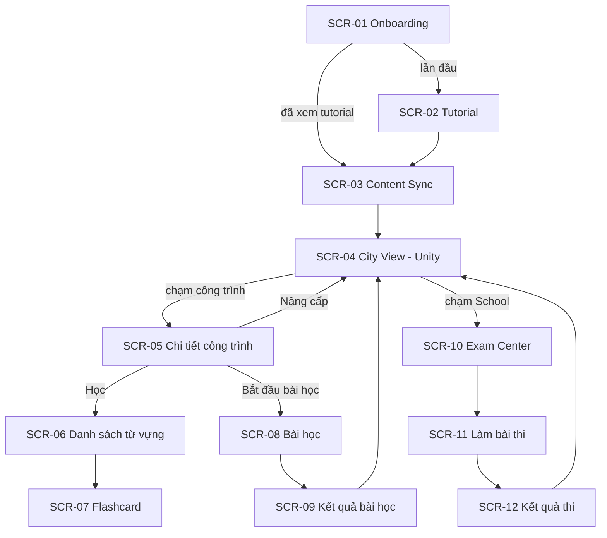

# LINGUACITY — THIẾT KẾ GIAO DIỆN (SCREEN CATALOG)

**Tương ứng báo cáo:** Chương 4 — 4.1 Danh sách màn hình & sơ đồ chuyển đổi · 4.2 Mô tả chi tiết các màn hình
**Quy tắc:** Danh sách màn hình + sơ đồ chuyển đổi (bản thô) làm **trước**. Wireframe + mô tả chi tiết + sơ đồ biến cố làm **theo Slice**.
**Nơi lưu hình:** `diagrams/images/ui/` — đặt tên `4.x-<ma-man-hinh>.png` (wireframe Figma hoặc ảnh chụp màn hình thật).

---

## 1. DANH SÁCH MÀN HÌNH

| Mã | Màn hình | Công nghệ | UC | Slice | Trạng thái |
| :--- | :--- | :--- | :--- | :--- | :--- |
| SCR-01 | Splash / Onboarding | Compose | UC_01 | VS1 | ✅ (loading + lỗi; chưa có nút Thử lại) |
| SCR-02 | Tutorial | ⬜ Compose hay Unity | UC_02 | VS1 | 🟡 (API xong, UI chưa có) |
| SCR-03 | Đồng bộ nội dung (Content Sync) | Compose | UC_03 | VS2 | ⬜ |
| SCR-04 | City View (màn hình chính) | **Unity** (đường lui Compose) | UC_09 | TS-UNITY / VS5 | ⬜ |
| SCR-05 | Chi tiết công trình | Compose (bottom sheet) | UC_09, UC_10 | VS5 | ⬜ |
| SCR-06 | Danh sách từ vựng | Compose | UC_04 | VS2 | ⬜ |
| SCR-07 | Flashcard | Compose | UC_04 | VS2 | ⬜ |
| SCR-08 | Bài học (Learning Session / Mini-game) | Compose | UC_05 | VS3 | ⬜ |
| SCR-09 | Kết quả bài học | Compose | UC_05 | VS3 | ⬜ |
| SCR-10 | Exam Center (School) | Compose | UC_06 | VS4 | ⬜ |
| SCR-11 | Làm bài thi | Compose | UC_07, UC_08 | VS4 | ⬜ |
| SCR-12 | Kết quả thi | Compose | UC_08 | VS4 | ⬜ |
| SCR-13 | Thanh tài nguyên (HUD) | Compose overlay / Unity | UC_09 | VS5 | ⬜ |

---

## 2. SƠ ĐỒ CHUYỂN ĐỔI MÀN HÌNH (BẢN THÔ)

> Mũi tên đi **vào/ra SCR-04** là chỗ chuyển giữa Unity và Compose — cần kiểm tra kỹ trong Tech Spike (ADR-009).

---

## 3. MÔ TẢ CHI TIẾT MÀN HÌNH

Mẫu cho mỗi màn hình (giống báo cáo mẫu):
1. **Hình:** wireframe / ảnh chụp.
2. **Bảng thành phần:** STT · Tên thành phần · Kiểu (Text, Button, List…) · Mô tả · Dữ liệu nguồn.
3. **Sơ đồ biến cố:** sự kiện → xử lý → màn hình/trạng thái tiếp theo.

### 3.1. SCR-01 — Onboarding ✅

**Hình:** ⬜ chụp màn hình loading và màn hình lỗi trên Emulator → `diagrams/images/ui/4.1-scr01-loading.png`, `4.2-scr01-error.png`.

| STT | Thành phần | Kiểu | Mô tả | Dữ liệu |
| :--- | :--- | :--- | :--- | :--- |
| 1 | Vòng loading | `CircularProgressIndicator` | Hiện khi `state.isLoading = true` | `OnboardingState.isLoading` |
| 2 | Thông báo lỗi | `Text` | "Không thể khởi tạo người chơi." | cố định |
| 3 | Chi tiết lỗi | `Text` | Nội dung lỗi trả về | `OnboardingState.error` |
| 4 | ⬜ Nút Thử lại | `Button` | **Chưa có** — đề xuất gửi lại `OnboardingIntent.Onboard` | |

**Sơ đồ biến cố**

| Biến cố | Xử lý | Kết quả |
| :--- | :--- | :--- |
| Màn hình mở lần đầu | `LaunchedEffect` gửi `OnboardingIntent.Onboard` | Hiện loading |
| API trả thành công | ViewModel đặt `userProfile` | Gọi `onOnboardingSuccess()` (hiện chưa điều hướng — `MainActivity`) |
| API lỗi / mất mạng | ViewModel đặt `error` | Hiện thông báo lỗi |

### 3.2. SCR-02 … SCR-13
⬜ Viết khi bắt đầu Slice tương ứng.
