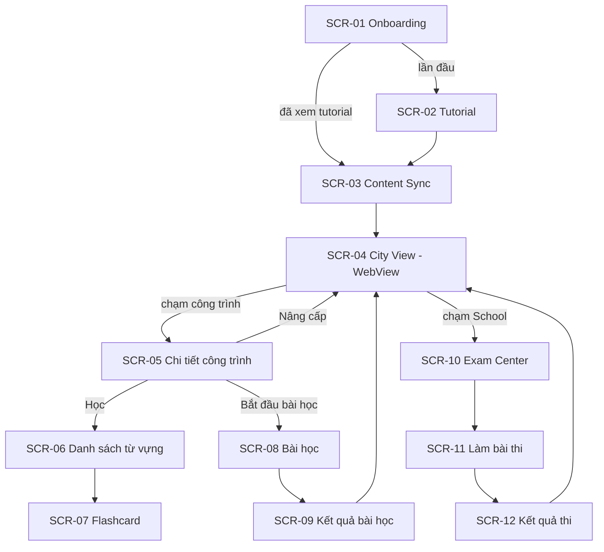

# LINGUACITY — THIẾT KẾ GIAO DIỆN (SCREEN CATALOG)

**Tương ứng báo cáo:** Chương 4 — 4.1 Danh sách màn hình & sơ đồ chuyển đổi · 4.2 Mô tả chi tiết các màn hình
**Quy tắc:** Danh sách màn hình + sơ đồ chuyển đổi (bản thô) làm **trước**. Wireframe + mô tả chi tiết + sơ đồ biến cố làm **theo Slice**.
**Nơi lưu hình:** `diagrams/images/ui/` — đặt tên `4.x-<ma-man-hinh>.png` (wireframe Figma hoặc ảnh chụp màn hình thật).

---

## 1. DANH SÁCH MÀN HÌNH

| Mã | Màn hình | Công nghệ | UC | Slice | Trạng thái |
| :--- | :--- | :--- | :--- | :--- | :--- |
| SCR-01 | Splash / Onboarding | Compose | UC_01 | VS1 | ✅ (loading + lỗi + Thử lại) |
| SCR-02 | Tutorial | Compose overlay trên City (thư ký Mai, ADR-014) | UC_02 | Tutorial | ✅ thay bản 3 trang (M6); bước ENTER_HOUSE/CUSTOMIZE giữ chỗ cho M7/M8 |
| SCR-03 | Đồng bộ nội dung (Content Sync) | Compose (tiến trình theo gói, Thử lại) | UC_03 | VS2 | 🟡 bản cơ bản (Loading đẹp ở M9) |
| SCR-04 | City View (màn hình chính) | **WebView + city-web (Three.js)**, đường lui Compose (ADR-010) | UC_09 | VS5 | 🟡 (bản đồ + nhúng xong, dữ liệu giả lập) |
| SCR-05 | Chi tiết công trình | Compose (thẻ đè lên bản đồ: Học / Xây / Thẻ từ, tiến độ sưu tầm, điều kiện Level kế) | UC_09, UC_10 | VS5 | 🟡 dữ liệu thật từ `GET /city` (`4.13`); Housing đã xây có nút "Vào nhà" (M7) |
| SCR-06 | Danh sách từ vựng | Compose | UC_04 | VS2 | 🟡 bản cơ bản (`4.6-scr06-vocabulary-list.png`; ✓ sưu tầm ở M5, skeleton ở M9) · M9: skeleton + stagger + shared element |
| SCR-07 | Flashcard | Compose (HorizontalPager + lật thẻ 3D) | UC_04 | VS2 | 🟡 bản cơ bản (`4.7`, `4.8`; shared element ở M9) · M9: shared element từ danh sách · **Thiết kế mới "Kho thẻ"** (2 chế độ đọc: Lưới đều / Bento) ở [`redesign/2026-11-09-kho-the-design.md`](redesign/2026-11-09-kho-the-design.md), chờ chọn thay SCR-06, SCR-07 hay cả hai |
| SCR-08 | Bài học (Learning Session / Mini-game) | Compose (trắc nghiệm + điền từ, phản hồi của Mai sau mỗi câu) | UC_05 | VS3 | 🟡 bản chức năng (`4.10`; chân dung Mai ở M6, hiệu ứng ở M9) |
| SCR-09 | Kết quả bài học | Compose (điểm, KP + thưởng + hệ số ngày, sưu tầm, danh hiệu mới) | UC_05 | VS3 | 🟡 bản chức năng (`4.11`) |
| SCR-10 | Trung tâm thi (của một công trình) | Compose | UC_06 | VS4 | 🟡 Specified (ADR-015) |
| SCR-11 | Làm bài thi | Compose (dùng `QuestionBody` chung với bài học) | UC_07, UC_08 | VS4 | 🟡 Specified |
| SCR-12 | Kết quả thi | Compose | UC_08 | VS4 | 🟡 Specified |
| SCR-13 | Thanh tài nguyên (HUD) | Compose overlay (đè lên WebView bản đồ) | UC_09 | VS5 | ✅ KP / Hourglass / Blueprint Shards + danh hiệu đang đeo (`4.23`) |
| SCR-14 | Splash | `core-splashscreen` + Compose | — | UI | ✅ `core-splashscreen` (icon nhà vector) + `BrandedSplash` khi onboarding (`4.18`) |
| SCR-15 | Loading theo điểm đến | Compose (mỗi điểm đến một kiểu) | — | UI | ✅ 6 kiểu (CITY, SYNC, CARDS, MEDAL, PROFILE, LESSON) + mẹo của Mai, chỉ hiện sau 150 ms |
| SCR-16 | Overlay thư ký (Mai) | Compose overlay (chân dung 2D vẽ bằng Canvas, 4 biểu cảm, chữ chạy, spotlight) | UC_02, UC_05 | Tutorial | ✅ (`4.14`, `4.15`, `4.17`) |
| SCR-17 | Bên trong công trình | city-web nội thất 3D (House) / Compose (khác) + bảng nhiệm vụ | UC_15 | VS3+ | 🟡 M7: nội thất 3D House + bảng nhiệm vụ Compose (Học / Thẻ từ / Trang trí / Ra ngoài), phím Back = ra; chờ E2E emulator |
| SCR-18 | Bộ sưu tập danh hiệu | Compose | UC_13 | VS3+ | 🟡 bản cơ bản (`4.12`; skeleton, hiệu ứng nhận ở M9) · M9: skeleton + stagger |
| SCR-19 | Hồ sơ | Compose + xem trước avatar (city-web) | UC_13, UC_14 | VS3+ | ✅ bản đầu: danh hiệu, tài nguyên, số từ, chuỗi ngày (`4.20`). M8 đã có ngoại hình (API + màn SCR-20) nhưng Hồ sơ chưa hiện xem trước avatar và chưa có lối vào Tuỳ biến |
| SCR-20 | Tuỳ biến nhân vật / nhà | Compose + city-web `avatar-preview` / nội thất | UC_14 | VS3+ | 🟡 M8: tab Nhân vật (xem trước 3D) + tab Nhà (mảng màu tường + tên sàn), mua món KP có hộp xác nhận; mở từ nút 🎨 và "Trang trí" trong nhà. Chưa gắn vào bước tutorial `CUSTOMIZE` của Mai (M6) |
| SCR-21 | Cài đặt | Compose (xoay màn hình, hiệu ứng, xem lại hướng dẫn) | — | UI | ✅ xoay màn hình, giảm hiệu ứng, xem lại hướng dẫn (`4.21`) |
| SCR-22 | Menu nổi | Compose FAB bung hình cung trên bản đồ | — | UI | ✅ 4 mục trên cung 1/4, xoay 45°, trễ 40 ms/mục, rung nhẹ (`4.19`) · M8 thêm 🎨 Tuỳ biến · đợt 2 thêm 📜 Nhiệm vụ, 🎯 Luyện tập |
| SCR-23 | Nhiệm vụ & Chuỗi | Compose (tab Chính tuyến / Hằng ngày, lịch chuỗi 7 ngày) | UC_16, UC_17, UC_20 | Đợt 2 | 🟡 Specified (ADR-015) |
| SCR-24 | Luyện tập | Compose (chọn chế độ, chủ đề, cỡ bài; chạy bằng SCR-08/09) | UC_19 | Đợt 2 | 🟡 Specified |
| SCR-25 | Sự kiện thành phố | Compose (thẻ cư dân + tình huống → 5 câu → thưởng) | UC_18 | Đợt 2 | 🟡 Specified |

---

## 2. SƠ ĐỒ CHUYỂN ĐỔI MÀN HÌNH (BẢN THÔ)

> SCR-04 là một composable bình thường chứa WebView (ADR-010), nên chuyển màn hình vào/ra dùng Navigation Compose như mọi màn khác. Dữ liệu qua lại bản đồ theo hợp đồng (B) ở system-design §9.2 (ADR-011).

---

## 3. MÔ TẢ CHI TIẾT MÀN HÌNH

Mẫu cho mỗi màn hình (giống báo cáo mẫu):
1. **Hình:** wireframe / ảnh chụp.
2. **Bảng thành phần:** STT · Tên thành phần · Kiểu (Text, Button, List…) · Mô tả · Dữ liệu nguồn.
3. **Sơ đồ biến cố:** sự kiện → xử lý → màn hình/trạng thái tiếp theo.

### 3.1. SCR-01 — Onboarding ✅

**Hình:** `diagrams/images/ui/4.2-scr01-error.png` (lỗi + Thử lại). ⬜ `4.1-scr01-loading.png`: vòng loading quá nhanh để chụp, sẽ chụp lại khi có Splash/Loading mới.

| STT | Thành phần | Kiểu | Mô tả | Dữ liệu |
| :--- | :--- | :--- | :--- | :--- |
| 1 | Vòng loading | `CircularProgressIndicator` | Hiện khi `state.isLoading = true` | `OnboardingState.isLoading` |
| 2 | Thông báo lỗi | `Text` | "Không thể khởi tạo người chơi." | cố định |
| 3 | Chi tiết lỗi | `Text` | Nội dung lỗi trả về | `OnboardingState.error` |
| 4 | Nút Thử lại | `Button` | Gửi `OnboardingIntent.Retry` | |

**Sơ đồ biến cố**

| Biến cố | Xử lý | Kết quả |
| :--- | :--- | :--- |
| Màn hình mở lần đầu | `LaunchedEffect` gửi `OnboardingIntent.Onboard` | Hiện loading |
| API trả thành công | ViewModel đặt `userProfile` | `AppNavHost`: `tutorialCompleted` → City, ngược lại → Tutorial |
| API lỗi / mất mạng | ViewModel đặt `error` | Hiện thông báo lỗi + Thử lại |
| Bấm Thử lại | `OnboardingIntent.Retry` | Gọi lại API |

### 3.2. SCR-02 — Tutorial (bản 3 trang) ✅

**Hình:** `diagrams/images/ui/4.3-scr02-tutorial-step1.png`, `4.4-scr02-tutorial-step3.png`.

| STT | Thành phần | Kiểu | Mô tả | Dữ liệu |
| :--- | :--- | :--- | :--- | :--- |
| 1 | Số trang | `Text` | "1/3" … "3/3" | `TutorialState` |
| 2 | Tiêu đề + mô tả | `Text` | Nội dung từng trang | cố định |
| 3 | Nút Tiếp / Bắt đầu | `Button` | Trang cuối gọi `POST /users/me/tutorial/complete` rồi vào City | `TutorialIntent` |

### 3.3. SCR-03 … SCR-09, SCR-13
⬜ Viết khi cần (đã có ảnh trong `diagrams/images/ui/`).

### 3.4. SCR-10 — Trung tâm thi 🟡 (ADR-015)

| # | Thành phần | Loại | Hành vi |
| :-: | --- | --- | --- |
| 1 | Tiêu đề "🏠 Thi lên House Lv2" + nút ‹ Quay lại | `TopAppBar` | |
| 2 | Checklist điều kiện | `Column` các dòng | Mỗi dòng có ✓ hoặc số còn thiếu: từ đã sưu tầm 38/45 · 200 KP · mảnh · School Lv1. Chạm dòng thiếu → gợi ý cách lấy (học / nhiệm vụ / sự kiện) |
| 3 | Thông tin đề | `Text` | "10 câu · đậu ≥ 80% · không giới hạn giờ" |
| 4 | Nút chính | `Button` | "Bắt đầu thi" (đủ điều kiện) · "Làm tiếp" (có lượt dở) · "Nâng cấp" (đã có bản vẽ) · mờ khi thiếu |
| 5 | Hộp xác nhận phí | `AlertDialog` | "Dùng 200 KP? Trượt không hoàn lại." |
| 6 | Mai (lần đầu mở) | thẻ chân dung | Một câu hướng dẫn, lưu cờ đã xem |

### 3.5. SCR-11 — Làm bài thi 🟡
| # | Thành phần | Hành vi |
| :-: | --- | --- |
| 1 | Thanh trên: "Câu 3/10", chấm tròn từng câu (đã trả lời / chưa) | Chạm chấm → nhảy tới câu đó |
| 2 | `QuestionBody` (chung với SCR-08) | Không chấm ngay, không có phản hồi đúng/sai |
| 3 | Nút ‹ Câu trước / Câu sau › | Câu trả lời giữ trong ViewModel + `SavedStateHandle` |
| 4 | Màn xem lại | Danh sách câu + câu trả lời; "Nộp bài" (xác nhận nếu còn câu trống) |
| 5 | Back / thoát | Hỏi "Thoát? Lượt thi vẫn giữ, vào lại được" |

### 3.6. SCR-12 — Kết quả thi 🟡
- **Phần đầu:** điểm "9/10 · 90%", vạch điểm đậu, trạng thái ĐẬU hoặc CHƯA ĐẬU.
- **Khi đậu:** thẻ bản vẽ bay vào (có hiệu ứng, tắt được bằng `LocalReduceMotion`), nút "Nâng cấp ngay".
- **Khi trượt:** Mai động viên, nút "Học thêm" (mở bài học của công trình).
- **Bên dưới:** danh sách từng câu gồm câu của mình, đáp án đúng, giải thích.

### 3.7. SCR-23 — Nhiệm vụ & Chuỗi 🟡
- **Khu chuỗi:**
  - 🔥 số ngày, kỷ lục;
  - lịch 7 ngày gần nhất;
  - hai ô hôm nay: "Học 1 bài" ✓ / "Xong 1 nhiệm vụ" ✓.
- **Tab Chính tuyến:** các bước đã xong (mờ) và bước hiện tại (tiến độ + thưởng + nút Nhận).
- **Tab Hằng ngày:**
  - 3 thẻ nhiệm vụ, mỗi thẻ có thanh tiến độ + thưởng + nút Nhận;
  - thẻ "Thưởng hôm nay" khi xong cả 3;
  - giờ làm mới.

### 3.8. SCR-24 — Luyện tập 🟡
- **Chọn chế độ:** Ôn (chỉ từ đã học) / Hỗn hợp (thêm từ mới).
- **Chọn chủ đề:** chip nhiều lựa chọn, mỗi chip có "đã sưu tầm x/y".
- **Chọn cỡ bài:** 10 / 20 từ.
- **Dòng giới hạn:** "Ôn: còn 1/1 lượt · Hỗn hợp: còn 2/3 · Từ mới: còn 14/20".
- **Nút "Bắt đầu":** mở SCR-08 với phiên `PRACTICE_*`.

### 3.9. SCR-25 — Sự kiện thành phố 🟡
- **Thẻ sự kiện:**
  - chân dung cư dân chibi (dùng `avatar-preview` hoặc biểu tượng);
  - tên cư dân, tình huống;
  - thưởng "+1 🧩 +15 KP";
  - nút "Giúp" / "Để sau".
- **Làm bài:** 5 câu dùng `QuestionBody`, có phản hồi ngay như bài học.
- **Kết quả:** "Cảm ơn bạn!" kèm thưởng, hoặc "Thử lại nhé" khi trượt.
