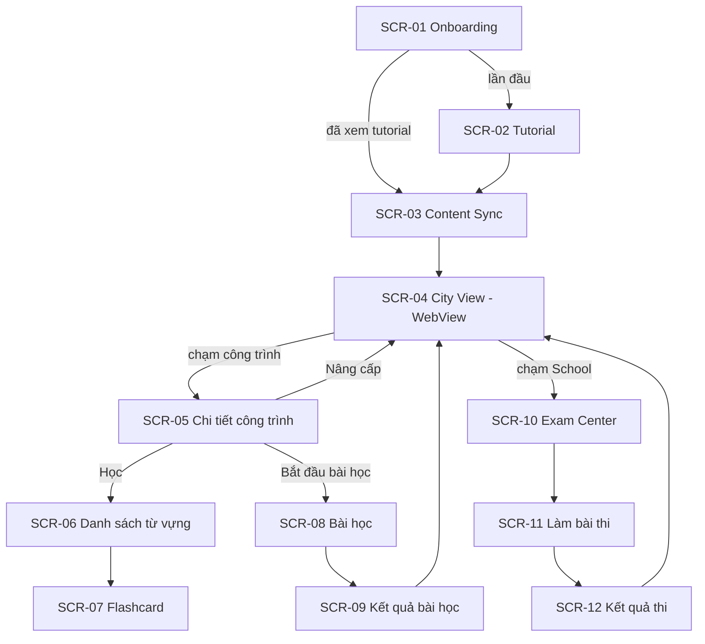

# LINGUACITY — THIẾT KẾ GIAO DIỆN (SCREEN CATALOG)

**Tương ứng báo cáo:** Chương 4 — 4.1 Danh sách màn hình & sơ đồ chuyển đổi · 4.2 Mô tả chi tiết các màn hình
**Quy tắc:** Danh sách màn hình + sơ đồ chuyển đổi (bản thô) làm **trước**. Wireframe + mô tả chi tiết + sơ đồ biến cố làm **theo Slice**.
**Nơi lưu hình:** `diagrams/images/ui/` — đặt tên `4.x-<ma-man-hinh>.png` (wireframe Figma hoặc ảnh chụp màn hình thật).

---

## 1. DANH SÁCH MÀN HÌNH

| Mã | Màn hình | Công nghệ | UC | Slice | Trạng thái |
| :--- | :--- | :--- | :--- | :--- | :--- |
| SCR-01 | Splash / Onboarding | Compose | UC_01 | VS1 | ✅ (loading + lỗi + Thử lại) |
| SCR-02 | Tutorial | Compose | UC_02 | VS1 | ✅ bản 3 trang · 🟡 sẽ thay bằng tutorial thư ký (ADR-014) |
| SCR-03 | Đồng bộ nội dung (Content Sync) | Compose (tiến trình theo gói, Thử lại) | UC_03 | VS2 | ⬜ |
| SCR-04 | City View (màn hình chính) | **WebView + city-web (Three.js)**, đường lui Compose (ADR-010) | UC_09 | VS5 | 🟡 (bản đồ + nhúng xong, dữ liệu giả lập) |
| SCR-05 | Chi tiết công trình | Compose (thẻ đè lên bản đồ) | UC_09, UC_10 | VS5 | 🟡 (thẻ tạm trong `CityScreen`) |
| SCR-06 | Danh sách từ vựng | Compose | UC_04 | VS2 | ⬜ |
| SCR-07 | Flashcard | Compose | UC_04 | VS2 | ⬜ |
| SCR-08 | Bài học (Learning Session / Mini-game) | Compose | UC_05 | VS3 | ⬜ |
| SCR-09 | Kết quả bài học | Compose | UC_05 | VS3 | ⬜ |
| SCR-10 | Exam Center (School) | Compose | UC_06 | VS4 | ⬜ |
| SCR-11 | Làm bài thi | Compose | UC_07, UC_08 | VS4 | ⬜ |
| SCR-12 | Kết quả thi | Compose | UC_08 | VS4 | ⬜ |
| SCR-13 | Thanh tài nguyên (HUD) | Compose overlay (đè lên WebView bản đồ) | UC_09 | VS5 | ⬜ |
| SCR-14 | Splash | `core-splashscreen` + Compose | — | UI | ⬜ |
| SCR-15 | Loading theo điểm đến | Compose (mỗi điểm đến một kiểu) | — | UI | ⬜ |
| SCR-16 | Overlay thư ký (Mai) | Compose overlay (chân dung 2D, chữ chạy, spotlight) | UC_02, UC_05 | Tutorial | ⬜ |
| SCR-17 | Bên trong công trình | city-web nội thất 3D (House) / Compose (khác) + bảng nhiệm vụ | UC_15 | VS3+ | ⬜ |
| SCR-18 | Bộ sưu tập danh hiệu | Compose | UC_13 | VS3+ | ⬜ |
| SCR-19 | Hồ sơ | Compose + xem trước avatar (city-web) | UC_13, UC_14 | VS3+ | ⬜ |
| SCR-20 | Tuỳ biến nhân vật / nhà | Compose + city-web `avatar-preview` / nội thất | UC_14 | VS3+ | ⬜ |
| SCR-21 | Cài đặt | Compose (xoay màn hình, hiệu ứng, xem lại hướng dẫn) | — | UI | ⬜ |
| SCR-22 | Menu nổi | Compose FAB bung hình cung trên bản đồ | — | UI | ⬜ |

---

## 2. SƠ ĐỒ CHUYỂN ĐỔI MÀN HÌNH (BẢN THÔ)

> SCR-04 là một composable bình thường chứa WebView (ADR-010), nên chuyển màn hình vào/ra dùng Navigation Compose như mọi màn khác. Dữ liệu qua lại bản đồ theo hợp đồng (B) ở system-design §9.2 (ADR-011).

---

## 3. MÔ TẢ CHI TIẾT MÀN HÌNH

Mẫu cho mỗi màn hình (giống báo cáo mẫu):
1. **Hình:** wireframe / ảnh chụp.
2. **Bảng thành phần:** STT · Tên thành phần · Kiểu (Text, Button, List…) · Mô tả · Dữ liệu nguồn.
3. **Sơ đồ biến cố:** sự kiện → xử lý → màn hình/trạng thái tiếp theo.

### 3.1. SCR-01 — Onboarding ✅

**Hình:** `diagrams/images/ui/4.2-scr01-error.png` (lỗi + Thử lại). ⬜ `4.1-scr01-loading.png`: vòng loading quá nhanh để chụp, sẽ chụp lại khi có Splash/Loading mới.

| STT | Thành phần | Kiểu | Mô tả | Dữ liệu |
| :--- | :--- | :--- | :--- | :--- |
| 1 | Vòng loading | `CircularProgressIndicator` | Hiện khi `state.isLoading = true` | `OnboardingState.isLoading` |
| 2 | Thông báo lỗi | `Text` | "Không thể khởi tạo người chơi." | cố định |
| 3 | Chi tiết lỗi | `Text` | Nội dung lỗi trả về | `OnboardingState.error` |
| 4 | Nút Thử lại | `Button` | Gửi `OnboardingIntent.Retry` | |

**Sơ đồ biến cố**

| Biến cố | Xử lý | Kết quả |
| :--- | :--- | :--- |
| Màn hình mở lần đầu | `LaunchedEffect` gửi `OnboardingIntent.Onboard` | Hiện loading |
| API trả thành công | ViewModel đặt `userProfile` | `AppNavHost`: `tutorialCompleted` → City, ngược lại → Tutorial |
| API lỗi / mất mạng | ViewModel đặt `error` | Hiện thông báo lỗi + Thử lại |
| Bấm Thử lại | `OnboardingIntent.Retry` | Gọi lại API |

### 3.2. SCR-02 — Tutorial (bản 3 trang) ✅

**Hình:** `diagrams/images/ui/4.3-scr02-tutorial-step1.png`, `4.4-scr02-tutorial-step3.png`.

| STT | Thành phần | Kiểu | Mô tả | Dữ liệu |
| :--- | :--- | :--- | :--- | :--- |
| 1 | Số trang | `Text` | "1/3" … "3/3" | `TutorialState` |
| 2 | Tiêu đề + mô tả | `Text` | Nội dung từng trang | cố định |
| 3 | Nút Tiếp / Bắt đầu | `Button` | Trang cuối gọi `POST /users/me/tutorial/complete` rồi vào City | `TutorialIntent` |

### 3.3. SCR-03 … SCR-13
⬜ Viết khi bắt đầu Slice tương ứng.
