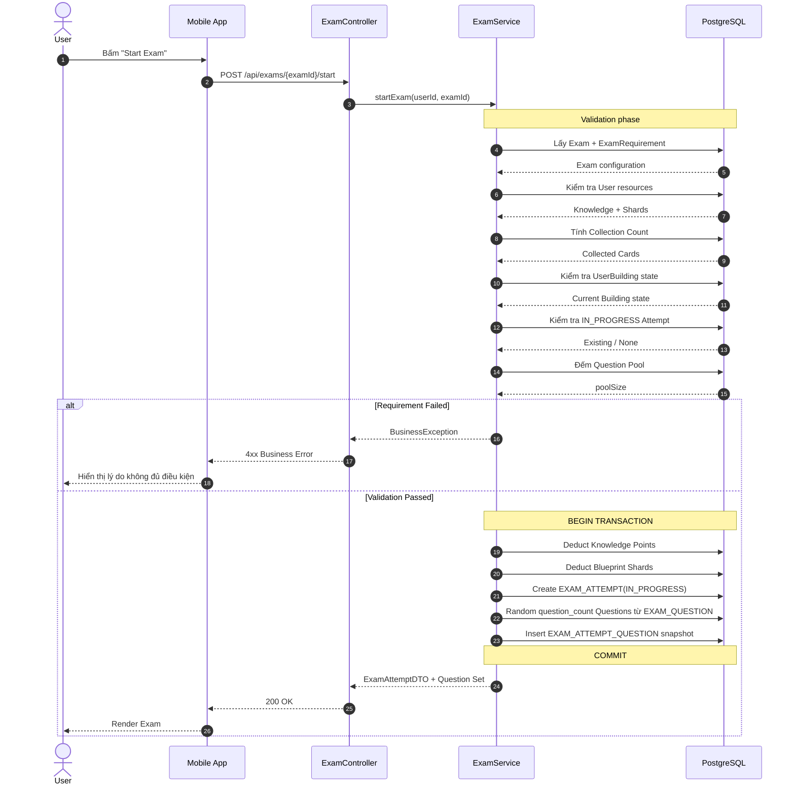
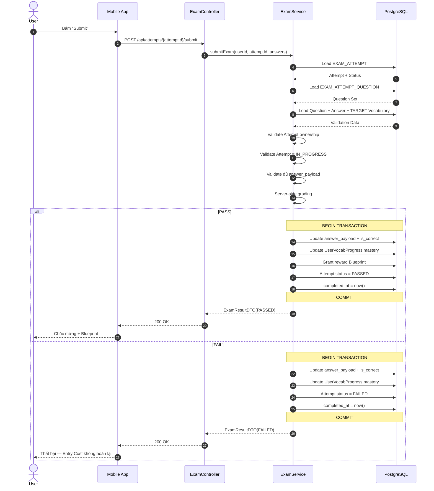
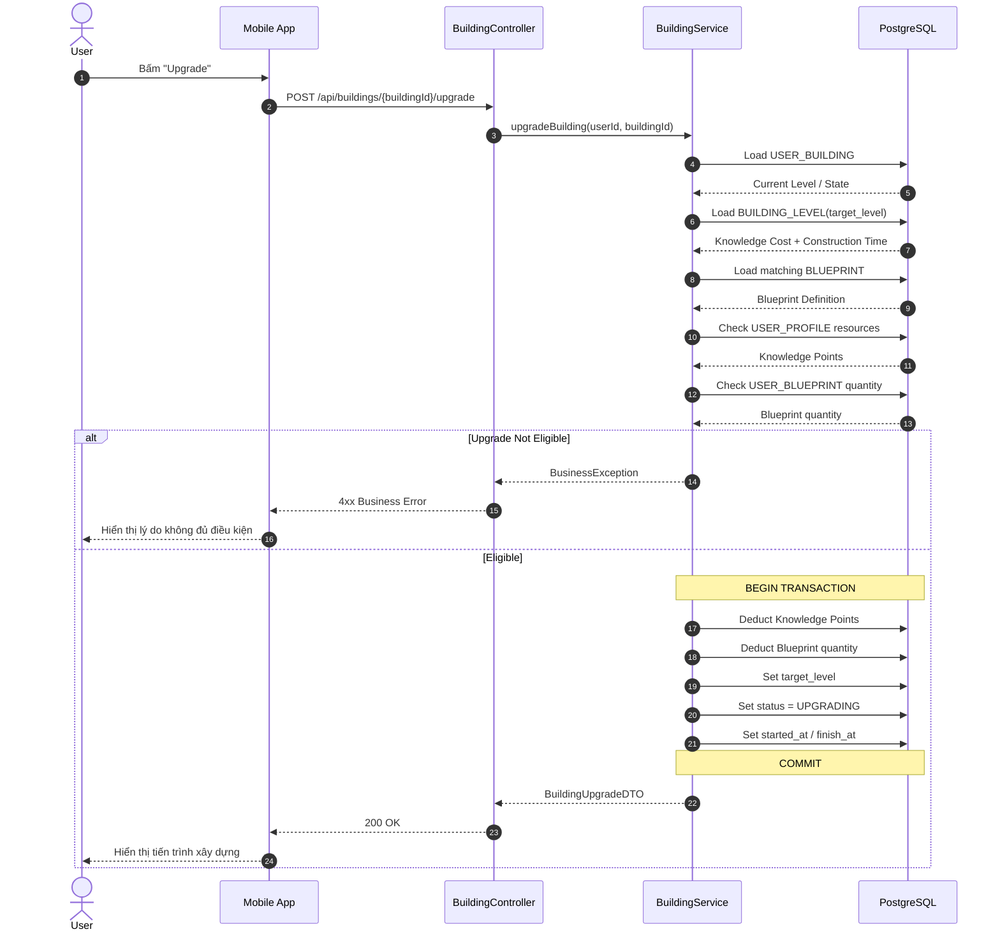
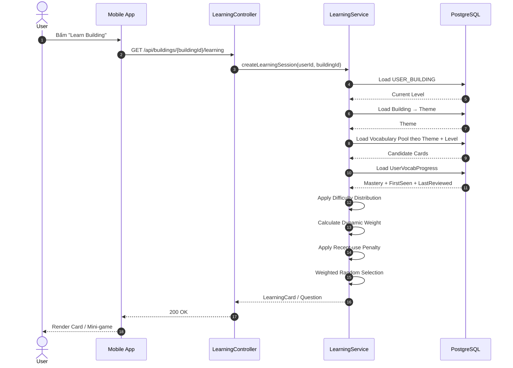

# LINGUACITY — 02. SYSTEM DESIGN

## PHẦN BỔ SUNG: 2.2.3 → 2.3.5

> Phần này tiếp nối `2.2.1 — ERD chính thức` và `2.2.2 — Database Constraints & Referential Integrity` đã được Freeze. Nội dung tập trung vào Index Design, Data Normalization, PostgreSQL/JPA Mapping và các Data Flow/Sequence Diagram cốt lõi của LinguaCity.

---

# 2.2.3 — INDEX DESIGN

## 2.2.3.1. Mục tiêu và nguyên tắc

Mục tiêu của phần này là xác định các Index cần thiết trên PostgreSQL dựa trên những truy vấn chính của LinguaCity.

Index chỉ được tạo cho các cột thường xuyên được sử dụng trong:

- `WHERE`
- `JOIN`
- `ORDER BY`
- Tra cứu theo quan hệ
- Kiểm tra các Business Constraint quan trọng

> **Nguyên tắc:** Không tạo index tràn lan. Mỗi index đều làm tăng dung lượng lưu trữ và chi phí xử lý khi `INSERT` / `UPDATE`.

Các `PRIMARY KEY` và `UNIQUE CONSTRAINT` đã tạo index tự động thì không tạo thêm index trùng lặp.

---

## 2.2.3.2. THEME

Các truy vấn chính:

```sql
-- Tra cứu Theme theo ID
SELECT *
FROM themes
WHERE id = ?;

-- Tra cứu Theme theo code
SELECT *
FROM themes
WHERE code = ?;
```

`PRIMARY KEY(id)` và `UNIQUE(code)` đã tự tạo index.

```text
THEME
├── PK(id)
└── UK(code)
```

**Không cần index bổ sung.**

---

## 2.2.3.3. BUILDING

Các truy vấn chính:

```sql
SELECT *
FROM buildings
WHERE theme_id = ?;
```

`id` và `code` đã được index bởi PK/UK.

Đề xuất thêm index cho khóa ngoại `theme_id`:

```sql
CREATE INDEX idx_building_theme_id
ON buildings(theme_id);
```

```text
BUILDING
├── PK(id)
├── UK(code)
└── INDEX(theme_id)
```

Index này hỗ trợ truy vấn `Theme → Building` và các phép JOIN liên quan.

---

## 2.2.3.4. BUILDING_LEVEL

Khóa chính:

```text
PK(building_id, level)
```

Các truy vấn chính:

```sql
SELECT *
FROM building_levels
WHERE building_id = ?
  AND level = ?;
```

Composite Primary Key đã trực tiếp hỗ trợ truy vấn này.

Ngoài ra, khi User Upgrade Building, truy vấn thường có dạng:

```sql
SELECT *
FROM building_levels
WHERE building_id = ?
  AND level = ?;
```

Do đó **không cần index bổ sung**.

```text
BUILDING_LEVEL
└── PK(building_id, level)
```

---

## 2.2.3.5. VOCABULARY

Đây là một trong những bảng quan trọng nhất đối với Gameplay.

Truy vấn chính là lấy Card Pool theo Theme + Level:

```sql
SELECT *
FROM vocabularies
WHERE theme_id = ?
  AND level = ?;
```

Weighted Random cũng cần lọc/nhóm theo `difficulty_rank`.

Do đó sử dụng Composite Index:

```sql
CREATE INDEX idx_vocabulary_theme_level_rank
ON vocabularies(theme_id, level, difficulty_rank);
```

Theo nguyên tắc Left-most Prefix, index này hỗ trợ tốt các truy vấn bắt đầu bằng `theme_id` và `level`, đồng thời có thể hỗ trợ bước lọc/nhóm theo Difficulty Rank.

```text
VOCABULARY
├── PK(id)
└── INDEX(theme_id, level, difficulty_rank)
```

Không cần tạo thêm:

```text
INDEX(theme_id)
INDEX(theme_id, level)
```

nếu các truy vấn thực tế vẫn bắt đầu bằng `theme_id + level`.

---

## 2.2.3.6. QUESTION

Các truy vấn dự kiến:

```sql
SELECT *
FROM questions
WHERE content_type = ?
  AND skill = ?
  AND question_type = ?;
```

Đề xuất:

```sql
CREATE INDEX idx_question_content_skill_type
ON questions(content_type, skill, question_type);
```

```text
QUESTION
├── PK(id)
└── INDEX(content_type, skill, question_type)
```

Không tạo index riêng cho từng Enum vì các giá trị này có độ phân tán thấp và việc tạo nhiều index nhỏ có thể tạo overhead không cần thiết.

---

## 2.2.3.7. EXAM

Các truy vấn chính:

```sql
SELECT *
FROM exams
WHERE building_id = ?
  AND target_level = ?;
```

Đề xuất:

```sql
CREATE INDEX idx_exam_building_target_level
ON exams(building_id, target_level);
```

```text
EXAM
├── PK(id)
├── UK(code)
└── INDEX(building_id, target_level)
```

Index này phục vụ việc xác định Exam tương ứng với Building và Target Level.

---

## 2.2.3.8. EXAM_REQUIREMENT

`EXAM_REQUIREMENT.exam_id` đã có:

```text
UNIQUE(exam_id)
```

Unique Constraint này tự tạo index.

Truy vấn chính:

```sql
SELECT *
FROM exam_requirements
WHERE exam_id = ?;
```

Do đó:

```text
EXAM_REQUIREMENT
├── PK(id)
└── UK(exam_id)
```

**Không cần index bổ sung.**

---

## 2.2.3.9. BLUEPRINT

Các truy vấn chính:

```sql
SELECT *
FROM blueprints
WHERE building_id = ?
  AND target_level = ?;
```

Trong 2.2.2 đã Freeze:

```text
UNIQUE(building_id, target_level)
```

Unique Constraint này vừa bảo vệ tính duy nhất của Blueprint Definition vừa tự tạo Composite Index.

```text
BLUEPRINT
├── PK(id)
├── UK(code)
└── UK(building_id, target_level)
```

Không cần tạo thêm index `(building_id, target_level)`.

---

## 2.2.3.10. USER_PROFILE

`id` là UUID Primary Key.

Các thao tác hiện tại chủ yếu truy cập trực tiếp theo `id`:

```sql
SELECT *
FROM user_profiles
WHERE id = ?;
```

```text
USER_PROFILE
└── PK(id)
```

Không cần index bổ sung ở MVP.

---

## 2.2.3.11. USER_BUILDING

Truy vấn thường xuyên:

```sql
SELECT *
FROM user_buildings
WHERE user_id = ?;
```

và:

```sql
SELECT *
FROM user_buildings
WHERE user_id = ?
  AND building_id = ?;
```

Đã có:

```text
UNIQUE(user_id, building_id)
```

Unique Composite Index này có `user_id` ở vị trí đầu tiên nên hỗ trợ tốt cả hai truy vấn trên.

```text
USER_BUILDING
├── PK(id)
└── UK(user_id, building_id)
```

**Không tạo thêm `INDEX(user_id)`** để tránh trùng lặp.

---

## 2.2.3.12. USER_VOCAB_PROGRESS

Các truy vấn chính:

```sql
SELECT *
FROM user_vocab_progress
WHERE user_id = ?;
```

và:

```sql
SELECT *
FROM user_vocab_progress
WHERE user_id = ?
  AND vocabulary_id = ?;
```

Đã có:

```text
UNIQUE(user_id, vocabulary_id)
```

Unique Composite Index này hỗ trợ cả hai truy vấn.

```text
USER_VOCAB_PROGRESS
├── PK(id)
└── UK(user_id, vocabulary_id)
```

**Không cần index bổ sung trong MVP.**

---

## 2.2.3.13. USER_BLUEPRINT

Các truy vấn chính:

```sql
SELECT *
FROM user_blueprints
WHERE user_id = ?;
```

và:

```sql
SELECT *
FROM user_blueprints
WHERE user_id = ?
  AND blueprint_id = ?;
```

Đã có:

```text
UNIQUE(user_id, blueprint_id)
```

Do đó:

```text
USER_BLUEPRINT
├── PK(id)
└── UK(user_id, blueprint_id)
```

**Không cần index bổ sung.**

---

## 2.2.3.14. EXAM_ATTEMPT

Có hai nhóm truy vấn quan trọng.

### Kiểm tra Attempt đang hoạt động

Rule đã Freeze:

> Một User chỉ có tối đa một `IN_PROGRESS` Attempt cho cùng một Exam.

Sử dụng Partial Unique Index:

```sql
CREATE UNIQUE INDEX ux_exam_attempt_active
ON exam_attempts(user_id, exam_id)
WHERE status = 'IN_PROGRESS';
```

Index này vừa:

- bảo vệ Business Rule;
- hỗ trợ truy vấn tìm Attempt đang hoạt động.

### Lấy lịch sử Attempt của User

Nếu về sau thường xuyên sử dụng:

```sql
SELECT *
FROM exam_attempts
WHERE user_id = ?
ORDER BY started_at DESC;
```

có thể bổ sung:

```sql
CREATE INDEX idx_exam_attempt_user_started
ON exam_attempts(user_id, started_at DESC);
```

Ở MVP, index lịch sử này có thể được giữ nếu màn hình Exam History được triển khai ngay; nếu chưa có, có thể đợi profiling thực tế.

```text
EXAM_ATTEMPT
├── PK(id)
├── PARTIAL UNIQUE INDEX(user_id, exam_id) WHERE status = 'IN_PROGRESS'
└── [Optional] INDEX(user_id, started_at DESC)
```

---

## 2.2.3.15. EXAM_QUESTION

`EXAM_QUESTION` là Question Pool.

Truy vấn chính:

```sql
SELECT *
FROM exam_questions
WHERE exam_id = ?;
```

Primary Key:

```text
PK(exam_id, question_id)
```

đã hỗ trợ trực tiếp truy vấn theo `exam_id`.

```text
EXAM_QUESTION
└── PK(exam_id, question_id)
```

Không cần index bổ sung.

---

## 2.2.3.16. EXAM_ATTEMPT_QUESTION

Truy vấn chính:

```sql
SELECT *
FROM exam_attempt_questions
WHERE attempt_id = ?
ORDER BY question_order;
```

Primary Key:

```text
PK(attempt_id, question_id)
```

không tối ưu cho việc sắp xếp theo `question_order`.

Đề xuất:

```sql
CREATE INDEX idx_attempt_question_order
ON exam_attempt_questions(attempt_id, question_order);
```

```text
EXAM_ATTEMPT_QUESTION
├── PK(attempt_id, question_id)
└── INDEX(attempt_id, question_order)
```

Index này phục vụ trực tiếp việc render đúng thứ tự câu hỏi của Attempt.

---

## 2.2.3.17. QUESTION_VOCABULARY

Có hai hướng truy vấn.

### Question → Vocabulary

```sql
SELECT *
FROM question_vocabularies
WHERE question_id = ?;
```

Primary Key:

```text
PK(question_id, vocabulary_id)
```

đã hỗ trợ tốt.

### Vocabulary → Question

```sql
SELECT *
FROM question_vocabularies
WHERE vocabulary_id = ?;
```

Ở đây `vocabulary_id` nằm ở vị trí thứ hai của Composite PK nên cần index bổ sung:

```sql
CREATE INDEX idx_question_vocabulary_vocabulary
ON question_vocabularies(vocabulary_id);
```

```text
QUESTION_VOCABULARY
├── PK(question_id, vocabulary_id)
└── INDEX(vocabulary_id)
```

Đây là index quan trọng cho Learning Analytics/Recommendation.

---

## 2.2.3.18. Tổng hợp Index — MVP

| Bảng | PK / UK tự động | Index bổ sung | Mục đích |
|---|---|---|---|
| `THEME` | `PK(id)`, `UK(code)` | Không | Định danh + tra cứu code |
| `BUILDING` | `PK(id)`, `UK(code)` | `(theme_id)` | Theme → Building |
| `BUILDING_LEVEL` | `PK(building_id, level)` | Không | Building Level lookup |
| `VOCABULARY` | `PK(id)` | `(theme_id, level, difficulty_rank)` | Card Pool |
| `QUESTION` | `PK(id)` | `(content_type, skill, question_type)` | Question filtering |
| `EXAM` | `PK(id)`, `UK(code)` | `(building_id, target_level)` | Exam lookup |
| `EXAM_REQUIREMENT` | `PK(id)`, `UK(exam_id)` | Không | Exam → Requirement |
| `BLUEPRINT` | `PK(id)`, `UK(code)`, `UK(building_id, target_level)` | Không | Blueprint lookup |
| `USER_PROFILE` | `PK(id)` | Không | User lookup |
| `USER_BUILDING` | `PK(id)`, `UK(user_id, building_id)` | Không | User → Building |
| `USER_VOCAB_PROGRESS` | `PK(id)`, `UK(user_id, vocabulary_id)` | Không | User → Card |
| `USER_BLUEPRINT` | `PK(id)`, `UK(user_id, blueprint_id)` | Không | User → Blueprint |
| `EXAM_ATTEMPT` | `PK(id)` | Partial Unique `(user_id, exam_id)` for `IN_PROGRESS` | Concurrent Attempt |
| `EXAM_QUESTION` | `PK(exam_id, question_id)` | Không | Exam → Question Pool |
| `EXAM_ATTEMPT_QUESTION` | `PK(attempt_id, question_id)` | `(attempt_id, question_order)` | Attempt → Ordered Questions |
| `QUESTION_VOCABULARY` | `PK(question_id, vocabulary_id)` | `(vocabulary_id)` | Vocabulary → Questions |

---

## 2.2.3.19. Các Index không tạo trong MVP

Không tạo index riêng cho các field sau nếu chưa có workload thực tế:

```text
Vocabulary.word
Vocabulary.meaning
UserVocabProgress.mastery_score
UserBuilding.current_level
Question.skill
Question.question_type
```

Lý do: các truy vấn này chưa phải Access Pattern chính của MVP hoặc có selectivity thấp.

Chỉ bổ sung sau khi có Profiling/Monitoring thực tế cho thấy chúng trở thành bottleneck.

---

# 2.2.4 — DATA NORMALIZATION

## 2.2.4.1. Mục tiêu

Mục tiêu của phần này là kiểm tra xem mô hình dữ liệu đã loại bỏ các dạng dư thừa và bất thường dữ liệu phổ biến của mô hình quan hệ hay chưa.

> Mô hình quan hệ cốt lõi của LinguaCity được chuẩn hóa theo nguyên tắc 3NF. `JSONB` được sử dụng như một vùng mở rộng có cấu trúc, có chủ đích cho payload linh hoạt chứ không phải nơi chứa các thuộc tính quan hệ cốt lõi.

---

## 2.2.4.2. First Normal Form — 1NF

Nguyên tắc:

- Mỗi thuộc tính quan hệ có một giá trị đơn ở mức field.
- Không lưu các repeating group trong cùng một dòng.
- Quan hệ N-N được tách thành Junction Table.

### Nghiệm thu

Thay vì lưu nhiều Question trong một field của `EXAM`, hệ thống sử dụng:

```text
EXAM_QUESTION
```

Thay vì lưu nhiều Vocabulary trong một field của `QUESTION`, hệ thống sử dụng:

```text
QUESTION_VOCABULARY
```

Thay vì lưu danh sách Blueprint của User trong một cột, hệ thống sử dụng:

```text
USER_BLUEPRINT
```

### JSONB — controlled structured extension

Hai vùng JSONB:

```text
VOCABULARY.examples
QUESTION.metadata
```

lưu payload có cấu trúc linh hoạt phục vụ Client/Mini-game.

Các trường này không được dùng làm khóa quan hệ và không tham gia các JOIN nghiệp vụ cốt lõi.

Do đó JSONB được xem là **controlled structured extension**, không phải dấu hiệu để phá vỡ các quan hệ cốt lõi đã chuẩn hóa.

---

## 2.2.4.3. Second Normal Form — 2NF

Các bảng có Composite Primary Key phải bảo đảm mọi thuộc tính không khóa phụ thuộc vào **toàn bộ** khóa.

### BUILDING_LEVEL

```text
PK(building_id, level)
```

- `knowledge_cost` phụ thuộc vào cả Building và Target Level.
- `construction_time` cũng phụ thuộc vào cả Building và Target Level.

Ví dụ:

```text
Housing + Level 2 → 250 Knowledge
Housing + Level 3 → 500 Knowledge
```

Không thể suy ra chi phí chỉ từ `building_id` hoặc chỉ từ `level`.

### EXAM_ATTEMPT_QUESTION

```text
PK(attempt_id, question_id)
```

`answer_payload`, `is_correct` và `answered_at` mô tả kết quả của đúng Question trong đúng Attempt.

Do đó các thuộc tính này phụ thuộc vào toàn bộ Composite Key.

### EXAM_QUESTION

```text
PK(exam_id, question_id)
```

Không có thuộc tính mô tả riêng một phía của khóa.

### QUESTION_VOCABULARY

```text
PK(question_id, vocabulary_id)
```

`relation_type` phụ thuộc vào chính cặp Question–Vocabulary.

---

## 2.2.4.4. Third Normal Form — 3NF

Nguyên tắc:

> Mỗi thuộc tính không khóa phải phụ thuộc trực tiếp vào khóa chính và không phụ thuộc bắc cầu vào một thuộc tính không khóa khác.

### VOCABULARY

Không lưu:

```text
vocabulary.theme_name
```

mà lưu:

```text
theme_id
```

Tên Theme thuộc `THEME`.

Điều này tránh trường hợp đổi Theme Name phải cập nhật hàng nghìn Vocabulary.

### USER_BUILDING

Không lưu:

```text
max_level
```

vì `max_level` là thuộc tính của loại Building và được xác định trong `BUILDING`.

### BLUEPRINT / USER_BLUEPRINT

`BLUEPRINT` chỉ mô tả Blueprint Definition:

```text
building_id
target_level
```

`USER_BLUEPRINT` chỉ lưu trạng thái sở hữu:

```text
user_id
blueprint_id
quantity
```

Không sao chép `building_id` hoặc `target_level` vào `USER_BLUEPRINT`.

### EXAM / EXAM_REQUIREMENT

`EXAM_REQUIREMENT` chỉ lưu các điều kiện cần để Start Exam.

Không sao chép các thông tin như:

```text
building_code
building_name
blueprint_code
```

vào Requirement.

---

## 2.2.4.5. Derived Data không lưu dư thừa

Các giá trị có thể tính từ dữ liệu nguồn được ưu tiên derive thay vì lưu lại thành trạng thái thứ hai.

Ví dụ:

```text
Collection Count
Level Mastery
Exam Unlock State
Card Weight
MASTERED state
```

Ví dụ `MASTERED` được derive khi:

```text
mastery_score = max_mastery
```

Không cần lưu thêm:

```text
status = MASTERED
```

Điều này giảm nguy cơ Data Anomaly.

---

## 2.2.4.6. Tách Static Content và Player State

Một trong những quyết định chuẩn hóa quan trọng nhất là:

```text
STATIC CONTENT
├── Theme
├── Building
├── BuildingLevel
├── Vocabulary
├── Question
├── Exam
├── ExamRequirement
└── Blueprint

PLAYER STATE
├── UserProfile
├── UserBuilding
├── UserVocabProgress
├── UserBlueprint
├── ExamAttempt
└── ExamAttemptQuestion
```

Ví dụ `Building` không lưu `current_level` của Player.

Ví dụ `Vocabulary` không lưu `mastery_score` của Player.

Ví dụ `Blueprint` không lưu `quantity` của Player.

Mỗi loại dữ liệu chỉ chịu trách nhiệm cho một domain state rõ ràng.

---

## 2.2.4.7. Kết luận

Mô hình quan hệ cốt lõi của LinguaCity đáp ứng các nguyên tắc 3NF với:

- Entity tách theo trách nhiệm.
- Quan hệ N-N được chuẩn hóa bằng Junction Table.
- Static Content và Player State được tách biệt.
- Derived State không bị lưu lặp.
- Blueprint Inventory được tách khỏi Blueprint Definition.
- Exam Definition được tách khỏi Exam Attempt.
- JSONB chỉ được sử dụng ở những vị trí cần cấu trúc linh hoạt.

Do đó Data Model hiện tại phù hợp để triển khai trên PostgreSQL mà không cần thay đổi kiến trúc chỉ vì lý do chuẩn hóa.

---

# 2.2.5 — POSTGRESQL / JPA MAPPING

## 2.2.5.1. Mục tiêu

Chuyển ERD và các Constraint đã Freeze thành thiết kế triển khai cụ thể cho:

```text
Java Spring Boot
+
JPA / Hibernate
+
PostgreSQL
```

Luồng kiến trúc:

```text
ERD
  ↓
PostgreSQL Tables
  ↓
JPA Entity
  ↓
Repository
  ↓
Service
  ↓
REST API / DTO
```

---

## 2.2.5.2. Naming Convention

### PostgreSQL

Sử dụng `snake_case` và tên bảng dạng số nhiều:

```text
 themes
 buildings
 building_levels
 vocabularies
 questions
 exams
 exam_requirements
 blueprints
 user_profiles
 user_buildings
 user_vocab_progress
 user_blueprints
 exam_attempts
 exam_questions
 exam_attempt_questions
 question_vocabularies
```

### Java

Entity dùng PascalCase số ít:

```text
Theme
Building
BuildingLevel
Vocabulary
Question
Exam
ExamRequirement
Blueprint
UserProfile
UserBuilding
UserVocabProgress
UserBlueprint
ExamAttempt
ExamQuestion
ExamAttemptQuestion
QuestionVocabulary
```

Field dùng camelCase:

```text
buildingId
targetLevel
masteryScore
```

Không phụ thuộc tuyệt đối vào default naming strategy của Spring Boot; các tên database quan trọng nên được cấu hình rõ bằng `@Table` / `@Column` khi cần.

---

## 2.2.5.3. Primary Key Mapping

### BIGINT ID

Phần lớn Entity sử dụng:

```java
@Id
@GeneratedValue(strategy = GenerationType.IDENTITY)
private Long id;
```

### UserProfile UUID

```java
@Id
@Column(nullable = false, updatable = false)
private UUID id;
```

UUID được Client sinh cho Guest User hoặc được Backend cấp trong bước khởi tạo User.

---

## 2.2.5.4. Fetch Strategy

Áp dụng nguyên tắc **LAZY-first**.

Ví dụ:

```java
@ManyToOne(fetch = FetchType.LAZY, optional = false)
@JoinColumn(name = "theme_id", nullable = false)
private Theme theme;
```

Các collection quan hệ được xử lý theo hướng LAZY.

Khi cần dữ liệu liên quan, Repository chủ động sử dụng:

```text
JOIN FETCH
EntityGraph
Projection
```

thay vì chuyển toàn bộ graph sang EAGER.

Mục tiêu là hạn chế N+1 Query và tránh serialize Entity graph không cần thiết.

---

## 2.2.5.5. Enum Mapping

Các giá trị như:

```text
ContentType
Skill
QuestionType
BuildingStatus
AttemptStatus
RelationType
```

được ánh xạ bằng:

```java
@Enumerated(EnumType.STRING)
@Column(nullable = false)
private AttemptStatus status;
```

Không sử dụng `EnumType.ORDINAL` vì thay đổi thứ tự Enum trong code có thể làm sai nghĩa dữ liệu đã lưu.

---

## 2.2.5.6. Composite Key — BUILDING_LEVEL

```java
@Embeddable
public class BuildingLevelId implements Serializable {

    @Column(name = "building_id")
    private Long buildingId;

    @Column(name = "level")
    private Integer level;
}
```

Entity:

```java
@Entity
@Table(name = "building_levels")
public class BuildingLevel {

    @EmbeddedId
    private BuildingLevelId id;

    @ManyToOne(fetch = FetchType.LAZY, optional = false)
    @MapsId("buildingId")
    @JoinColumn(name = "building_id", nullable = false)
    private Building building;

    @Column(name = "knowledge_cost", nullable = false)
    private Integer knowledgeCost;

    @Column(name = "construction_time", nullable = false)
    private Integer constructionTime;
}
```

`@MapsId` giúp tránh lặp cột `building_id` trong Embedded ID và Relationship Mapping.

---

## 2.2.5.7. Composite Key — EXAM_QUESTION

```text
PK(exam_id, question_id)
```

sử dụng `@EmbeddedId`:

```java
@Embeddable
public class ExamQuestionId implements Serializable {
    private Long examId;
    private Long questionId;
}
```

Entity:

```java
@Entity
@Table(name = "exam_questions")
public class ExamQuestion {

    @EmbeddedId
    private ExamQuestionId id;

    @ManyToOne(fetch = FetchType.LAZY, optional = false)
    @MapsId("examId")
    @JoinColumn(name = "exam_id", nullable = false)
    private Exam exam;

    @ManyToOne(fetch = FetchType.LAZY, optional = false)
    @MapsId("questionId")
    @JoinColumn(name = "question_id", nullable = false)
    private Question question;
}
```

`ExamQuestion` là Supporting Entity đại diện cho Question Pool.

---

## 2.2.5.8. Composite Key — EXAM_ATTEMPT_QUESTION

```text
PK(attempt_id, question_id)
```

Entity tương tự Junction Entity, nhưng có thêm state của Attempt:

```text
question_order
answer_payload
is_correct
answered_at
```

Điểm quan trọng:

- `answer_payload` có thể `NULL` trước khi User trả lời.
- `is_correct` có thể `NULL` trước khi Server chấm.
- `answered_at` có thể `NULL` trước khi User hoàn thành câu.

---

## 2.2.5.9. JSONB Mapping

`Vocabulary.examples` và `Question.metadata` sử dụng PostgreSQL `JSONB`.

Nếu backend chạy Hibernate 6 / Spring Boot 3, ưu tiên cơ chế JSON type native của Hibernate, ví dụ:

```java
@JdbcTypeCode(SqlTypes.JSON)
@Column(columnDefinition = "jsonb")
private List<String> examples;
```

Với payload Mini-game:

```java
@JdbcTypeCode(SqlTypes.JSON)
@Column(columnDefinition = "jsonb")
private JsonNode metadata;
```

Việc sử dụng thư viện mapping bên ngoài chỉ được quyết định nếu phiên bản Hibernate thực tế của dự án cần nó.

---

## 2.2.5.10. Composite FK — EXAM → BLUEPRINT

Đây là một Integrity Rule đặc biệt.

`EXAM` có:

```text
building_id
target_level
reward_blueprint_id
```

`BLUEPRINT` có:

```text
id
building_id
target_level
```

Database phải bảo đảm:

```text
EXAM.building_id
    = BLUEPRINT.building_id

EXAM.target_level
    = BLUEPRINT.target_level
```

Cặp `(building_id, target_level)` của Blueprint được Unique nên có thể được tham chiếu qua Composite FK.

Trong JPA, phần này cần được mapping cẩn thận; có thể dùng `@JoinColumns` kết hợp với các field đồng nhất và constraint được tạo ở Database Migration/Schema Layer.

---

## 2.2.5.11. DTO Pattern

JPA Entity không được trả trực tiếp từ Controller.

Luồng:

```text
Entity
  ↓
Mapper
  ↓
Response DTO
  ↓
JSON
```

Request cũng nên đi theo:

```text
JSON
  ↓
Request DTO
  ↓
Service
  ↓
Entity / Domain Operation
```

Ví dụ `SubmitExamRequest` chỉ chứa `answer_payload` mà Mobile được phép gửi; Client không được gửi:

```text
is_correct
score
reward_blueprint_id
```

Backend phải tự xác định các giá trị này.

---

# 2.3 — DATA FLOW & SEQUENCE DIAGRAM

## 2.3.1. Nguyên tắc chung

Các Sequence Diagram của LinguaCity phải phản ánh:

```text
Mobile App
   ↓
Controller
   ↓
Service / Domain Logic
   ↓
Repository
   ↓
PostgreSQL
```

Các thao tác Gameplay-critical sử dụng Transaction để giữ tính nhất quán.

---

# 2.3.2. Start Exam Flow

## Mục tiêu

Mô tả luồng từ khi User chọn Start Exam đến khi một `EXAM_ATTEMPT` và Question Set được tạo thành công.

### Sequence Diagram



### Validation Rules

Backend phải tự kiểm tra:

```text
Collection Count >= required_card_count
Knowledge Points >= required_knowledge
Blueprint Shards >= required_blueprint_shards
Building đang ở trạng thái hợp lệ
Không có IN_PROGRESS Attempt khác
Question Pool >= question_count
```

Nếu bất kỳ điều kiện nào không đạt:

```text
Không Start Exam
Không trừ Resource
Không tạo Attempt
```

### Transaction Scope

Các thao tác sau phải nằm trong cùng Transaction:

```text
Deduct Resources
Create Attempt
Select Question Set
Create AttemptQuestion Snapshot
```

Nếu một bước lỗi:

```text
ROLLBACK
```

để tránh trạng thái:

```text
Resource đã mất
nhưng Attempt chưa được tạo
```

### Question Pool Validation

Nếu:

```text
EXAM.question_count = 10
```

nhưng:

```text
EXAM_QUESTION = 7
```

thì Exam không hợp lệ để Start.

MVP yêu cầu:

```text
poolSize >= question_count
```

---

# 2.3.3. Submit Exam Flow

## Mục tiêu

Mô tả việc User nộp bài, Server chấm điểm, cập nhật kết quả từng câu, cập nhật Mastery và xử lý Pass/Fail.

### Sequence Diagram



### Validation trước khi Submit

Attempt phải:

```text
Thuộc đúng User
status = IN_PROGRESS
Có đúng question_count Question
```

và:

```text
Tất cả Question bắt buộc đã có answer_payload
```

Không cho phép Submit cùng một Attempt lần thứ hai sau khi:

```text
PASSED
FAILED
```

### Server Authority

Mobile chỉ gửi:

```text
answer_payload
```

Mobile không được gửi:

```text
is_correct
score
reward_blueprint
```

Server tự:

```text
Grade
Calculate Result
Update Mastery
Grant Reward
```

### Mastery Update

Kết quả mỗi Question được liên kết tới Vocabulary thông qua:

```text
EXAM_ATTEMPT_QUESTION
        ↓
QUESTION
        ↓
QUESTION_VOCABULARY
        ↓
TARGET Vocabulary
        ↓
USER_VOCAB_PROGRESS
```

Với MVP:

```text
Correct → mastery_score + 1
Wrong   → mastery_score - 1
```

và clamp trong:

```text
0 .. max_mastery
```

### Learning Analytics Foundation

Từ dữ liệu Attempt, hệ thống có thể phân loại:

```text
Chưa học + đúng
→ NEWLY_LEARNED

Đã học + sai
→ NEEDS_REVIEW

Chưa học + sai
→ NEEDS_LEARNING
```

Phần AI chỉ được triển khai sau lớp Analytics xác định dữ liệu.

---

# 2.3.4. Upgrade Building Flow

## Mục tiêu

Mô tả quá trình sử dụng Knowledge Points + Blueprint đúng Target Level để nâng Building.

### Sequence Diagram



### Upgrade Rules

Ví dụ:

```text
Housing.current_level = 1
```

Target:

```text
Housing → Level 2
```

Backend xác định:

```text
BUILDING_LEVEL(HOUSING, 2)
```

và:

```text
BLUEPRINT(HOUSING, 2)
```

Điều kiện:

```text
Knowledge Points >= knowledge_cost
AND
USER_BLUEPRINT.quantity >= 1
```

Khi Start Upgrade:

```text
Knowledge Points -= knowledge_cost
Blueprint quantity -= 1
UserBuilding.target_level = 2
UserBuilding.status = UPGRADING
```

Khi hoàn thành:

```text
current_level = target_level
target_level = NULL
status = IDLE
```

### Transaction Rule

Việc tiêu Resource và chuyển Building sang `UPGRADING` phải nằm trong cùng Transaction.

Không cho phép:

```text
Resource đã bị trừ
nhưng Building chưa chuyển sang UPGRADING
```

---

# 2.3.5. Vocabulary Learning Flow

## Mục tiêu

Đây là Learning Loop cốt lõi của LinguaCity, nối trực tiếp Building/Theme với Vocabulary Card, Question Bank và Mastery.

### Sequence Diagram



### Card Selection Pipeline

```text
Building
   ↓
Theme + Level
   ↓
Vocabulary Pool
   ↓
Difficulty Distribution
   ↓
Mastery Weight
   ↓
Recency Penalty
   ↓
Weighted Random
   ↓
Selected Vocabulary Card
```

Ví dụ:

```text
Level 1
D = 100%

Level 2
D = 70%
C = 30%
```

Các giá trị cụ thể của Level cao hơn vẫn thuộc Game Balance Configuration.

### Question Selection

Sau khi chọn Vocabulary Card, hệ thống có thể chọn Question phù hợp từ Centralized Question Bank:

```text
Vocabulary
    ↓
QuestionVocabulary
    ↓
TARGET Questions
    ↓
Question Type / Skill phù hợp
```

MVP tập trung vào:

```text
READING
WRITING
MULT_CHOICE
FILL_BLANK
```

Các Mini-game khác được hỗ trợ ở tầng `Question.metadata` khi triển khai.

---

# 2.3.6. Learning Result → Mastery Update

Sau khi User hoàn thành Question:

```text
Question Result
     ↓
Correct / Wrong
     ↓
MasteryEngine
     ↓
UserVocabProgress
```

MVP:

```text
Correct → +1
Wrong   → -1
```

Boundary:

```text
0 ≤ mastery_score ≤ max_mastery
```

Nếu Card mới được gặp lần đầu:

```text
first_seen_at = now()
```

Nếu Card đã tồn tại:

```text
last_reviewed_at = now()
```

Card đã đạt:

```text
mastery_score = max_mastery
```

được coi là `MASTERED` ở tầng Domain, không cần lưu thêm một cột status riêng.

---

# 2.3.7. Learning Analytics Flow

## Mục tiêu

Tách dữ liệu học tập thực tế khỏi lớp AI.

AI không được tự quyết định trạng thái dữ liệu gốc. Trước tiên hệ thống phải tạo ra Analytics có tính xác định từ kết quả học tập.

### Data Flow

```text
EXAM_ATTEMPT_QUESTION
        ↓
QUESTION
        ↓
QUESTION_VOCABULARY
        ↓
TARGET Vocabulary
        ↓
USER_VOCAB_PROGRESS
        ↓
Learning Analytics
```

### Phân loại kết quả

#### Chưa học + Trả lời đúng

```text
first_seen_at = NULL trước Attempt
AND
is_correct = TRUE
```

→

```text
NEWLY_LEARNED
```

#### Đã học + Trả lời sai

```text
first_seen_at != NULL
AND
is_correct = FALSE
```

→

```text
NEEDS_REVIEW
```

#### Chưa học + Trả lời sai

```text
first_seen_at = NULL
AND
is_correct = FALSE
```

→

```text
NEEDS_LEARNING
```

### AI Layer trong tương lai

```text
Raw Learning Data
        ↓
Deterministic Learning Analytics
        ↓
Recommendation / Weakness Detection
        ↓
AI Summary
```

Ví dụ:

```text
NEWLY_LEARNED
→ "Bạn vừa học thêm 3 từ mới."

NEEDS_REVIEW
→ "Bạn nên ôn lại 4 từ đã học nhưng trả lời sai."

NEEDS_LEARNING
→ "Bạn chưa nắm 2 từ mới xuất hiện trong bài thi."
```

Không cần tạo `AI_ANALYTICS` Table cho MVP.

---

# 2.3.8. Tổng hợp các Transaction Gameplay chính

LinguaCity có ba Transaction nghiệp vụ chính:

## Start Exam

```text
Validate Requirement
↓
Deduct Knowledge + Shards
↓
Create Attempt
↓
Create Attempt Question Set
```

## Submit Exam

```text
Validate Attempt
↓
Grade Answers
↓
Update Attempt Question Results
↓
Update Vocabulary Mastery
↓
PASS → Grant Blueprint
FAIL → No Refund
```

## Upgrade Building

```text
Validate Building Level
↓
Validate Knowledge + Blueprint
↓
Deduct Resources
↓
Set UPGRADING
↓
Commit
```

Tất cả các thao tác trên đều phải được Backend kiểm soát và sử dụng Transaction khi có thay đổi Resource/Player State.

---

# 2.3.9. Server Authority và Optimistic UI

Mobile có thể cập nhật giao diện ngay lập tức để tạo cảm giác phản hồi nhanh:

```text
User Action
    ↓
Local UI Update
    ↓
Server Request
```

Tuy nhiên, các trạng thái Gameplay-critical phải được Backend xác thực cuối cùng:

```text
Exam Start
Exam Pass
Blueprint Reward
Resource Change
Building Upgrade
Mastery Sync
```

Nếu Server từ chối:

```text
Server State
    ↓
Sync
    ↓
Correct Local State
```

Điều này giữ được trải nghiệm mượt nhưng không giao quyền kiểm soát cuối cùng cho Client.

---

# 2.3.10. Các quy tắc Retry và Idempotency

## Retry

Retry không sửa Attempt cũ.

```text
Attempt #501 → FAILED
        ↓
Retry
        ↓
Attempt #502
        ↓
Question Set mới
```

Attempt cũ được giữ lại làm lịch sử.

## Idempotency

Một Attempt đã:

```text
PASSED
```

hoặc:

```text
FAILED
```

thì không thể được Submit lần nữa.

Request Submit lặp lại phải trả về trạng thái phù hợp hoặc Business Error và tuyệt đối không:

```text
Grant Blueprint lần hai
Deduct Resource lần hai
Update Attempt lần hai
```

---

# 2.3.11. Cơ sở cho Flashcard Collection

Flashcard Collection sử dụng:

```text
USER_VOCAB_PROGRESS
        ↓
VOCABULARY
        ↓
THEME
```

Mỗi Card có thể hiển thị:

```text
Word
Meaning
IPA
Example
Difficulty Rank
Current Mastery
Max Mastery
First Seen
Last Reviewed
```

Có thể filter theo:

```text
Theme
Level
Difficulty Rank
Mastery
Weak Cards
Mastered Cards
Recently Seen
```

Màn hình này không cần tạo thêm database table cho MVP.

---

# 2.3.12. Kết luận giai đoạn System Design hiện tại

Sau khi hoàn thành các phần trên, kiến trúc dữ liệu và Runtime Flow của LinguaCity đã được nối thành một chuỗi thống nhất:

```text
REQUIREMENTS
    ↓
DOMAIN MODEL
    ↓
ERD
    ↓
CONSTRAINTS
    ↓
INDEX
    ↓
NORMALIZATION
    ↓
JPA / POSTGRESQL
    ↓
SEQUENCE / TRANSACTION
    ↓
API CONTRACT
    ↓
IMPLEMENTATION
```

Riêng Gameplay Core:

```text
Learn Vocabulary
      ↓
Collect Cards
      ↓
Mastery
      ↓
Collection đủ
      ↓
Exam Requirement
      ↓
Start Exam
      ↓
Dynamic Question Set
      ↓
Submit
      ↓
PASS / FAIL
      ↓
Blueprint
      ↓
Building Upgrade
      ↓
Next Level
      ↓
Learn New Content
```

Kiến trúc này đồng thời tạo nền tảng cho:

```text
Flashcard Collection
Learning Analytics
Recommendation
AI Summary
Daily Quest
City Events
Adaptive Learning
```

mà không yêu cầu thay đổi Core Data Model trong MVP.

---

# 2.3.13. Trạng thái sau khi hoàn thành phần này

```text
2.2.1 ERD
    ✅ Freeze

2.2.2 Constraints & Referential Integrity
    ✅ Freeze

2.2.3 Index Design
    ✅ Thiết kế MVP

2.2.4 Data Normalization
    ✅ Hoàn thành

2.2.5 PostgreSQL / JPA Mapping
    ✅ Hoàn thành ở mức Target Design

2.3.1 Start Exam Flow
    ✅

2.3.2 Submit Exam Flow
    ✅

2.3.3 Upgrade Building Flow
    ✅

2.3.4 Vocabulary Learning Flow
    ✅

2.3.5 Learning Analytics Flow
    ✅

API Contract
    ⏳ Bước tiếp theo

Room Schema + DAO
    ⏳ Chưa bắt đầu

Repository + Sync Design
    ⏳ Chưa bắt đầu

MVI + Navigation Design
    ⏳ Chưa bắt đầu

UI/UX Wireframe
    ⏳ Chưa bắt đầu
```

> **Bước tiếp theo của System Design là `API Contract Design`: xác định endpoint, request DTO, response DTO, error model và quy tắc đồng bộ giữa Mobile App và Spring Boot.**
