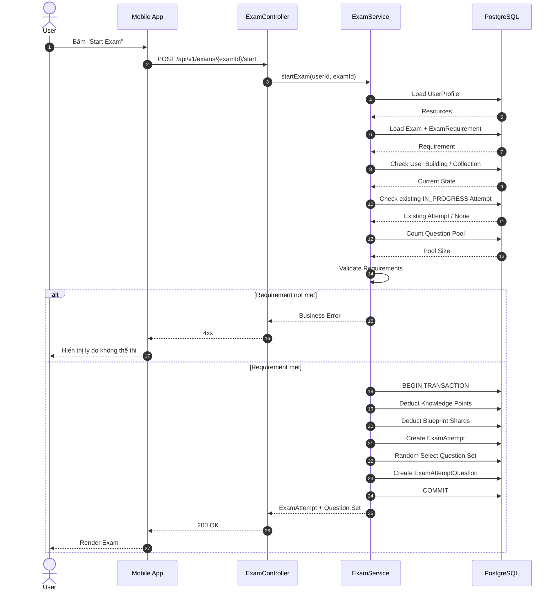
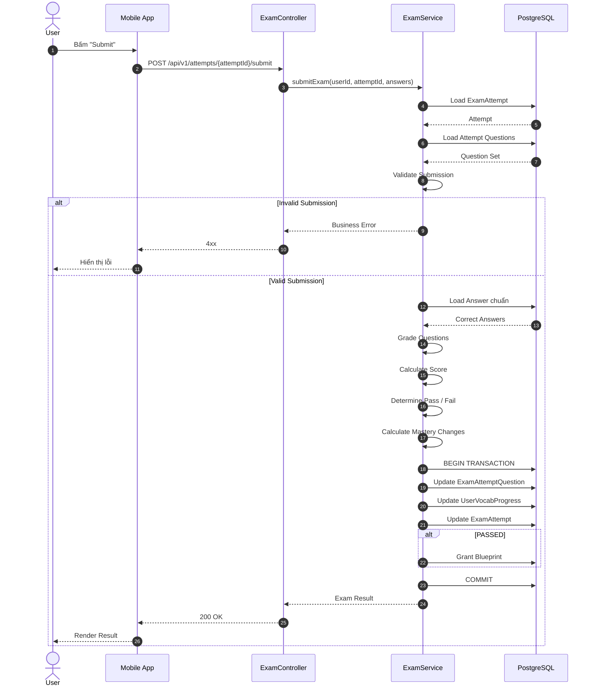
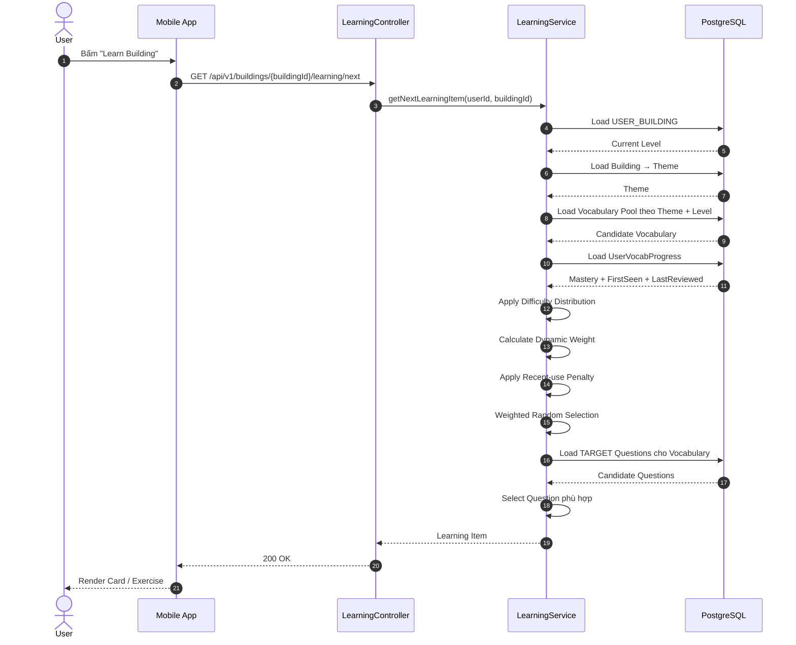
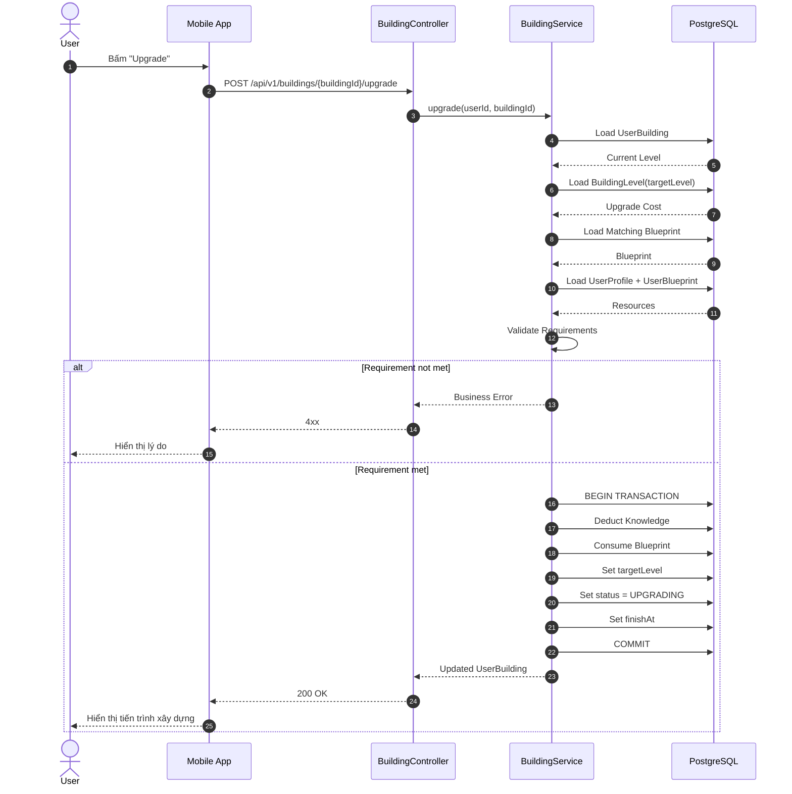

# 2.3 — DATA FLOW & RUNTIME BEHAVIOR

## 2.3.1. Mục tiêu

Phần này mô tả cách các thành phần của LinguaCity vận hành tại Runtime dựa trên Data Model, Database Design và API Contract đã được Freeze ở các phần trước.

Mục tiêu:
- Mô tả luồng dữ liệu giữa Mobile App, Backend và PostgreSQL.
- Mô tả các Business Flow quan trọng của Core Gameplay.
- Xác định rõ phần nào được xử lý ở Client, Domain và Server.
- Bảo đảm các Gameplay-critical action tuân thủ nguyên tắc Server Authority.
- Làm cơ sở để triển khai Repository, UseCase, ViewModel và API ở các giai đoạn tiếp theo.

Kiến trúc Runtime tổng quát:

```text
Jetpack Compose
      ↓
ViewModel / MVI
      ↓
UseCase
      ↓
Repository
      ↓
┌─────┴─────┐
↓           ↓
Room      Retrofit
            ↓
       Spring Boot
            ↓
       PostgreSQL
```

Nguyên tắc chung:

```text
READ
→ Room First

OFFLINE
→ Read-Only

LEARNING / MASTERY
→ Backend First

GAMEPLAY COMMAND
→ Backend First

FINAL STATE
→ PostgreSQL / Server Authority
```

---

# 2.3.2. Start Exam Flow

## Mục tiêu

Start Exam là một Gameplay Command. Mobile chỉ gửi yêu cầu; Backend chịu trách nhiệm kiểm tra điều kiện, trừ tài nguyên, tạo Attempt và sinh Question Set.

## 2.3.2.1. Preconditions

Trước khi Start Exam, Backend phải xác minh:

```text
1. User tồn tại.
2. Exam tồn tại.
3. Building liên quan hợp lệ.
4. User không có ExamAttempt IN_PROGRESS cho Exam này.
5. User đạt required_card_count.
6. User có đủ Knowledge Points.
7. User có đủ Blueprint Shards.
8. Question Pool có ít nhất question_count câu khả dụng.
```

## 2.3.2.2. Sequence Diagram



## 2.3.2.3. Transaction Rules

Các thao tác sau phải thuộc cùng một Server Transaction:

```text
Check / Lock relevant state
        ↓
Deduct Entry Cost
        ↓
Create ExamAttempt
        ↓
Create ExamAttemptQuestion
        ↓
COMMIT
```

Nếu bất kỳ bước nào thất bại:

```text
ROLLBACK
```

Không được xảy ra trạng thái:

```text
Resource đã bị trừ
nhưng Attempt chưa được tạo
```

## 2.3.2.4. Question Set Generation

`EXAM_QUESTION` là Question Pool.

Ví dụ:

```text
Exam Pool
= 30 Questions

EXAM.question_count
= 10
```

Backend chọn 10 Questions cho Attempt hiện tại.

Mỗi Attempt có thể nhận một tổ hợp khác nhau:

```text
Attempt #501
→ Q01 Q04 Q07 Q09 ...

Attempt #502
→ Q02 Q05 Q08 Q11 ...
```

`question_order` chỉ được lưu trong `EXAM_ATTEMPT_QUESTION`.

---

# 2.3.3. Submit Exam Flow

## Mục tiêu

Submit Exam là bước chấm điểm chính thức. Backend giữ Answer chuẩn và quyết định Pass/Fail.

## 2.3.3.1. Request

```http
POST /api/v1/attempts/{attemptId}/submit
```

Ví dụ:

```json
{
  "answers": [
    {
      "questionId": 31,
      "answerPayload": "A"
    },
    {
      "questionId": 32,
      "answerPayload": {
        "left": "negotiate",
        "right": "đàm phán"
      }
    }
  ]
}
```

## 2.3.3.2. Validation

Backend phải kiểm tra:

```text
1. Attempt tồn tại.
2. Attempt thuộc User hiện tại.
3. Attempt.status = IN_PROGRESS.
4. Attempt chưa được Submit trước đó.
5. Tất cả Question thuộc Attempt.
6. Số Answer hợp lệ.
7. Tất cả Question bắt buộc đã có Answer.
8. AnswerPayload đúng format của QuestionType.
```

Nếu:

```text
submitted_answer_count != EXAM.question_count
```

thì trả lỗi:

```text
INCOMPLETE_EXAM_SUBMISSION
```

## 2.3.3.3. Sequence Diagram



## 2.3.3.4. Pass

Nếu đạt điều kiện Pass:

```text
ExamAttempt.status = PASSED
completed_at = now()
```

và:

```text
USER_BLUEPRINT.quantity += reward_quantity
```

Blueprint được lấy từ:

```text
EXAM.reward_blueprint_id
```

Không random Blueprint Reward.

## 2.3.3.5. Fail

Nếu Fail:

```text
ExamAttempt.status = FAILED
completed_at = now()
```

Không:

```text
Refund Entry Cost
Grant Blueprint
Reset Collection
Reset Mastery
```

Người chơi có thể thi lại bằng một `EXAM_ATTEMPT` mới.

---

# 2.3.4. Retry Exam Flow

Retry không sửa Attempt cũ.

Ví dụ:

```text
Attempt #501
→ FAILED
```

Khi User Retry:

```text
POST /api/v1/exams/{examId}/start
```

Backend tạo:

```text
Attempt #502
→ IN_PROGRESS
```

và sinh Question Set mới từ cùng Question Pool.

Flow:

```text
Attempt #501
      ↓
FAILED
      ↓
Retry
      ↓
Check Requirement Again
      ↓
Create Attempt #502
      ↓
Generate New Question Set
```

Attempt cũ được giữ nguyên nhằm phục vụ:
- Exam History.
- Debugging.
- Learning Analytics.
- AI Recommendation trong tương lai.

---

# 2.3.5. Vocabulary Learning Flow

## Mục tiêu

Đây là Learning Loop cốt lõi của LinguaCity, nối trực tiếp:

```text
Building / Theme
        ↓
Vocabulary Pool
        ↓
Vocabulary Card
        ↓
Question / Exercise
        ↓
Backend Grading
        ↓
Mastery Update
```

Trong MVP, **Learning là Online Operation**.

Người dùng có thể đọc các Vocabulary Card đã được cache trong Room khi Offline, nhưng không thể thực hiện hoạt động làm thay đổi Mastery khi không có mạng.

## 2.3.5.1. Learning Item Selection

Khi User bấm "Learn" tại một Building, Mobile gửi Request lên Backend:

```http
GET /api/v1/buildings/{buildingId}/learning/next
```

Backend thực hiện:

```text
Load USER_BUILDING
        ↓
Xác định Current Level
        ↓
Load Building
        ↓
Load Theme
        ↓
Load Vocabulary Pool
        ↓
Load UserVocabProgress
        ↓
Apply Difficulty Distribution
        ↓
Calculate Dynamic Weight
        ↓
Apply Recency Penalty
        ↓
Weighted Random Selection
        ↓
Select Vocabulary
        ↓
Select TARGET Question phù hợp
        ↓
Return Learning Item
```

## 2.3.5.2. Sequence Diagram



## 2.3.5.3. Card Selection Pipeline

```text
Building
   ↓
Current Level
   ↓
Theme
   ↓
Vocabulary Pool
   ↓
Difficulty Distribution
   ↓
Mastery Weight
   ↓
Recency Penalty
   ↓
Weighted Random
   ↓
Selected Vocabulary
```

Ví dụ:

```text
Level 1
D = 100%

Level 2
D = 70%
C = 30%
```

Các giá trị cụ thể của các Level cao hơn thuộc **Game Balance Configuration** và chưa Freeze ở Data Model.

## 2.3.5.4. Question Selection

Sau khi Vocabulary được chọn:

```text
Vocabulary
    ↓
QUESTION_VOCABULARY
    ↓
TARGET Questions
    ↓
Question Type / Skill
    ↓
Selected Exercise
```

MVP tập trung vào:

```text
READING
WRITING

MULT_CHOICE
FILL_BLANK
```

Các Mini-game khác có thể được hỗ trợ trong tương lai thông qua:

```text
QUESTION.question_type
QUESTION.metadata
```

## 2.3.5.5. Learning Item Response

Ví dụ:

```json
{
  "vocabulary": {
    "id": 101,
    "word": "negotiate",
    "meaning": "đàm phán",
    "ipa": "/nɪˈɡoʊʃieɪt/",
    "difficultyRank": "D"
  },
  "question": {
    "id": 501,
    "questionType": "MULT_CHOICE",
    "skill": "READING",
    "questionText": "What does negotiate mean?",
    "metadata": {
      "options": [
        {
          "key": "A",
          "text": "To discuss"
        },
        {
          "key": "B",
          "text": "To cancel"
        }
      ]
    }
  }
}
```

Response **không chứa đáp án đúng**.

Backend giữ Answer chuẩn để thực hiện Server-side Grading.

## 2.3.5.6. Offline Behavior

Khi không có mạng:

```text
Room
  ↓
Cached Vocabulary
  ↓
Flashcard Read-only
```

Người dùng có thể:

```text
Xem Word
Xem Meaning
Xem IPA
Xem Examples
Xem Image
Xem Mastery hiện tại
```

Nhưng không thể:

```text
Answer Question
      ↓
Mastery Update
```

Mastery chỉ thay đổi thông qua một hoạt động học tập có chấm điểm được Backend xử lý.

## 2.3.5.7. Learning Result

```text
User Answer
     ↓
POST /api/v1/learning/answer
     ↓
Backend Grading
     ↓
Correct / Wrong
     ↓
Mastery Update
     ↓
Response
     ↓
Room Update
     ↓
UI Recompose
```

Chi tiết logic cập nhật Mastery được mô tả tại `2.3.6`.

---

# 2.3.6. Learning Result → Mastery Update

## 2.3.6.1. Nguyên tắc

Mastery chỉ thay đổi khi User thực hiện một hoạt động học tập có chấm điểm.

Không tự tăng Mastery khi:
- Mở Flashcard.
- Đọc Vocabulary.
- Xem Meaning.
- Xem IPA.
- Xem Example.

Offline Read-Only không làm thay đổi Mastery.

## 2.3.6.2. Sequence

```text
User Answer
     ↓
Learning API
     ↓
Backend Grading
     ↓
Correct / Wrong
     ↓
MasteryEngine
     ↓
USER_VOCAB_PROGRESS
     ↓
API Response
     ↓
Room Update
```

## 2.3.6.3. Mastery Rule

MVP:

```text
Correct → +1
Wrong   → -1
```

Boundary:

```text
0 ≤ mastery_score ≤ max_mastery
```

Trong đó `max_mastery` phụ thuộc Difficulty Rank.

Các giá trị cụ thể chưa được Freeze trong Data Model.

## 2.3.6.4. First Seen / Review Timestamp

Nếu Vocabulary chưa có `UserVocabProgress`:

```text
first_seen_at = now()
last_reviewed_at = now()
```

Nếu Vocabulary đã tồn tại:

```text
last_reviewed_at = now()
```

`first_seen_at` không thay đổi sau lần đầu.

## 2.3.6.5. Mastered

Nếu:

```text
mastery_score = max_mastery
```

Vocabulary được coi là:

```text
MASTERED
```

ở Domain Layer.

Không cần lưu thêm cột `status` vào Database.

## 2.3.6.6. Server Authority

Backend là nơi tính Mastery chính thức.

Mobile không được gửi:

```json
{
  "masteryScore": 8
}
```

để yêu cầu Server chấp nhận.

Mobile chỉ gửi:

```json
{
  "questionId": 501,
  "answerPayload": "A"
}
```

Backend tự tính:

```text
Current Mastery
       +
Correct / Wrong
       ↓
New Mastery
```

Sau đó trả kết quả về Mobile để cập nhật Room.

---

# 2.3.7. Learning Analytics Flow

## Mục tiêu

Learning Analytics được tách biệt khỏi AI.

AI không tự quyết định trạng thái dữ liệu gốc. Hệ thống trước tiên tạo ra Analytics có tính xác định từ kết quả học tập.

## 2.3.7.1. Phạm vi MVP

Trong MVP, Analytics được suy ra từ các kết quả học tập đã được Backend lưu nhận.

Đối với Exam:

```text
EXAM_ATTEMPT_QUESTION
        ↓
QUESTION
        ↓
QUESTION_VOCABULARY
        ↓
TARGET Vocabulary
        ↓
USER_VOCAB_PROGRESS
        ↓
Learning Analytics
```

Learning Session thông thường có thể cập nhật `USER_VOCAB_PROGRESS`, nhưng dữ liệu lịch sử chi tiết của từng Learning Session chưa được lưu thành một Entity/Attempt riêng trong MVP.

Nếu Phase sau cần Analytics toàn bộ lịch sử Learning Session, có thể bổ sung Learning Event/Attempt riêng mà không thay đổi Core Vocabulary Model.

## 2.3.7.2. Phân loại kết quả

### Chưa học + Trả lời đúng

Trạng thái trước Attempt:

```text
first_seen_at = NULL
```

và:

```text
is_correct = TRUE
```

→ `NEWLY_LEARNED`

### Đã học + Trả lời sai

```text
first_seen_at != NULL
AND
is_correct = FALSE
```

→ `NEEDS_REVIEW`

### Chưa học + Trả lời sai

```text
first_seen_at = NULL
AND
is_correct = FALSE
```

→ `NEEDS_LEARNING`

## 2.3.7.3. AI Layer trong tương lai

```text
Raw Learning Data
        ↓
Deterministic Learning Analytics
        ↓
Recommendation / Weakness Detection
        ↓
AI Summary
```

Ví dụ:

```text
NEWLY_LEARNED
→ "Bạn vừa học thêm 3 từ mới."

NEEDS_REVIEW
→ "Bạn nên ôn lại 4 từ đã học nhưng trả lời sai."

NEEDS_LEARNING
→ "Bạn chưa nắm 2 từ mới xuất hiện trong bài thi."
```

AI không được trực tiếp thay đổi:

```text
mastery_score
exam_result
knowledge_points
blueprint_reward
building_level
```

Không cần tạo `AI_ANALYTICS` Table cho MVP.

---

# 2.3.8. Building Upgrade Flow

## Mục tiêu

Building Upgrade nối Learning Loop với City Loop:

```text
Mastery
   ↓
Exam
   ↓
Blueprint
   ↓
Knowledge Points
   ↓
Building Upgrade
```

## 2.3.8.1. Preconditions

Backend kiểm tra:

```text
1. UserBuilding tồn tại.
2. Building đã được Unlock.
3. Building không ở trạng thái UPGRADING.
4. Current Level hợp lệ.
5. Target Level tồn tại.
6. User có đủ Knowledge Points.
7. User có Blueprint tương ứng với Target Level.
```

## 2.3.8.2. Sequence



## 2.3.8.3. Blueprint Rule

Ví dụ:

```text
Housing Lv1
     ↓
Upgrade → Lv2
     ↓
Need:
Blueprint_Housing_Lv2
```

Không dùng Blueprint chung chung.

Blueprint là Definition cụ thể của:

```text
Building + Target Level
```

## 2.3.8.4. Complete Upgrade

Khi đạt `finish_at`:

```text
current_level = target_level
target_level = NULL
status = IDLE
```

MVP có thể để Client gọi:

```http
POST /api/v1/buildings/{buildingId}/complete
```

nhưng Server phải sử dụng Server Time để kiểm tra `finish_at`.

Client không được tự quyết định:

```text
current_level
finish_at
```

---

# 2.3.9. Resource Flow

LinguaCity sử dụng ba Resource chính:

```text
Knowledge Points
Blueprint Shards
Blueprint
```

## 2.3.9.1. Knowledge Points

MVP Core:

```text
Knowledge Points
        ↓
Building Upgrade
```

Các Resource thay đổi Gameplay phải được Server tính toán.

## 2.3.9.2. Blueprint Shards

Blueprint Shards là Resource dùng chung để đáp ứng Exam Requirement:

```text
Exam Requirement
        ↓
required_blueprint_shards
        ↓
Start Exam
        ↓
Consume Shards
```

Nếu User Fail:

```text
No Refund
```

## 2.3.9.3. Blueprint

Blueprint là phần thưởng cụ thể sau khi Pass Exam:

```text
Exam
 ↓
reward_blueprint_id
 ↓
USER_BLUEPRINT.quantity += reward_quantity
```

Blueprint sau đó được dùng khi Upgrade Building.

---

# 2.3.10. Flashcard / Vocabulary Collection Flow

Flashcard là giao diện tổng hợp các Vocabulary User đã gặp.

```text
Vocabulary
      ↓
UserVocabProgress tồn tại
      ↓
Collection
```

Collection có thể hiển thị:

```text
Word
Meaning
IPA
Examples
Difficulty Rank
Mastery Score
Max Mastery
First Seen
Last Reviewed
```

### Offline

Flashcard Collection có thể đọc từ Room:

```text
Room
 ↓
Flow
 ↓
Flashcard Screen
```

Mastery hiển thị là Mastery gần nhất được Server xác nhận.

Không có thao tác tự tăng Mastery từ Flashcard.

---

# 2.3.11. Runtime State Update

Sau một Server-authoritative operation thành công:

```text
API Response
     ↓
Response DTO
     ↓
Mapper
     ↓
Room Transaction
     ↓
Room Flow
     ↓
ViewModel
     ↓
UI Recompose
```

Ví dụ Pass Exam có thể thay đổi đồng thời:

```text
ExamAttempt
UserBlueprint
UserProfile
UserVocabProgress
```

Các Entity liên quan phải được cập nhật trong một Room Transaction.

Không cập nhật từng Entity rời rạc nếu có nguy cơ UI quan sát thấy trạng thái trung gian không nhất quán.

---

# 2.3.12. Error & Failure Flow

## Network Error

```text
UI
 ↓
Repository
 ↓
Network Failure
 ↓
Domain Error
 ↓
ViewModel
 ↓
UI Error State
```

Ví dụ:

```text
Không có Internet
→ "Không thể kết nối máy chủ."
```

## Business Error

Ví dụ:

```text
Không đủ Knowledge
```

Backend trả:

```text
INSUFFICIENT_KNOWLEDGE
```

Repository map thành:

```text
Validation("INSUFFICIENT_KNOWLEDGE")
```

UI hiển thị thông báo phù hợp.

## Offline Read

Nếu Offline nhưng Room đã có Vocabulary:

```text
Network = OFF
      ↓
Room available
      ↓
Flashcard vẫn hoạt động
```

Nếu dữ liệu chưa từng được cache:

```text
Network = OFF
      ↓
No Local Data
      ↓
UI hiển thị Empty / Offline state
```

---

# 2.3.13. Tổng hợp Core Runtime Loop

LinguaCity có hai vòng lặp liên kết.

## Learning Loop

```text
Building
   ↓
Theme
   ↓
Vocabulary
   ↓
Question
   ↓
Answer
   ↓
Backend Grading
   ↓
Mastery +1 / -1
   ↓
Vocabulary Progress
```

## City Loop

```text
Mastery / Collection
       ↓
Exam Requirement
       ↓
Start Exam
       ↓
Pass
       ↓
Blueprint
       ↓
Knowledge + Blueprint
       ↓
Building Upgrade
       ↓
Next Level
       ↓
New Vocabulary
       ↓
...
```

Hai vòng lặp kết hợp thành Core Loop:

```text
Learn
  ↓
Master Vocabulary
  ↓
Pass Exam
  ↓
Receive Blueprint
  ↓
Upgrade City
  ↓
Unlock Next Level
  ↓
Learn New Vocabulary
  ↓
...
```

Đây là nguyên tắc Product Core:

> **Tiến bộ học tập trực tiếp quyết định tiến bộ của thành phố.**

---

# 2.3.14. Runtime Architecture Summary

```text
                         MOBILE
                           │
                           ↓
                    ViewModel / MVI
                           │
                           ↓
                         UseCase
                           │
                           ↓
                      Repository
                           │
                  ┌────────┴────────┐
                  ↓                 ↓
                Room             Retrofit
                  │                 │
                  │                 ↓
                  │            Spring Boot
                  │                 │
                  │                 ↓
                  │            PostgreSQL
                  │
                  ↓
               UI State
                  ↓
              Compose UI
```

### Offline

```text
Room
 ↓
Read Vocabulary / Flashcard
 ↓
UI
```

### Learning

```text
User Answer
 ↓
Backend
 ↓
Grading
 ↓
Mastery +1 / -1
 ↓
Room
 ↓
UI
```

### Exam

```text
Start Exam
 ↓
Backend
 ↓
Question Set
 ↓
Room Snapshot
 ↓
Submit
 ↓
Backend
 ↓
Pass / Fail
 ↓
Blueprint / No Reward
 ↓
Room
```

### Upgrade

```text
Upgrade
 ↓
Backend Transaction
 ↓
Resource + Building State
 ↓
Room
```

---

# 2.3.15. Definition of Done — Runtime Flow

Phần Runtime Behavior được xem là hoàn thiện khi:

```text
✅ Start Exam được xử lý Server-side.
✅ Question Pool và Exam Attempt được tách biệt.
✅ Retry tạo Attempt mới.
✅ Learning Item được chọn dựa trên Theme, Level, Mastery và Difficulty.
✅ Question được lấy từ Centralized Question Bank.
✅ Mastery chỉ thay đổi sau hoạt động có chấm điểm.
✅ Correct = +1, Wrong = -1.
✅ Mastery có Boundary theo max_mastery.
✅ Offline chỉ hỗ trợ Read-only Flashcard/Vocabulary.
✅ Submit Exam được Server chấm.
✅ Blueprint Reward do Server quyết định.
✅ Building Upgrade do Server quyết định.
✅ Room cập nhật sau Authoritative Response.
✅ Learning Analytics không phụ thuộc trực tiếp vào AI.
✅ AI không sửa dữ liệu Gameplay-critical.
```

---

# 2.3.16. Trạng thái thiết kế

| Hạng mục | Trạng thái |
|---|---|
| Start Exam Flow | ✅ Freeze |
| Submit Exam Flow | ✅ Freeze |
| Exam Retry | ✅ Freeze |
| Vocabulary Learning Flow | ✅ Freeze |
| Mastery Update | ✅ Freeze |
| Learning Analytics Foundation | ✅ Freeze |
| Building Upgrade Flow | ✅ Freeze |
| Resource Flow | ✅ Freeze |
| Flashcard Collection | ✅ Freeze |
| Offline Read-only | ✅ Freeze |
| Runtime State Update | ✅ Freeze |
| Error / Failure Flow | ✅ Baseline |
| AI Analytics | ⏳ Future |
| Adaptive Learning nâng cao | ⏳ Future |
| Spaced Repetition | ⏳ Future |
| Listening / Speaking | ⏳ Phase 2 |

---

# 2.3.17. Kết luận

Runtime Architecture của LinguaCity được thiết kế theo nguyên tắc:

```text
Room
→ Local Read / UI State

Backend
→ Learning Grading / Gameplay Authority

PostgreSQL
→ Global Authoritative State
```

MVP sử dụng **Offline Read-Only**:

```text
Offline
→ đọc Vocabulary / Flashcard đã cache
```

Các thao tác làm thay đổi Mastery hoặc Gameplay:

```text
Learning Answer
Exam
Building Upgrade
Resource Change
Blueprint Reward
```

đều phải đi qua Backend.

Sau `2.3`, hệ thống đã xác định được cách **Data Model → API → Runtime Flow → Room Update** liên kết với nhau.
