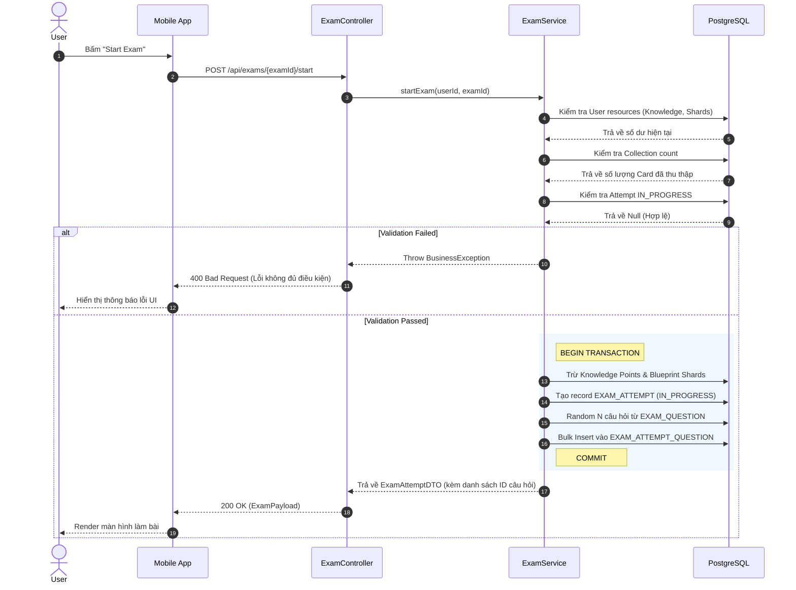
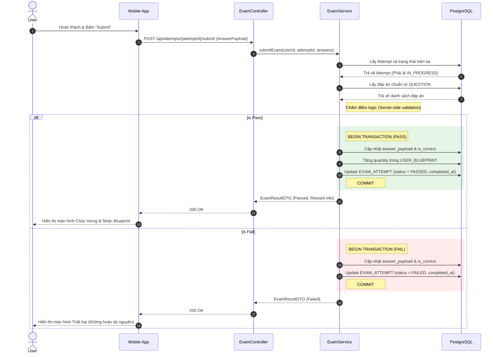

# LINGUACITY — 02. SYSTEM DESIGN

**Tên dự án:** LinguaCity (Thành phố Ngôn ngữ)  
**Loại tài liệu:** System Design / Architecture Design  
**Giai đoạn:** Giai đoạn 2 — Thiết kế Hệ thống  
**Trạng thái:** Đang thực hiện  
**Phiên bản:** 0.3 — Freeze Exam / Blueprint / Attempt Data Model + 2.2.1–2.2.2  
**Ngày cập nhật:** 22/08/2026  

---

# 1. Mục đích tài liệu

File này là tài liệu trung tâm của **Giai đoạn 2 — System Design**.

Mục tiêu của tài liệu là chuyển các yêu cầu đã được chốt trong `01_Requirements_Analysis.md` thành thiết kế kỹ thuật có thể triển khai được, đồng thời lưu lại toàn bộ các quyết định kiến trúc đã được thống nhất trong quá trình phân tích.

Tài liệu được xây dựng theo hướng:

```text
Requirements
      ↓
System Design
      ↓
Implementation
      ↓
Testing
```

Trong đó:

- File 01 trả lời: **Hệ thống phải làm gì?**
- File 02 trả lời: **Hệ thống sẽ được thiết kế như thế nào?**
- File 03 sẽ ghi lại: **Thiết kế đã được triển khai thành code như thế nào?**

File này hiện chưa phải bản System Design hoàn chỉnh. Trước mắt, tài liệu lưu giữ toàn bộ nội dung đã được chốt ở **2.1 — Domain & Data Model** và **2.1.5 — Freeze Data Dictionary + Vocabulary Card System**, tránh thất thoát quyết định khi tiếp tục phát triển.

---

# 2. Trạng thái Giai đoạn 2

## 2.1. Tiến độ hiện tại

| Hạng mục | Trạng thái |
|---|---|
| 2.1 Domain Entities | ✅ Đã chốt |
| 2.1.5 Data Dictionary + Vocabulary Card System | ✅ Đã chốt |
| 2.2 ERD + Constraints | 🟡 2.2.1–2.2.2 đã hoàn thiện |
| 2.3 Data Flow & Sequence Diagram | ⏳ Chưa bắt đầu |
| 2.4 PostgreSQL / JPA Target Schema | ⏳ Chưa bắt đầu |
| 2.5 API Contract | ⏳ Chưa bắt đầu |
| 2.6 Room Schema + DAO | ⏳ Chưa bắt đầu |
| 2.7 Repository + Sync Design | ⏳ Chưa bắt đầu |
| 2.8 MVI + Navigation Design | ⏳ Chưa bắt đầu |
| 2.9 UI/UX Wireframe | ⏳ Chưa bắt đầu |

---

# 3. 2.1 — DOMAIN ENTITIES

## 3.1. Nguyên tắc phân chia dữ liệu

Dữ liệu của LinguaCity được chia thành hai nhóm chính:

### Static Content

Đây là dữ liệu do hệ thống quản lý. Người chơi chủ yếu đọc dữ liệu này.

```text
Theme
Building
BuildingLevel
Vocabulary
Question
Exam
ExamRequirement
Blueprint
```

### Player State

Đây là dữ liệu thay đổi liên tục theo tiến trình của từng người chơi.

```text
UserProfile
UserBuilding
UserVocabProgress
UserBlueprint
ExamAttempt
ExamAttemptQuestion
```

Nguyên tắc quan trọng:

> Static Content mô tả thế giới và nội dung học tập; Player State mô tả trạng thái hiện tại của từng người chơi trong thế giới đó.

---

# 4. Static Content Entities

## 4.1. Theme

`Theme` là thực thể đại diện cho chủ đề học tập.

### Fields

| Field | Type | Key | Null | Constraint / Notes |
|---|---|---|---|---|
| `id` | Long | PK | NO | Auto Increment |
| `code` | String | UK | NO | Ví dụ `DAILY_LIFE` |
| `name` | String | — | NO | Tên hiển thị |
| `description` | String | — | YES | Mô tả Theme |

### Quan hệ

```text
Theme 1 ─── N Building
Theme 1 ─── N Vocabulary
```

MVP ưu tiên mỗi Building chỉ sử dụng một Theme, nhưng Database không khóa cứng khả năng một Theme được dùng cho nhiều Building.

---

# 5. Building

`Building` chỉ đại diện cho **định nghĩa của một loại công trình**, không lưu trạng thái của một người chơi cụ thể.

### Fields

| Field | Type | Key | Null | Constraint / Notes |
|---|---|---|---|---|
| `id` | Long | PK | NO | Auto Increment |
| `code` | String | UK | NO | `HOUSING`, `ROAD`, `PARK`, `SCHOOL` |
| `theme_id` | Long | FK | NO | References `Theme(id)` |
| `max_level` | Int | — | NO | Level tối đa |

### Nguyên tắc

Không chứa:

```text
user_id
current_level
is_unlocked
status
finish_time
```

Các field trên thuộc Player State và được chuyển sang `UserBuilding`.

---

# 6. Vocabulary

Mỗi Vocabulary là một **Vocabulary Card** tĩnh của hệ thống.

### Fields

| Field | Type | Key | Null | Constraint / Notes |
|---|---|---|---|---|
| `id` | Long | PK | NO | Auto Increment |
| `word` | String | — | NO | Từ vựng |
| `meaning` | String | — | NO | Nghĩa |
| `word_type` | String / Enum | — | NO | Noun, Verb, Adj... |
| `ipa` | String | — | YES | Phiên âm IPA |
| `examples` | JSONB | — | YES | Danh sách câu ví dụ |
| `image_url` | String | — | YES | Hình minh họa |
| `theme_id` | Long | FK | NO | References `Theme(id)` |
| `level` | Int | — | NO | Level xuất hiện |
| `difficulty_rank` | String / Enum | — | NO | `D`, `C`, `B`, `A`, ... |

### Nguyên tắc

Vocabulary không còn gắn trực tiếp với:

```text
buildingType
```

Thay vào đó:

```text
Building → Theme → Vocabulary
```

Điều này giảm coupling giữa nội dung học tập và cấu trúc công trình.

---

# 7. Question

`Question` là thực thể đại diện cho một đơn vị bài tập trong **Centralized Question Bank**.

Một Question không đồng nghĩa với một Vocabulary Card.

Một Vocabulary có thể liên quan tới nhiều Question và một Question có thể kiểm tra nhiều Vocabulary.

### Fields

| Field | Type | Key | Null | Constraint / Notes |
|---|---|---|---|---|
| `id` | Long | PK | NO | Auto Increment |
| `content_type` | Enum | — | NO | `VOCABULARY`, `GRAMMAR` |
| `skill` | Enum | — | NO | `READING`, `WRITING`, `LISTENING`, `SPEAKING` |
| `question_type` | String / Enum | — | NO | Ví dụ `MULT_CHOICE`, `FILL_BLANK`, `MATCHING_GAME`, `SORTING_GAME` |
| `question_text` | Text | — | YES | Nullable vì một số Mini-game không cần câu hỏi dạng text |
| `answer` | Text | — | YES | Đáp án chuẩn, chủ yếu dành cho server-side validation |
| `explanation` | Text | — | YES | Giải thích |
| `audio_url` | String | — | YES | Chuẩn bị cho Listening |
| `metadata` | JSONB | — | YES | Payload đặc thù theo `question_type` |

### Metadata Principle

`metadata` là **typed extension payload**, không phải nơi chứa tùy ý mọi dữ liệu.

Dữ liệu ổn định, cần query/filter/join phải nằm ở các cột quan hệ chuẩn:

```text
content_type
skill
question_type
...
```

Dữ liệu phụ thuộc loại Mini-game nên nằm trong:

```text
metadata JSONB
```

Ví dụ:

### MULT_CHOICE

```json
{
  "options": [
    {"key": "A", "text": "To discuss"},
    {"key": "B", "text": "To cancel"},
    {"key": "C", "text": "To delay"},
    {"key": "D", "text": "To purchase"}
  ]
}
```

### MATCHING_GAME

```json
{
  "pairs": [
    {"id": "p1", "left": "Negotiate", "right": "Đàm phán"},
    {"id": "p2", "left": "Contract", "right": "Hợp đồng"}
  ]
}
```

### SORTING_GAME

```json
{
  "tokens": [
    "contract",
    "negotiate",
    "to",
    "They",
    "decided"
  ]
}
```

### Nguyên tắc bảo mật

Đáp án chuẩn không nên được gửi cho Client trước khi người chơi hoàn thành câu hỏi.

Do đó cần tách:

```text
Question Storage Model
```

và:

```text
Question Gameplay DTO
```

Backend giữ thông tin cần thiết cho validation; Mobile chỉ nhận payload cần để hiển thị và tương tác.

---

# 8. Exam

`Exam` đại diện cho một bài Test sát hạch gắn với một công trình và **Level đích**.

Exam không còn chỉ xác định số lượng Blueprint nhận được. Blueprint mà Exam trả về phải là Blueprint cụ thể tương ứng với công trình và Level cần mở khóa.

### Fields

| Field | Type | Key | Null | Constraint / Notes |
|---|---|---|---|---|
| `id` | Long | PK | NO | Auto Increment |
| `code` | String | UK | NO | Ví dụ `EXAM_HOUSING_LV2` |
| `building_id` | Long | FK | NO | Building mục tiêu |
| `target_level` | Int | — | NO | Level đích |
| `reward_blueprint_id` | Long | FK | NO | Blueprint được nhận khi Pass |
| `question_count` | Int | — | NO | Số Question được chọn cho mỗi Attempt |

### Level Consistency

`target_level` của Exam phải khớp với `target_level` của `reward_blueprint_id` và với `BuildingLevel(building_id, target_level)`.

Ví dụ:

```text
EXAM_HOUSING_LV2
    ↓
target_level = 2
    ↓
BLUEPRINT_HOUSING_LV2
    ↓
BUILDING_LEVEL(HOUSING, 2)
```

### Business Rule

Ví dụ:

```text
EXAM_HOUSING_LV2
      ↓
Housing Level 1
      ↓
Collection đủ
      ↓
Start Exam
      ↓
Pass
      ↓
BLUEPRINT_HOUSING_LV2
      ↓
Upgrade Housing 1 → 2
```

Exam không nên chỉ lưu:

```text
reward_blueprints = 1
```

vì thông tin đó không cho biết Blueprint nào được nhận.

Thay vào đó Exam phải liên kết trực tiếp tới:

```text
BLUEPRINT_HOUSING_LV2
```

### Exam Entry Cost

Khi User bấm Start Exam, hệ thống phải kiểm tra toàn bộ Requirement trước.

```text
Collection đủ
Knowledge Points đủ
Blueprint Shards đủ
Building đúng level hiện tại
```

Nếu không đủ:

```text
Exam không bắt đầu
Không mất tài nguyên
```

Nếu đủ:

```text
BEGIN TRANSACTION

Knowledge Points -= required_knowledge
Blueprint Shards -= required_blueprint_shards
Create ExamAttempt

COMMIT
```

Tài nguyên được xem là đã tiêu thụ ngay tại thời điểm bắt đầu Exam.

### Pass / Fail

```text
PASS
 ↓
Grant reward_blueprint
 ↓
ExamAttempt = PASSED
```

```text
FAIL
 ↓
Không nhận Blueprint
 ↓
Tài nguyên đã nộp không hoàn lại
 ↓
ExamAttempt = FAILED
```

Đây là Business Rule của Game Economy, không phải chỉ là chi tiết implementation.

---

# 9. Blueprint

`Blueprint` là Static Content đại diện cho **quyền nâng một Building lên một Level cụ thể**.

Blueprint phải gắn với cả Building và Target Level để tránh tình trạng một Blueprint chung có thể bị dùng sai cho nhiều công trình hoặc nhiều Level.

### Fields

| Field | Type | Key | Null | Constraint / Notes |
|---|---|---|---|---|
| `id` | Long | PK | NO | Auto Increment |
| `code` | String | UK | NO | Ví dụ `BLUEPRINT_HOUSING_LV2` |
| `building_id` | Long | FK | NO | Building tương ứng |
| `target_level` | Int | — | NO | Level mà Blueprint mở khóa |

### Ví dụ

| id | code | building | target_level |
|---|---|---|---:|
| 1 | `BLUEPRINT_HOUSING_LV2` | Housing | 2 |
| 2 | `BLUEPRINT_HOUSING_LV3` | Housing | 3 |
| 3 | `BLUEPRINT_ROAD_LV2` | Road | 2 |

Như vậy:

```text
Housing Level 2
→ BLUEPRINT_HOUSING_LV2
```

khác hoàn toàn với:

```text
Housing Level 3
→ BLUEPRINT_HOUSING_LV3
```

Blueprint là Static Content; trạng thái User sở hữu Blueprint được lưu riêng ở `UserBlueprint`.

---

# 10. BuildingLevel

`BuildingLevel` định nghĩa requirement để một loại Building đạt đến một Level cụ thể.

Level trong bảng này được hiểu là **Level đích**, không phải Level hiện tại.

### Fields

| Field | Type | Key | Null | Constraint / Notes |
|---|---|---|---|---|
| `building_id` | Long | PK/FK | NO | Building tương ứng |
| `level` | Int | PK | NO | Target Level |
| `knowledge_cost` | Int | — | NO | Knowledge Points cần để bắt đầu nâng cấp |
| `construction_time` | Int / Duration | — | NO | Thời gian xây dựng |

### Composite Key

```text
PK(building_id, level)
```

Ví dụ:

| building | level | knowledge_cost | construction_time |
|---|---:|---:|---:|
| Housing | 1 | 100 | 60s |
| Housing | 2 | 250 | 180s |
| Housing | 3 | 500 | 300s |

Ở đây:

```text
level = 2
```

nghĩa là **nâng công trình lên Level 2**.

Đây là nguồn sự thật cho **chi phí và thời gian nâng cấp**:

> “Muốn nâng Housing từ Level 1 lên Level 2 cần bao nhiêu Knowledge và mất bao lâu?”

Blueprint của Level đích không được lưu trực tiếp trong `BuildingLevel`. Hệ thống xác định Blueprint tương ứng bằng:

```text
BUILDING_LEVEL
(building_id, level)
        ↕
BLUEPRINT
(building_id, target_level)
```

Ví dụ:

```text
Housing + Level 2
        ↓
BLUEPRINT_HOUSING_LV2
```

Do đó quan hệ này không bị lưu lặp ở hai phía.

---

# 11. ExamRequirement

`ExamRequirement` lưu các tài nguyên cần có để bắt đầu một Exam.

### Fields

| Field | Type | Key | Null | Constraint / Notes |
|---|---|---|---|---|
| `id` | Long | PK | NO | Auto Increment |
| `exam_id` | Long | FK | NO | References `Exam(id)` |
| `required_card_count` | Int | — | NO | Collection Count tối thiểu |
| `required_knowledge` | Int | — | NO | Knowledge Points bị tiêu thụ khi Start |
| `required_blueprint_shards` | Int | — | NO | Blueprint Shards bị tiêu thụ khi Start |

### Ví dụ

```text
EXAM_HOUSING_LV2

required_card_count = 40
required_knowledge = 100
required_blueprint_shards = 3
```

Exam chỉ được bắt đầu khi toàn bộ các điều kiện đều thỏa mãn.

---

# 12. ExamAttempt

`ExamAttempt` lưu lại mỗi lần một User thực sự bắt đầu một Exam.

Việc thêm Entity này cần thiết vì Exam đã có **Entry Cost**. Hệ thống phải biết User đã bắt đầu Exam nào, lúc nào và kết quả ra sao.

### Fields

| Field | Type | Key | Null | Constraint / Notes |
|---|---|---|---|---|
| `id` | Long | PK | NO | Auto Increment |
| `user_id` | UUID/String | FK | NO | User thực hiện Exam |
| `exam_id` | Long | FK | NO | Exam được thực hiện |
| `status` | Enum | — | NO | `IN_PROGRESS`, `PASSED`, `FAILED` |
| `started_at` | Timestamp | — | NO | Thời điểm bắt đầu |
| `completed_at` | Timestamp | — | YES | Thời điểm hoàn thành |

### Status

```text
IN_PROGRESS
PASSED
FAILED
```

Nếu app bị đóng trong lúc đang làm bài:

```text
ExamAttempt
status = IN_PROGRESS
```

Backend vẫn biết User có một attempt đang tồn tại.

### Pass Transaction

Khi User hoàn thành Exam, Server xử lý trong một transaction:

```text
BEGIN

Verify ExamAttempt
Verify answers

IF PASS:
    create/update UserBlueprint
    quantity += 1
    status = PASSED

COMMIT
```

Nếu Fail:

```text
status = FAILED
```

Không có bước hoàn trả Entry Cost.

---

# 12.1. ExamAttemptQuestion

`ExamAttemptQuestion` lưu lại **Question Set thực tế** mà User nhận được trong một lần thi, cùng với kết quả của từng Question.

Đây là dữ liệu quan trọng cho:

```text
Exam History
Mastery Update
Learning Analytics
AI Recommendation (future)
```

### Fields

| Field | Type | Key | Null | Constraint / Notes |
|---|---|---|---|---|
| `attempt_id` | Long | PK/FK | NO | ExamAttempt tương ứng |
| `question_id` | Long | PK/FK | NO | Question thực tế được chọn |
| `question_order` | Int | — | NO | Thứ tự Question trong Attempt, bắt đầu từ 1 |
| `answer_payload` | JSONB | — | YES | Câu trả lời User đã chọn/gửi |
| `is_correct` | Boolean | — | YES | Kết quả chấm câu hỏi |
| `answered_at` | Timestamp | — | YES | Thời điểm User hoàn thành câu |

### Composite Key

```text
PK(attempt_id, question_id)
```

Một Question chỉ xuất hiện một lần trong cùng một Attempt.

Ngoài ra:

```text
UNIQUE(attempt_id, question_order)
```

để đảm bảo mỗi vị trí trong Attempt chỉ có một Question.

`question_order` bắt đầu từ `1`.

### Answer Payload

MVP sử dụng `JSONB` để hỗ trợ nhiều loại Question khác nhau:

```text
"A"

"negotiate"

["A", "C", "B"]

{"left":"...", "right":"..."}
```

`response_time_ms` **chưa được đưa vào MVP**.

### Snapshot của Attempt

Luồng dữ liệu:

```text
EXAM
  ↓
EXAM_QUESTION
  ↓
Question Pool
  ↓
Random / Selection
  ↓
EXAM_ATTEMPT_QUESTION
```

Do đó Retry không sửa Attempt cũ mà tạo Attempt mới:

```text
Attempt #501 → FAILED
        ↓
      Retry
        ↓
Attempt #502 → Question Set mới
```

Attempt cũ được giữ nguyên để phục vụ lịch sử và Analytics.

---

# 13. Player State Entities

## 13.1. UserProfile

`UserProfile` là root entity của Player State.

### Fields

| Field | Type | Key | Null | Default |
|---|---|---|---|---|
| `id` | UUID/String | PK | NO | Client-generated |
| `knowledge_points` | Int | — | NO | 0 |
| `hourglass_count` | Int | — | NO | 0 |
| `blueprint_shards` | Int | — | NO | 0 |

`full_blueprints` được loại bỏ khỏi `UserProfile` vì Blueprint Inventory hiện được quản lý tập trung bằng `UserBlueprint`.

### Identity

MVP không có Login/JWT. Mobile sinh UUID khi tạo Guest User.

```text
Android
   ↓
Generate UUID
   ↓
Store locally
   ↓
Create Guest User on Backend when sync is available
```

---

# 14. UserBuilding

`UserBuilding` biểu diễn trạng thái của một Building đối với từng người chơi.

### Fields

| Field | Type | Key | Null | Default |
|---|---|---|---|---|
| `id` | Long | PK | NO | Auto Increment |
| `user_id` | UUID/String | FK | NO | — |
| `building_id` | Long | FK | NO | — |
| `current_level` | Int | — | NO | 0 |
| `target_level` | Int | — | YES | NULL |
| `is_unlocked` | Boolean | — | NO | false |
| `status` | Enum | — | NO | `IDLE` |
| `started_at` | Timestamp | — | YES | — |
| `finish_at` | Timestamp | — | YES | — |

### Unique Constraint

```text
UNIQUE(user_id, building_id)
```

### Status

```text
IDLE
UPGRADING
```

`status`, `started_at`, `finish_at` và `target_level` thuộc Player State vì mỗi người chơi có thể đang nâng cấp một công trình khác nhau.

### Upgrade Flow

Ví dụ User đang có:

```text
Housing
current_level = 1
```

Khi bấm Upgrade, Backend lấy:

```text
BUILDING_LEVEL
building = HOUSING
level = 2
```

Sau đó kiểm tra:

```text
Knowledge Points >= 250
AND
UserBlueprint(BLUEPRINT_HOUSING_LV2) >= 1
```

Nếu đủ:

```text
BEGIN TRANSACTION

Knowledge Points -= 250
Blueprint_HOUSING_LV2 -= 1
current_level = 1
target_level = 2
status = UPGRADING

COMMIT
```

Khi hoàn thành:

```text
current_level = 2
target_level = NULL
status = IDLE
```

Blueprint không được lưu trực tiếp trong `UserBuilding`.

---

# 15. UserBlueprint

`UserBlueprint` lưu Inventory Blueprint mà từng User đang sở hữu.

### Fields

| Field | Type | Key | Null | Default |
|---|---|---|---|---|
| `id` | Long | PK | NO | Auto Increment |
| `user_id` | UUID/String | FK | NO | — |
| `blueprint_id` | Long | FK | NO | — |
| `quantity` | Int | — | NO | 0 |

### Unique Constraint

```text
UNIQUE(user_id, blueprint_id)
```

Ví dụ:

```text
User A
├── BLUEPRINT_HOUSING_LV2 → 1
├── BLUEPRINT_ROAD_LV2    → 2
└── BLUEPRINT_HOUSING_LV3 → 0
```

`UserBlueprint` chỉ lưu trạng thái sở hữu. Thông tin Blueprint dùng cho Level nào đã được định nghĩa ở Static Content `Blueprint`.

---

# 16. UserVocabProgress

`UserVocabProgress` lưu trạng thái của một Vocabulary Card đối với từng User.

### Fields

| Field | Type | Key | Null | Meaning |
|---|---|---|---|---|
| `id` | Long | PK | NO | Auto Increment |
| `user_id` | UUID/String | FK | NO | User |
| `vocabulary_id` | Long | FK | NO | Vocabulary |
| `mastery_score` | Int | — | NO | Điểm Mastery hiện tại |
| `first_seen_at` | Timestamp | — | YES | Lần đầu gặp Card |
| `last_reviewed_at` | Timestamp | — | YES | Lần học gần nhất |

### Unique Constraint

```text
UNIQUE(user_id, vocabulary_id)
```

### Collection

Một Card được coi là **Collected** khi:

```text
first_seen_at != NULL
```

Do đó:

```text
Collected Count
=
COUNT(first_seen_at IS NOT NULL)
```

Không tạo thêm Card khi cùng Vocabulary xuất hiện lại.

# 17. 2.1.5 — FREEZE DATA DICTIONARY + VOCABULARY CARD SYSTEM

## 17.1. Vocabulary Card

Mỗi Vocabulary là một Card duy nhất đối với mỗi người chơi.

Ví dụ:

```text
Vocabulary:
negotiate

→ Card #001 của User A
```

Nếu Card xuất hiện lại, không tạo Card mới.

Lần xuất hiện đầu tiên:

```text
Collected +1
```

Các lần tiếp theo:

```text
Collected không đổi
Mastery thay đổi
```

---

# 18. Collection Progress vs Mastery Progress

Hai tiến trình được tách biệt hoàn toàn.

## Collection Progress

Đo số Card người chơi đã từng gặp.

Ví dụ Level 1 có 40 Card:

```text
32 / 40
```

## Mastery Progress

Đo mức độ thông thạo của từng Card.

Ví dụ:

```text
negotiate → 8 / 10
contract  → 3 / 10
schedule  → 10 / 10
```

Hai khái niệm này không được gộp thành một phần trăm duy nhất.

---

# 19. Mastery Score

Mỗi Card có:

```text
mastery_score
max_mastery
```

Trong MVP:

```text
Correct Answer → mastery_score + 1
Wrong Answer   → mastery_score - 1
```

### Boundary Rule

```text
0 ≤ mastery_score ≤ max_mastery
```

Nếu trả lời sai khi:

```text
mastery_score = 0
```

thì vẫn:

```text
0
```

Không có giá trị âm.

Nếu trả lời đúng khi:

```text
mastery_score = max_mastery
```

thì vẫn giữ:

```text
max_mastery
```

Không vượt giới hạn.

---

# 20. Difficulty Rank

Mỗi Vocabulary Card có Difficulty Rank:

```text
D → C → B → A → ...
```

Rank và Mastery là hai khái niệm khác nhau:

```text
Difficulty Rank
= độ khó của nội dung

Mastery Score
= mức độ người chơi đã thông thạo nội dung
```

Ví dụ:

```text
negotiate
Rank = C
Mastery = 8 / 15
```

---

# 21. Max Mastery theo Rank

Mỗi Rank có `max_mastery` riêng.

Ví dụ cấu hình có thể là:

```text
D → 10
C → 15
B → 20
A → 25
```

Đây là **Game Balance Configuration**, chưa đóng băng các giá trị số cụ thể trong SRS.

Không hardcode các giá trị này trực tiếp vào Database Schema.

---

# 22. Difficulty Distribution theo Level

Tỷ lệ Card được lựa chọn theo Rank thay đổi theo Level.

Ví dụ đã chốt:

```text
Level 1
D = 100%

Level 2
D = 70%
C = 30%
```

Các Level cao hơn sẽ tiếp tục được cấu hình sau khi prototype được kiểm thử.

Đây là **Content Selection Rule / Game Balance**, không phải Player State.

---

# 23. Weighted Random Card Selection

Khi người chơi bấm:

```text
Learn Building
```

hệ thống thực hiện:

```text
Building
   ↓
Theme
   ↓
Level
   ↓
Candidate Vocabulary Cards
   ↓
Difficulty Distribution
   ↓
Mastery Weight
   ↓
Recency Weight
   ↓
Weighted Random
   ↓
Selected Card
```

### Weight

Weight không được lưu cố định trong `UserVocabProgress`.

Weight được tính động dựa trên ít nhất:

```text
Difficulty
+
Mastery
+
Recency
```

Mục tiêu:

- Card mới hoặc yếu → dễ xuất hiện hơn.
- Card đã thành thạo → xuất hiện ít hơn.
- Card vừa xuất hiện → bị giảm khả năng xuất hiện liên tiếp.

---

# 24. Recent-use Penalty / Cooldown

Card vừa xuất hiện không nên lập tức xuất hiện lại liên tục.

Do đó cần một cơ chế recent-use penalty/cooldown.

Thông tin cần thiết có thể lấy từ:

```text
last_reviewed_at
```

Trong MVP chưa đóng băng công thức chính xác.

---

# 25. MASTERED

Một Card được coi là:

```text
MASTERED
```

khi:

```text
mastery_score = max_mastery
```

Không cần lưu một giá trị `status = MASTERED` riêng nếu có thể derive từ Mastery.

Conceptual state:

```text
0
↓
LEARNING
↓
max_mastery
↓
MASTERED
```

---

# 26. Learning Session

Khi người chơi bấm học, hệ thống tạo một Learning Session ở tầng Domain.

Learning Session có thể chứa:

```text
theme
level
candidate_cards
current_card
cards_seen
```

MVP chưa yêu cầu `LearningSession` phải trở thành Database Table.

Nó có thể là Domain Model dùng trong một phiên học.

---

# 27. Question và Vocabulary

Hai Entity có trách nhiệm khác nhau:

```text
Vocabulary
= Card / kiến thức

Question
= bài tập kiểm tra kiến thức
```

Do đó cần quan hệ:

```text
Question
   ↕
QuestionVocabulary
   ↕
Vocabulary
```

`QuestionVocabulary` được thiết kế như một **Supporting Entity**, vì một Question có thể kiểm tra nhiều Vocabulary và một Vocabulary có thể có nhiều Question.

### Fields

| Field | Type | Key | Null | Constraint / Notes |
|---|---|---|---|---|
| `question_id` | Long | PK/FK | NO | Question được liên kết |
| `vocabulary_id` | Long | PK/FK | NO | Vocabulary được liên kết |
| `relation_type` | Enum | — | NO | `TARGET`, `CONTEXT` |

### Composite Key

```text
PK(question_id, vocabulary_id)
```

`relation_type` giúp phân biệt Vocabulary đang được **kiểm tra trực tiếp** hay chỉ xuất hiện trong ngữ cảnh của Question.

Ví dụ:

```text
Question:
"The company decided to negotiate a contract."

negotiate → TARGET
contract  → CONTEXT
```

Thiết kế này phục vụ tốt hơn cho Learning Analytics và Recommendation vì hệ thống không mặc định mọi Vocabulary xuất hiện trong Question đều là kiến thức chính đang được kiểm tra.

Quan hệ này đặc biệt hữu ích cho:

- Vocabulary-specific practice.
- Analytics.
- Recommendation.
- Mini-game.
- Spaced Repetition trong tương lai.

---

# 28. Question Metadata

`metadata` mô tả cấu trúc đặc thù của Mini-game.

Nguyên tắc:

```text
metadata
→ How to play?
```

Trong khi:

```text
QuestionVocabulary
→ What knowledge is being tested?
```

Và:

```text
ExamQuestion
→ Where is the Question used?
```

Ba lớp này có ba trách nhiệm độc lập.

---

# 29. ExamQuestion

`ExamQuestion` là Supporting Entity **bắt buộc cho MVP**, dùng để định nghĩa **Question Pool** của một Exam.

`ExamQuestion` không đại diện cho toàn bộ câu hỏi sẽ xuất hiện cố định trong một lần thi.

Quan hệ:

```text
EXAM
  ↓
EXAM_QUESTION
  ↓
QUESTION
```

Một Exam có thể có nhiều Question trong Pool và mỗi Question có thể được dùng trong nhiều Exam khác nhau.

### Fields

| Field | Type | Key | Null |
|---|---|---|---|
| `exam_id` | Long | PK/FK | NO |
| `question_id` | Long | PK/FK | NO |

### Composite Key

```text
PK(exam_id, question_id)
```

Một Question không thể được thêm hai lần vào cùng một Question Pool.

### Question Pool vs Attempt Question Set

```text
EXAM_QUESTION
= Question Pool

EXAM_ATTEMPT_QUESTION
= Question Set thực tế của một Attempt
```

Ví dụ:

```text
Exam Pool:
Q01 Q03 Q05 Q07 Q12 Q14 ... Q30

Attempt #501:
Q03 Q11 Q27 ...
```

`question_order` **không nằm trong `ExamQuestion`** vì thứ tự chỉ tồn tại đối với một Attempt cụ thể.

# 30. Điều kiện Unlock Exam

Điều kiện được chốt lại:

```text
Collection Count
=
Required Card Count
```

Ví dụ:

```text
Housing Lv1
Required Cards = 40

Collected:
39 / 40
→ LOCKED

Collected:
40 / 40
→ UNLOCKED
```

Không yêu cầu toàn bộ Card đạt Max Mastery mới được thi.

Điều này tạo ra hai mục tiêu:

```text
Collect all Cards
```

và:

```text
Master Cards
```

---

# 31. Flashcard Collection

Hệ thống phải có một màn hình Flashcard Collection để người chơi xem các Card đã gặp.

Mỗi Card tối thiểu hiển thị:

```text
Word
Meaning
Difficulty Rank
Current Mastery
Max Mastery
Last Reviewed
```

Có thể mở rộng filter:

```text
Theme
Level
Rank
Mastery
Weak Cards
Mastered Cards
Recently Seen
```

---

# 32. Core Learning Flow

```text
Building
   ↓
Theme + Level
   ↓
Vocabulary Card Pool
   ↓
Weighted Random
   ↓
Study / Mini-game
   ↓
Question Result
   ↓
Mastery +1 / -1
   ↓
Update UserVocabProgress
   ↓
Collection Progress
   ↓
Required Cards reached?
   ├── No → Continue Learning
   └── Yes → Unlock Exam
```

---

# 33. Core Game Loop sau khi cập nhật

```text
Learn
   ↓
Collect Cards
   ↓
Increase Mastery
   ↓
Collect đủ Cards
   ↓
Exam
   ↓
Pass
   ↓
Blueprint
   ↓
Build / Upgrade
   ↓
Unlock next Level
   ↓
Learn next content
```

---

# 34. Server Authority

Mobile có thể cập nhật UI theo hướng Optimistic để phản hồi nhanh:

```text
User Answer
   ↓
Local update
   ↓
UI feedback
```

Nhưng các trạng thái Gameplay-critical phải được Backend xác thực khi Sync:

```text
Exam Pass
Blueprint reward
Building upgrade
Resource change
Progress sync
```

Backend là nơi kiểm duyệt cuối cùng đối với các thay đổi quan trọng.

---

# 35. Những quyết định đã Freeze tại Data Model + Vocabulary Card System

```text
✅ Static Content / Player State separation
✅ Theme Entity
✅ Building → Theme
✅ Vocabulary Card = Vocabulary
✅ UserProfile UUID
✅ UserBuilding
✅ UserVocabProgress
✅ UserBlueprint
✅ Dynamic Mastery
✅ Collection vs Mastery separation
✅ Difficulty Rank
✅ Per-Rank max mastery
✅ Correct +1 / Wrong -1
✅ Mastery clamp 0..max_mastery
✅ Difficulty Distribution
✅ Dynamic Weight
✅ Recent-use Penalty/Cooldown
✅ Flashcard Collection
✅ Question Bank
✅ Question.metadata JSONB
✅ QuestionVocabulary concept
✅ ExamQuestion as Question Pool
✅ ExamAttemptQuestion
✅ Exam Attempt uses randomized Question Set
✅ Exam Unlock by Collection threshold
✅ Server-authoritative validation
✅ Blueprint gắn với Building + Target Level
✅ BuildingLevel chứa Upgrade Requirement
✅ ExamRequirement chứa Exam Entry Cost
✅ ExamAttempt theo dõi từng lần thi
✅ Exam Entry Cost bị trừ khi Start Exam
✅ Fail không hoàn lại Entry Cost
✅ Pass nhận Blueprint cụ thể
✅ Exam target_level ↔ reward Blueprint integrity
✅ Retry tạo ExamAttempt mới
✅ Tối đa 1 IN_PROGRESS Attempt cho mỗi User/Exam
✅ Upgrade tiêu thụ Knowledge + Blueprint tương ứng
```

Nhóm quyết định trên được xem là **Freeze Data Model** cho phiên bản thiết kế hiện tại. Các thay đổi tiếp theo chỉ được thực hiện khi có quyết định kiến trúc mới được ghi nhận rõ ràng.

---

# 36. Những phần vẫn để mở

Các nội dung dưới đây chưa được đóng băng:

```text
- Exact max_mastery value của từng Rank.
- Exact weight formula.
- Exact recent-use cooldown.
- Difficulty distribution của các Level cao hơn.
- Cách chọn số Card trong một Learning Session.
- Số Question cần làm cho một Card.
- Quy tắc cụ thể để một Question được coi là “bắt buộc” cho một Card.
- Chi tiết Spaced Repetition.
- Listening / Speaking.
- Chi tiết chấm điểm Exam.
- Difficulty Profile của Exam.
- Quy tắc Weight/Selection chi tiết nếu Question Pool cần cân bằng theo Difficulty.
```

Các nội dung này được xem là **Game Balance / Domain Policy**, không phải lý do để thay đổi Core Data Model hiện tại.

Ngược lại, các quy tắc sau đã được Freeze và không còn để mở trong MVP:

```text
- Exam Entry Cost bị trừ ngay khi Start Exam.
- Fail không hoàn lại Entry Cost.
- Pass nhận Blueprint cụ thể.
- Blueprint gắn với Building + Target Level.
- Upgrade dùng Blueprint của Target Level.
```

---

# 37. CURRENT CODE → TARGET DESIGN

| Thành phần | Prototype hiện tại | Target Design |
|---|---|---|
| User ID | `Long` Auto Increment | UUID String |
| Building | Chứa trực tiếp `user_id` | `Building` + `UserBuilding` |
| Building Type | String | Building code / Enum |
| Vocabulary | Gắn `buildingType` | Gắn `Theme` |
| Progress | `status` + `lastReviewed` | `mastery_score` + first/last seen |
| Theme | Chưa có | Entity riêng |
| Question | Chưa có | Centralized Question Bank |
| Mini-game payload | Chưa có | `metadata` JSONB |
| Exam | Chưa có | Exam + ExamRequirement + ExamAttempt + ExamAttemptQuestion |
| Exam reward | `reward_blueprints` số lượng chung | `reward_blueprint_id` cụ thể + Composite Integrity |
| Blueprint | `full_blueprints` trong UserProfile | `Blueprint` + `UserBlueprint` |
| Building Level | Chưa tách requirement theo Level | `BuildingLevel(building_id, level)` + Blueprint lookup theo target level |
| Building progress | `current_level`, status | `current_level` + `target_level` + upgrade transaction |
| Exam cost | Chưa có | Knowledge + Blueprint Shards tại Start |
| Service / DTO / Mapper | Chưa hoàn thiện | Target Backend architecture |
| Server validation | Chưa hoàn thiện | Authoritative Server |

---

# 38. Future Architecture

Các cơ chế dưới đây được giữ ở mức **định hướng kiến trúc**, chưa trở thành Entity hoặc Business Rule chính thức của MVP.

Mục đích của phần này là ghi nhận hướng phát triển mà không làm Data Model hiện tại phình to chỉ vì nhu cầu tương lai.

### Nhóm cơ chế có thể mở rộng sau MVP

```text
Daily Quest
Streak / Daily Learning
Achievement / Milestone
City Event
Mastery Decay / Review
Adaptive Recommendation
Population / Happiness
Building Synergy
Era / City Expansion
Cosmetics / Personalization
Social / Leaderboard
Seasonal Content
```

### Các abstraction nên giữ khả năng mở rộng

```text
MasteryEngine
RequirementEvaluator
RewardEngine
LearningSession
QuestionRenderer
GameEvent
```

Ví dụ:

```text
RequirementEvaluator
    ↓
Exam Requirement
Upgrade Requirement
Quest Requirement (future)
Event Requirement (future)
```

và:

```text
RewardEngine
    ↓
Knowledge
Hourglass
Blueprint
Cosmetic (future)
```

Các abstraction này không đồng nghĩa với việc phải tạo thêm Database Table ngay từ MVP.

Nguyên tắc hiện tại là:

> **Chỉ thêm Data Model khi cơ chế đó thực sự được chốt và có nhu cầu triển khai.**

---

---

# 39. 2.2 — ERD + Database Constraints

## 39.1. 2.2.1 — ERD chính thức

Sau khi Freeze Data Model, ERD được cập nhật để phản ánh đúng vai trò của từng Entity.

Một thay đổi quan trọng so với mô hình trước là `ExamQuestion` không còn đại diện cho một đề thi cố định. Đây là **Question Pool**. Question thực tế mà User nhận trong từng lần thi được lưu ở `ExamAttemptQuestion`.

### ERD

```mermaid
erDiagram

    THEME ||--o{ BUILDING : "1-N"
    THEME ||--o{ VOCABULARY : "1-N"

    BUILDING ||--o{ BUILDING_LEVEL : "1-N"
    BUILDING ||--o{ BLUEPRINT : "1-N"
    BUILDING ||--o{ EXAM : "1-N"

    USER_PROFILE ||--o{ USER_BUILDING : "1-N"
    USER_PROFILE ||--o{ USER_VOCAB_PROGRESS : "1-N"
    USER_PROFILE ||--o{ USER_BLUEPRINT : "1-N"
    USER_PROFILE ||--o{ EXAM_ATTEMPT : "1-N"

    BUILDING ||--o{ USER_BUILDING : "1-N"
    VOCABULARY ||--o{ USER_VOCAB_PROGRESS : "1-N"
    BLUEPRINT ||--o{ USER_BLUEPRINT : "1-N"

    QUESTION ||--o{ QUESTION_VOCABULARY : "1-N"
    VOCABULARY ||--o{ QUESTION_VOCABULARY : "1-N"

    EXAM ||--|| EXAM_REQUIREMENT : "1-1"
    EXAM ||--o{ EXAM_QUESTION : "1-N"
    QUESTION ||--o{ EXAM_QUESTION : "1-N"

    EXAM ||--o{ EXAM_ATTEMPT : "1-N"
    EXAM_ATTEMPT ||--o{ EXAM_ATTEMPT_QUESTION : "1-N"
    QUESTION ||--o{ EXAM_ATTEMPT_QUESTION : "1-N"

    BLUEPRINT ||--o{ EXAM : "1-N"

    THEME {
        BIGINT id PK
        VARCHAR code UK
        VARCHAR name
        TEXT description
    }

    BUILDING {
        BIGINT id PK
        VARCHAR code UK
        BIGINT theme_id FK
        INT max_level
    }

    BUILDING_LEVEL {
        BIGINT building_id PK, FK
        INT level PK
        INT knowledge_cost
        INT construction_time
    }

    BLUEPRINT {
        BIGINT id PK
        VARCHAR code UK
        BIGINT building_id FK
        INT target_level
    }

    VOCABULARY {
        BIGINT id PK
        VARCHAR word
        VARCHAR meaning
        VARCHAR word_type
        VARCHAR ipa
        JSONB examples
        VARCHAR image_url
        BIGINT theme_id FK
        INT level
        VARCHAR difficulty_rank
    }

    QUESTION {
        BIGINT id PK
        ENUM content_type
        ENUM skill
        ENUM question_type
        TEXT question_text
        TEXT answer
        TEXT explanation
        VARCHAR audio_url
        JSONB metadata
    }

    QUESTION_VOCABULARY {
        BIGINT question_id PK, FK
        BIGINT vocabulary_id PK, FK
        ENUM relation_type
    }

    EXAM {
        BIGINT id PK
        VARCHAR code UK
        BIGINT building_id FK
        INT target_level
        BIGINT reward_blueprint_id FK
        INT question_count
    }

    EXAM_REQUIREMENT {
        BIGINT id PK
        BIGINT exam_id FK UK
        INT required_card_count
        INT required_knowledge
        INT required_blueprint_shards
    }

    EXAM_QUESTION {
        BIGINT exam_id PK, FK
        BIGINT question_id PK, FK
    }

    USER_PROFILE {
        UUID id PK
        INT knowledge_points
        INT hourglass_count
        INT blueprint_shards
    }

    USER_BUILDING {
        BIGINT id PK
        UUID user_id FK
        BIGINT building_id FK
        INT current_level
        INT target_level
        BOOLEAN is_unlocked
        ENUM status
        TIMESTAMP started_at
        TIMESTAMP finish_at
    }

    USER_VOCAB_PROGRESS {
        BIGINT id PK
        UUID user_id FK
        BIGINT vocabulary_id FK
        INT mastery_score
        TIMESTAMP first_seen_at
        TIMESTAMP last_reviewed_at
    }

    USER_BLUEPRINT {
        BIGINT id PK
        UUID user_id FK
        BIGINT blueprint_id FK
        INT quantity
    }

    EXAM_ATTEMPT {
        BIGINT id PK
        UUID user_id FK
        BIGINT exam_id FK
        ENUM status
        TIMESTAMP started_at
        TIMESTAMP completed_at
    }

    EXAM_ATTEMPT_QUESTION {
        BIGINT attempt_id PK, FK
        BIGINT question_id PK, FK
        INT question_order
        JSONB answer_payload
        BOOLEAN is_correct
        TIMESTAMP answered_at
    }
```

### ERD Notes

ERD tập trung thể hiện:

```text
Entity
+
PK/FK
+
Relationship
```

Các Constraint chi tiết như `CHECK`, Composite Foreign Key, Partial Unique Index hoặc `ON DELETE / ON UPDATE` sẽ được mô tả trong phần `2.2.2` thay vì cố gắng nhồi toàn bộ vào Mermaid `erDiagram`.

### Exam Question Pool

```text
EXAM
  ↓
EXAM_QUESTION
  ↓
QUESTION
```

`EXAM_QUESTION` xác định Question nào **có thể được chọn** cho Exam.

Nó không lưu `question_order` vì thứ tự chỉ tồn tại trong một Attempt cụ thể.

### Exam Attempt Question

```text
EXAM_ATTEMPT
      ↓
EXAM_ATTEMPT_QUESTION
      ↓
QUESTION
```

Bảng này là Snapshot của Question Set thực tế mà User nhận được.

Ví dụ:

```text
EXAM_QUESTION
→ Q01 Q03 Q05 Q07 Q12 Q14 ... Q30

Attempt #501
→ Q03 Q11 Q27 ...
```

Retry tạo Attempt mới:

```text
Attempt #501 → FAILED
        ↓
Retry
        ↓
Attempt #502 → Question Set mới
```

Attempt #501 vẫn được giữ lại để phục vụ Exam History và Learning Analytics.

### Building Level và Blueprint

`BUILDING_LEVEL` không lưu `blueprint_id`.

Quan hệ logic được xác định bởi:

```text
BUILDING_LEVEL
(building_id, level)
        ↕
BLUEPRINT
(building_id, target_level)
```

Vì `BLUEPRINT(building_id, target_level)` là Unique, hệ thống luôn xác định được một Blueprint tương ứng với một Target Level.

### Exam và Reward Blueprint

```text
EXAM
  ↓ reward_blueprint_id
BLUEPRINT
```

Mỗi Exam chỉ reward một Blueprint.

Một Blueprint có thể được nhiều Exam sử dụng:

```text
BLUEPRINT_HOUSING_LV2
        ↑
        ├── EXAM_HOUSING_LV2
        └── SPECIAL_HOUSING_EVENT
```

Do đó cardinality là:

```text
EXAM N ─── 1 BLUEPRINT
```

hay:

```text
BLUEPRINT 1 ─── N EXAM
```

### Exam và Target Level Integrity

Một Exam phải có:

```text
EXAM.building_id
EXAM.target_level
EXAM.reward_blueprint_id
```

và Blueprint được reward phải có đúng:

```text
BLUEPRINT.building_id = EXAM.building_id
BLUEPRINT.target_level = EXAM.target_level
```

Database sẽ bảo vệ Rule này bằng Composite Foreign Key được mô tả ở `2.2.2`.

---

## 39.2. 2.2.2 — Database Constraints & Referential Integrity

Sau khi hoàn thiện ERD, bước tiếp theo là xác định các Constraint và quy tắc Referential Integrity ở mức Database.

Mục tiêu của phần này là:

- Dữ liệu không chứa bản ghi tham chiếu tới Entity không tồn tại.
- Các quan hệ 1-1, 1-N và Junction Table không tạo dữ liệu trùng hoặc mâu thuẫn.
- Các Integrity Rule quan trọng của Exam / Blueprint / Attempt được Database bảo vệ trực tiếp khi có thể.
- Những Rule liên quan đến Transaction vẫn được giữ ở Domain / Backend Logic thay vì cố gắng đưa toàn bộ vào Database.

Nguyên tắc:

> Database bảo vệ tính toàn vẹn của dữ liệu; Backend chịu trách nhiệm thực thi Business Logic và Transaction.

### 39.2.2.1. Primary Key Constraints

Mỗi Entity phải có Primary Key để xác định duy nhất một record.

Các Entity Static Content sử dụng `BIGINT`:

```text
THEME
BUILDING
BLUEPRINT
VOCABULARY
QUESTION
EXAM
EXAM_REQUIREMENT
```

`BUILDING_LEVEL` sử dụng Composite Primary Key:

```text
PK(building_id, level)
```

vì `level` chỉ có ý nghĩa trong phạm vi một Building.

Các Junction / Supporting Entity sử dụng Composite Primary Key:

```text
EXAM_QUESTION
PK(exam_id, question_id)

QUESTION_VOCABULARY
PK(question_id, vocabulary_id)

EXAM_ATTEMPT_QUESTION
PK(attempt_id, question_id)
```

Player State sử dụng:

```text
USER_PROFILE
→ UUID id

USER_BUILDING
→ BIGINT id

USER_VOCAB_PROGRESS
→ BIGINT id

USER_BLUEPRINT
→ BIGINT id

EXAM_ATTEMPT
→ BIGINT id
```

`USER_PROFILE` tiếp tục sử dụng UUID vì MVP chưa có Login/JWT và Mobile có thể sinh UUID cho Guest User trước khi đồng bộ với Backend.

### 39.2.2.2. Foreign Key Constraints

Foreign Key đảm bảo một record chỉ có thể tham chiếu tới Entity tồn tại.

#### Theme

```text
BUILDING.theme_id
→ THEME.id

VOCABULARY.theme_id
→ THEME.id
```

#### Building

```text
BUILDING_LEVEL.building_id
→ BUILDING.id

BLUEPRINT.building_id
→ BUILDING.id

EXAM.building_id
→ BUILDING.id

USER_BUILDING.building_id
→ BUILDING.id
```

#### User State

```text
USER_BUILDING.user_id
→ USER_PROFILE.id

USER_VOCAB_PROGRESS.user_id
→ USER_PROFILE.id

USER_BLUEPRINT.user_id
→ USER_PROFILE.id

EXAM_ATTEMPT.user_id
→ USER_PROFILE.id
```

#### Blueprint

```text
USER_BLUEPRINT.blueprint_id
→ BLUEPRINT.id
```

`EXAM.reward_blueprint_id` cũng phải tham chiếu tới `BLUEPRINT`, nhưng ngoài FK thông thường còn có Composite FK để bảo vệ Building + Target Level. Phần này được mô tả riêng bên dưới.

#### Question System

```text
QUESTION_VOCABULARY.question_id
→ QUESTION.id

QUESTION_VOCABULARY.vocabulary_id
→ VOCABULARY.id

EXAM_QUESTION.exam_id
→ EXAM.id

EXAM_QUESTION.question_id
→ QUESTION.id
```

#### Exam Attempt

```text
EXAM_REQUIREMENT.exam_id
→ EXAM.id

EXAM_ATTEMPT.exam_id
→ EXAM.id

EXAM_ATTEMPT_QUESTION.attempt_id
→ EXAM_ATTEMPT.id

EXAM_ATTEMPT_QUESTION.question_id
→ QUESTION.id
```

### 39.2.2.3. Unique Constraints

#### Static Content Code

```text
UNIQUE(THEME.code)
UNIQUE(BUILDING.code)
UNIQUE(BLUEPRINT.code)
UNIQUE(EXAM.code)
```

Mỗi Content Definition phải có một `code` duy nhất.

#### Blueprint Definition

```text
UNIQUE(BLUEPRINT.building_id, BLUEPRINT.target_level)
```

Constraint này đảm bảo một cặp:

```text
(Building, Target Level)
```

chỉ có một Blueprint Definition.

Ví dụ:

```text
HOUSING + Lv2
→ BLUEPRINT_HOUSING_LV2
```

không thể tồn tại một Blueprint thứ hai cũng đại diện cho `HOUSING + Lv2`.

#### Exam Requirement

```text
UNIQUE(EXAM_REQUIREMENT.exam_id)
```

Constraint này đảm bảo mỗi Exam có tối đa một `ExamRequirement`.

Quan hệ 1-1 giữa `EXAM` và `EXAM_REQUIREMENT` là Business Rule. Việc mỗi Exam bắt buộc phải có một `ExamRequirement` được đảm bảo ở Application/Domain Layer khi tạo hoặc cấu hình Exam.

#### User Building

```text
UNIQUE(USER_BUILDING.user_id, USER_BUILDING.building_id)
```

Một User chỉ có một Player State cho một loại Building.

#### User Vocabulary Progress

```text
UNIQUE(
    USER_VOCAB_PROGRESS.user_id,
    USER_VOCAB_PROGRESS.vocabulary_id
)
```

Một User chỉ có một Progress record cho một Vocabulary.

#### User Blueprint

```text
UNIQUE(
    USER_BLUEPRINT.user_id,
    USER_BLUEPRINT.blueprint_id
)
```

Inventory của cùng một Blueprint được lưu bằng `quantity` thay vì tạo nhiều dòng.

#### Exam Attempt Question

```text
UNIQUE(attempt_id, question_order)
```

Mỗi vị trí trong một Attempt chỉ có một Question.

`question_order` bắt đầu từ `1`.

### 39.2.2.4. Composite Foreign Key — Exam → Blueprint

Đây là Integrity Rule quan trọng của mô hình Exam mới.

`EXAM` lưu:

```text
building_id
 target_level
reward_blueprint_id
```

`BLUEPRINT` lưu:

```text
id
building_id
target_level
```

Rule cần bảo vệ:

```text
EXAM.building_id
        =
BLUEPRINT.building_id

EXAM.target_level
        =
BLUEPRINT.target_level
```

Ví dụ hợp lệ:

```text
EXAM_HOUSING_LV2

building_id  = HOUSING
target_level = 2
reward_blueprint_id
        ↓
BLUEPRINT_HOUSING_LV2
```

Không hợp lệ:

```text
EXAM_HOUSING_LV2

building_id  = HOUSING
target_level = 2
reward_blueprint_id
        ↓
BLUEPRINT_ROAD_LV2
```

Để Database có thể bảo vệ Rule này, `BLUEPRINT` cần một Unique Key phù hợp:

```text
UNIQUE(BLUEPRINT.id, BLUEPRINT.building_id, BLUEPRINT.target_level)
```

và `EXAM` sử dụng Composite Foreign Key:

```text
FOREIGN KEY (
    reward_blueprint_id,
    building_id,
    target_level
)
REFERENCES BLUEPRINT (
    id,
    building_id,
    target_level
)
```

Mục đích của Composite FK ở đây không phải để biểu diễn thêm một quan hệ mới, mà để Database có thể kiểm tra đồng thời:

```text
Blueprint tồn tại
+
Blueprint thuộc đúng Building
+
Blueprint đúng Target Level
```

### 39.2.2.5. NOT NULL Constraints

Các field bắt buộc cho việc xác định Entity hoặc Relationship không được phép `NULL`.

Ví dụ:

```text
THEME.code
THEME.name

BUILDING.code
BUILDING.theme_id
BUILDING.max_level

BUILDING_LEVEL.building_id
BUILDING_LEVEL.level
BUILDING_LEVEL.knowledge_cost
BUILDING_LEVEL.construction_time

BLUEPRINT.code
BLUEPRINT.building_id
BLUEPRINT.target_level

EXAM.code
EXAM.building_id
EXAM.target_level
EXAM.reward_blueprint_id
EXAM.question_count
```

Đối với Attempt:

```text
EXAM_ATTEMPT.user_id
EXAM_ATTEMPT.exam_id
EXAM_ATTEMPT.status
EXAM_ATTEMPT.started_at
```

`completed_at` có thể `NULL` khi Attempt vẫn đang:

```text
IN_PROGRESS
```

Đối với Attempt Question:

attempt_id
question_id
question_order

Các field trên là dữ liệu bắt buộc của Snapshot.

`answer_payload`, `is_correct` và `answered_at` có thể NULL khi Question mới được tạo trong Attempt nhưng User chưa trả lời.

Sau khi User trả lời:
- `answer_payload` được ghi nhận.
- `is_correct` được cập nhật thành TRUE/FALSE.
- `answered_at` được ghi nhận.

### 39.2.2.6. CHECK Constraints

Một số giá trị có thể được bảo vệ trực tiếp bằng `CHECK`.

#### Resources

```text
CHECK(knowledge_points >= 0)
CHECK(hourglass_count >= 0)
CHECK(blueprint_shards >= 0)
```

Blueprint Inventory:

```text
CHECK(quantity >= 0)
```

#### Building Level

```text
CHECK(level >= 1)
CHECK(current_level >= 0)
CHECK(target_level >= 1)
```

`current_level = 0` được phép vì Building có thể chưa được Unlock.

#### Exam Question Count

```text
CHECK(question_count > 0)
```

Một Exam phải có ít nhất một Question trong Question Pool / Attempt.

#### Attempt Question Order

```text
CHECK(question_order >= 1)
```

#### Exam Requirement

```text
CHECK(required_card_count >= 0)
CHECK(required_knowledge >= 0)
CHECK(required_blueprint_shards >= 0)
```

#### Mastery Score

MVP quy định:

```text
0 ≤ mastery_score ≤ max_mastery
```

Các giá trị `max_mastery` cụ thể theo Rank vẫn thuộc Game Balance Configuration và chưa được Freeze hoàn toàn.

### 39.2.2.7. ON DELETE / ON UPDATE Strategy

Nguyên tắc của MVP là **không Cascade tùy tiện đối với Static Content**, vì Static Content có thể đã được Player State hoặc Gameplay History tham chiếu.

#### Theme → Building / Vocabulary

```text
ON DELETE RESTRICT
ON UPDATE RESTRICT
```

Không xóa Theme nếu vẫn còn Building hoặc Vocabulary sử dụng Theme.

#### Building → BuildingLevel / Blueprint / Exam

```text
ON DELETE RESTRICT
ON UPDATE RESTRICT
```

Không xóa Building khi vẫn còn Level, Blueprint hoặc Exam phụ thuộc.

#### Blueprint → UserBlueprint / Exam

```text
ON DELETE RESTRICT
ON UPDATE RESTRICT
```

Không xóa Blueprint khi còn Inventory hoặc Exam tham chiếu.

#### UserProfile → Player State

Đối với Guest User, nếu User bị xóa hoàn toàn có thể dùng:

```text
ON DELETE CASCADE
```

cho:

```text
USER_BUILDING
USER_VOCAB_PROGRESS
USER_BLUEPRINT
EXAM_ATTEMPT
```

Các record này không có ý nghĩa độc lập khi User đã bị xóa.

#### Exam → ExamRequirement

Có thể dùng:

```text
ON DELETE CASCADE
```

vì Requirement phụ thuộc trực tiếp vào Exam.

#### Exam → ExamAttempt

Nên dùng:

```text
ON DELETE RESTRICT
```

vì `EXAM_ATTEMPT` là lịch sử Gameplay.

#### ExamAttempt → ExamAttemptQuestion

Có thể dùng:

```text
ON DELETE CASCADE
```

vì `EXAM_ATTEMPT_QUESTION` chỉ có ý nghĩa trong phạm vi một Attempt.

#### Question / Vocabulary → Junction Table

Đối với các Junction Table:

```text
EXAM_QUESTION
QUESTION_VOCABULARY
```

có thể dùng:

```text
ON DELETE CASCADE
```

ở tầng Database. Tuy nhiên, nếu Question đã đi vào Exam History thì việc xóa Question vẫn phải được hạn chế ở Business Layer để tránh mất dữ liệu lịch sử.

### 39.2.2.8. Concurrent Exam Attempt Constraint

Một User chỉ được có tối đa một Attempt:

```text
status = IN_PROGRESS
```

cho cùng một Exam.

Rule:

```text
1 User
+
1 Exam
↓
MAX 1 IN_PROGRESS Attempt
```

Ví dụ:

```text
User A
Exam Housing Lv2

Attempt #501
status = IN_PROGRESS
```

Nếu User Start Exam lần nữa, Backend không được tạo Attempt #502 khi Attempt #501 vẫn đang `IN_PROGRESS`.

Hệ thống có thể:

```text
Resume existing Attempt
```

hoặc trả về Business Error.

Ở Database, Rule này nên được bảo vệ bằng Partial Unique Index:

```sql
UNIQUE(user_id, exam_id)
WHERE status = 'IN_PROGRESS'
```

Chi tiết Index sẽ được trình bày đầy đủ ở `2.2.3 Index Design`.

### 39.2.2.9. Business-level Consistency Rules

Một số Rule không nên chỉ dựa vào Foreign Key hoặc CHECK mà phải được đảm bảo bằng Backend Transaction.

#### Start Exam

User phải thỏa mãn toàn bộ Requirement:

```text
Collection Count >= required_card_count
Knowledge Points >= required_knowledge
Blueprint Shards >= required_blueprint_shards
Building đang ở trạng thái hợp lệ
```

Nếu không đủ:

```text
Exam không bắt đầu
Resources không bị trừ
ExamAttempt không được tạo
```

Nếu đủ:

```text
BEGIN

Validate Requirements
Check no IN_PROGRESS Attempt

Deduct Knowledge Points
Deduct Blueprint Shards

Create EXAM_ATTEMPT
status = IN_PROGRESS

Select Question Set
Create EXAM_ATTEMPT_QUESTION

COMMIT
```

Tài nguyên được tiêu thụ ngay khi Exam bắt đầu.

#### Question Set của Attempt

Question được chọn từ:

```text
EXAM
  ↓
EXAM_QUESTION
  ↓
Question Pool
```

Sau đó tạo Snapshot:

```text
EXAM_ATTEMPT_QUESTION
```

Số lượng Question thực tế phải đúng:

```text
EXAM.question_count
```

Ví dụ:

```text
Question Pool = 30
question_count = 10

Attempt #501
→ 10 Question
```

Attempt khác có thể nhận một tổ hợp Question khác từ cùng Pool.

#### Answer Question

Khi User trả lời:

```text
EXAM_ATTEMPT_QUESTION.answer_payload
EXAM_ATTEMPT_QUESTION.is_correct
EXAM_ATTEMPT_QUESTION.answered_at
```

`answer_payload` sử dụng `JSONB` để hỗ trợ các dạng Answer khác nhau.

MVP chưa lưu:

```text
response_time_ms
```

#### Pass Exam

Khi Attempt Pass:

```text
Verify Attempt
        ↓
Verify Answers
        ↓
Verify reward Blueprint Integrity
        ↓
USER_BLUEPRINT.quantity += 1
        ↓
EXAM_ATTEMPT.status = PASSED
        ↓
completed_at
        ↓
COMMIT
```

Blueprint được cấp phải là Blueprint được cấu hình cho Exam.

#### Fail Exam

Khi Fail:

```text
EXAM_ATTEMPT.status = FAILED
```

và:

```text
Không refund Entry Cost
Không tạo Blueprint
Không reset Collection
Không reset Mastery
```

Retry tạo một Attempt mới:

```text
Attempt #501 → FAILED
        ↓
Retry
        ↓
Attempt #502 → Question Set mới
```

Attempt cũ không bị sửa thành Attempt mới và không bị xóa.

#### Upgrade Building

Khi Upgrade:

```text
current_level = 1
target_level = 2
```

Backend xác định:

```text
(BUILDING, target_level)
        ↓
BUILDING_LEVEL
        ↓
knowledge_cost + construction_time

(BUILDING, target_level)
        ↓
BLUEPRINT
```

Sau đó kiểm tra:

```text
Knowledge Points >= knowledge_cost

USER_BLUEPRINT.quantity >= 1
```

với Blueprint phải đúng:

```text
building_id + target_level
```

Nếu đủ:

```text
BEGIN

Knowledge Points -= knowledge_cost
Blueprint quantity -= 1

UserBuilding.target_level = target_level
UserBuilding.status = UPGRADING

COMMIT
```

Khi hoàn thành:

```text
current_level = target_level
target_level = NULL
status = IDLE
```

### 39.2.2.10. Tóm tắt Integrity Model

Sau khi Freeze cơ chế Exam mới, các lớp bảo vệ dữ liệu được chia thành:

```text
PRIMARY KEY
    ↓
Xác định duy nhất Record

FOREIGN KEY
    ↓
Bảo vệ Referential Integrity

UNIQUE
    ↓
Ngăn dữ liệu logic bị trùng

CHECK
    ↓
Bảo vệ Value Range

COMPOSITE FOREIGN KEY
    ↓
Bảo vệ Exam Building
+ Target Level
+ Reward Blueprint

PARTIAL UNIQUE INDEX
    ↓
Ngăn nhiều IN_PROGRESS Attempt

TRANSACTION
    ↓
Bảo vệ Business Consistency
```

Kiến trúc Exam sau khi Freeze:

```text
                     EXAM
                       │
              ┌────────┴─────────┐
              │                  │
        EXAM_REQUIREMENT     EXAM_QUESTION
                                   │
                                   ↓
                              QUESTION POOL
                                   │
                                   ↓
                            EXAM_ATTEMPT
                                   │
                                   ↓
                        EXAM_ATTEMPT_QUESTION
                                   │
                          ┌────────┼────────┐
                          │        │        │
                      Question  Answer   Result

EXAM
  │
  ├── building_id
  ├── target_level
  └── reward_blueprint_id
             │
             ↓
          BLUEPRINT
```

Trong đó:

```text
EXAM
(building_id, target_level, reward_blueprint_id)
        ↓ Composite FK
BLUEPRINT
(id, building_id, target_level)
```

được Database kiểm soát để đảm bảo Exam không thể reward Blueprint thuộc công trình hoặc Target Level khác.

Các giá trị `Difficulty Profile`, `response_time_ms` và những Game Balance Formula chi tiết vẫn chưa được Freeze và sẽ được xem xét ở các phần sau khi có quyết định chính thức.

## 2.2.3 — INDEX DESIGN

Mục tiêu của phần này là xác định các Index cần thiết trên PostgreSQL dựa trên những truy vấn chính của LinguaCity. Index chỉ được tạo cho các cột thường xuyên dùng để `WHERE`, `JOIN`, `ORDER BY` hoặc truy vấn theo quan hệ.

> **Nguyên tắc:** Không tạo index tràn lan vì mỗi index đều làm tăng dung lượng ổ cứng và chi phí xử lý khi thực thi `INSERT` / `UPDATE`.

### 2.2.3.1. THEME
Bảng này đã có `PRIMARY KEY(id)` và `UNIQUE(code)` tự động tạo index. Không cần thêm index thủ công.

```text
THEME
├── PK (id)
└── UK (code)
```

### 2.2.3.2. BUILDING
Các truy vấn chính:
*   Lấy Building theo Theme
*   Tìm Building theo code

`id` và `code` đã được index. Đề xuất thêm index cho khóa ngoại `theme_id` để tối ưu ghép bảng:

```sql
CREATE INDEX idx_building_theme_id ON building(theme_id);
```

```text
BUILDING
├── PK (id)
├── UK (code)
└── INDEX (theme_id)
```

### 2.2.3.3. VOCABULARY
Đây là một trong những bảng quan trọng nhất. Truy vấn chính là lấy toàn bộ Card của một Theme + Level:

```sql
SELECT * FROM vocabulary 
WHERE theme_id = ? AND level = ?;
```

Đồng thời, thuật toán Weighted Random cũng cần lọc theo `difficulty_rank`. Do đó, cần một Composite Index bao phủ cả 3 cột:

```sql
CREATE INDEX idx_vocabulary_theme_level_rank 
ON vocabulary(theme_id, level, difficulty_rank);
```

Theo quy tắc Left-most prefix, index này đã hỗ trợ xuất sắc các truy vấn bắt đầu từ `theme_id` + `level` mà không cần tạo thêm index lẻ.

### 2.2.3.4. QUESTION
Các truy vấn dự kiến thường lọc kết hợp theo Content Type, Skill và Question Type:

```sql
SELECT * FROM question 
WHERE content_type = ? AND skill = ? AND question_type = ?;
```

```sql
CREATE INDEX idx_question_type_skill 
ON question(content_type, skill, question_type);
```

### 2.2.3.5. EXAM
Truy vấn chính là tìm Exam theo Building + Level đích:

```sql
SELECT * FROM exam 
WHERE building_id = ? AND target_level = ?;
```

```sql
CREATE INDEX idx_exam_building_level ON exam(building_id, target_level);
```

### 2.2.3.6. USER_PROFILE
`id` là PK UUID. Không có truy vấn phụ nào hiện tại yêu cầu index thêm.

```text
USER_PROFILE
└── PK (id)
```

### 2.2.3.7. USER_BUILDING
Truy vấn rất thường xuyên: *Lấy toàn bộ Building của User (`WHERE user_id = ?`)*.
Đồng thời chúng ta đã có ràng buộc:

```sql
UNIQUE(user_id, building_id)
```

Ràng buộc này tự động tạo composite index `(user_id, building_id)`. Vì `user_id` nằm ở vị trí đầu tiên (Left-most), nó đã hỗ trợ hoàn hảo cho truy vấn trên. **Không cần tạo thêm `INDEX(user_id)`.**

### 2.2.3.8. USER_VOCAB_PROGRESS
Đây là bảng có workload rất lớn. Các truy vấn chính:
*   Lấy toàn bộ Progress của User (`WHERE user_id = ?`)
*   Tìm Progress cụ thể (`WHERE user_id = ? AND vocabulary_id = ?`)

Tương tự như trên, hệ thống đã có `UNIQUE(user_id, vocabulary_id)`. Index tự động này hỗ trợ trọn vẹn cả hai loại truy vấn. **Không cần tạo thêm bất kỳ index nào.**

### 2.2.3.9. EXAM_ATTEMPT_QUESTION
Truy vấn lấy danh sách câu hỏi của một lượt thi theo thứ tự:

```sql
SELECT * FROM exam_attempt_question 
WHERE attempt_id = ? ORDER BY question_order;
```

Khóa chính `PK(attempt_id, question_id)` không tối ưu cho lệnh `ORDER BY`. Đề xuất thêm index để dữ liệu được sắp xếp sẵn trên cây B-Tree:

```sql
CREATE INDEX idx_attempt_question_order 
ON exam_attempt_question(attempt_id, question_order);
```

### 2.2.3.10. QUESTION_VOCABULARY
Truy vấn hai chiều:
*   Tìm Vocabulary của Question (`WHERE question_id = ?`) -> **Đã có PK hỗ trợ**.
*   Tìm Question của Vocabulary (`WHERE vocabulary_id = ?`) -> **Bị điểm mù do cột đứng thứ hai**.

Bắt buộc phải thêm index cho cột thứ hai để phục vụ tra cứu ngược:

```sql
CREATE INDEX idx_question_vocabulary_vocab ON question_vocabulary(vocabulary_id);
```

---

### 2.2.3.11. Tổng hợp Index (Mức MVP)

| Bảng | Khóa tự động (PK/UK) | Index bổ sung | Mục đích |
| :--- | :--- | :--- | :--- |
| **THEME** | `PK(id)`, `UK(code)` | *(Không)* | Khai báo cơ bản |
| **BUILDING** | `PK(id)`, `UK(code)` | `(theme_id)` | Join lấy công trình theo Theme |
| **VOCABULARY** | `PK(id)` | `(theme_id, level, difficulty_rank)` | Filter Card Pool cho Gameplay |
| **QUESTION** | `PK(id)` | `(content_type, skill, question_type)` | Lọc câu hỏi từ Bank |
| **EXAM** | `PK(id)`, `UK(code)` | `(building_id, target_level)` | Tra cứu Exam cho công trình |
| **USER_PROFILE** | `PK(id)` | *(Không)* | Định danh người chơi |
| **USER_BUILDING** | `PK(id)`, `UK(user_id, building_id)` | *(Không)* | Tránh over-indexing |
| **USER_VOCAB_PROGRESS** | `PK(id)`, `UK(user_id, vocabulary_id)`| *(Không)* | Tránh over-indexing |
| **EXAM_ATTEMPT_QUESTION**| `PK(attempt_id, question_id)`| `(attempt_id, question_order)` | Lấy list câu hỏi đã sắp xếp thứ tự |
| **QUESTION_VOCABULARY** | `PK(question_id, vocabulary_id)` | `(vocabulary_id)` | Tra cứu ngược Card sinh ra Câu hỏi nào |

### 2.2.3.12. Các Index không tạo trong MVP
Để tránh Over-indexing, hiện tại không tạo index riêng cho các cột lưu trữ dữ liệu text hoặc dữ liệu ít bị filter độc lập, bao gồm:
*   `Vocabulary.word`
*   `Vocabulary.meaning`
*   `UserVocabProgress.mastery_score`
*   `UserBuilding.current_level`

*(Chỉ bổ sung khi Profiling thực tế sau này cho thấy chúng trở thành bottleneck).*

### 2.2.3.13. 4 Index Cốt lõi của Gameplay
Hệ thống xoay quanh 4 luồng index quyết định hiệu năng trò chơi:
1.  `(theme_id, level, difficulty_rank)`: Nạp thẻ từ vựng vào RAM nhanh chóng.
2.  `(user_id, vocabulary_id)`: Xác định trạng thái của thẻ đối với từng người chơi.
3.  `(attempt_id, question_order)`: Render đề thi theo trình tự ngay lập tức.
4.  `(vocabulary_id)` (trên bảng nối): Khám phá bài tập liên kết với thẻ.

## 2.2.4 — DATA NORMALIZATION (CHUẨN HÓA DỮ LIỆU)

Mục tiêu của phần này là đánh giá và xác nhận lại cấu trúc ERD hiện tại của LinguaCity đã đạt các tiêu chuẩn thiết kế Cơ sở dữ liệu quan hệ (Relational Database Design Standards). Quá trình chuẩn hóa giúp loại bỏ dữ liệu dư thừa (Redundancy) và ngăn chặn các dị thường dữ liệu (Data Anomalies) khi Thêm, Sửa, hoặc Xóa.

Hệ thống LinguaCity được thiết kế để đạt **Dạng chuẩn 3 (3NF - Third Normal Form)**. Dưới đây là phần nghiệm thu chi tiết thông qua các thực thể cốt lõi.

### 2.2.4.1. Đánh giá Dạng chuẩn 1 (1NF - First Normal Form)
**Quy tắc:**
*   Mỗi ô (cell) trong bảng chỉ chứa một giá trị đơn trị (Atomic value).
*   Không có các cột lặp lại (Repeating groups).

**Nghiệm thu:**
Toàn bộ các bảng trong thiết kế đều tuân thủ 1NF.
*   Thay vì lưu một mảng các `blueprint_id` trong bảng `EXAM` (vi phạm 1NF), chúng ta đã tách ra rõ ràng: `reward_blueprint_id` là một giá trị duy nhất (BIGINT). 
*   Thay vì lưu nhiều câu hỏi trong một trường của bảng `EXAM`, chúng ta sử dụng bảng trung gian `EXAM_QUESTION` để chia nhỏ thành từng dòng đơn lẻ.

*Ghi chú ngoại lệ có chủ đích (Denormalization for Performance):*
Trong bảng `QUESTION`, cột `metadata JSONB` và trong bảng `VOCABULARY`, cột `examples JSONB` chứa dữ liệu có cấu trúc (có thể hiểu là vi phạm 1NF về mặt lý thuyết). Tuy nhiên, đây là một quyết định kiến trúc chủ đích. Dữ liệu trong JSONB này chỉ dùng để truyền tải xuống Client (Read-only payload) và không bao giờ dùng để `JOIN` hay `WHERE` độc lập. Việc dùng JSONB giúp hệ thống tránh phải tạo thêm hàng chục bảng con rườm rà cho từng loại Mini-game.

### 2.2.4.2. Đánh giá Dạng chuẩn 2 (2NF - Second Normal Form)
**Quy tắc:**
*   Bảng phải đạt 1NF.
*   Tất cả các thuộc tính không phải là khóa (non-key attributes) phải phụ thuộc hoàn toàn vào **toàn bộ** Khóa chính (Primary Key), không được phụ thuộc vào một phần của khóa. (Quy tắc này chủ yếu áp dụng cho bảng có Khóa chính phức hợp - Composite Key).

**Nghiệm thu qua bảng BUILDING_LEVEL:**
Bảng `BUILDING_LEVEL` có Khóa chính phức hợp là `PK(building_id, level)`.
*   Cột `knowledge_cost` và `construction_time` phụ thuộc vào **cả hai** cột này. 
*   Ví dụ: Chi phí (cost) không chỉ phụ thuộc vào việc nó là "Nhà ở" (`building_id`), cũng không chỉ phụ thuộc vào việc nó là "Level 2" (`level`). Chi phí 250 điểm chỉ đúng khi nó là "Nhà ở nâng lên Level 2".
*   => **Đạt 2NF hoàn hảo.** Không có sự phụ thuộc một phần (Partial Dependency).

**Nghiệm thu qua bảng EXAM_ATTEMPT_QUESTION:**
*   Khóa chính là `PK(attempt_id, question_id)`.
*   Cột `is_correct` (kết quả Đúng/Sai) phụ thuộc vào việc người chơi nào đang thi (Attempt) và thi câu nào (Question). Nó không thể chỉ phụ thuộc vào Attempt hoặc chỉ phụ thuộc vào Question.
*   => **Đạt 2NF.**

### 2.2.4.3. Đánh giá Dạng chuẩn 3 (3NF - Third Normal Form)
**Quy tắc:**
*   Bảng phải đạt 2NF.
*   Không có thuộc tính không khóa nào phụ thuộc bắc cầu (Transitive Dependency) vào một thuộc tính không khóa khác. Tức là: "Mọi cột phải phụ thuộc vào Khóa chính, toàn bộ Khóa chính, và không gì khác ngoài Khóa chính".

**Nghiệm thu qua bảng VOCABULARY:**
*   Khóa chính là `id`.
*   Các cột `word`, `meaning`, `difficulty_rank` đều trực tiếp mô tả cho `id` của từ vựng đó.
*   Chúng ta có `theme_id` (Khóa ngoại). Tuy nhiên, chúng ta **không** lưu cột `theme_name` (Tên chủ đề) vào bảng `VOCABULARY`. Nếu lưu, `theme_name` sẽ phụ thuộc vào `theme_id`, vi phạm 3NF. Thay vào đó, chúng ta tách nó ra bảng `THEME`.
*   => **Đạt 3NF.**

**Nghiệm thu qua bảng USER_BUILDING:**
*   Khóa chính là `id`.
*   Cột `current_level` phụ thuộc trực tiếp vào `id` (trạng thái của nhà này của user này).
*   Chúng ta **không** lưu cột `max_level` (Cấp độ tối đa của công trình) vào bảng này. Vì `max_level` là thuộc tính của loại công trình, nó phụ thuộc vào `building_id` chứ không phụ thuộc vào tiến độ của User. Việc lưu `max_level` ở bảng tĩnh `BUILDING` đảm bảo khi hệ thống cập nhật mở giới hạn level mới, ta chỉ cần sửa 1 dòng ở `BUILDING` thay vì hàng triệu dòng của người chơi.
*   => **Đạt 3NF.**

### 2.2.4.4. Kết luận
Dựa trên các phân tích trên, mô hình ERD của LinguaCity đã được chuẩn hóa đạt mức 3NF. Việc tách biệt rạch ròi giữa `Static Content` và `Player State` cũng như cấu trúc các Junction Table (`EXAM_QUESTION`, `EXAM_ATTEMPT_QUESTION`) đảm bảo cơ sở dữ liệu không bị phình to do dữ liệu rác, đồng thời đáp ứng tốt hiệu năng khi thực hiện các ACID Transaction trong Gameplay.

## 2.2.5 — POSTGRESQL / JPA MAPPING

Mục tiêu của phần này là chuyển đổi ERD và các ràng buộc đã chốt ở các bước trước thành thiết kế triển khai cụ thể cho kiến trúc Backend sử dụng **Java Spring Boot + JPA/Hibernate**.

Nguyên tắc luồng dữ liệu (Data Flow Principle):

```text
ERD
  ↓
PostgreSQL Schema (Tables)
  ↓
JPA Entity (Classes)
  ↓
Repository (Data Access)
  ↓
Service (Business Logic)
  ↓
REST API (Controller)
```

### 2.2.5.1. Nguyên tắc Ánh xạ Chung (Mapping Conventions)

1.  **Quy tắc Đặt tên (Naming Strategy):**
    *   **PostgreSQL:** Sử dụng `snake_case` và số nhiều (plural) cho tên bảng (Ví dụ: `themes`, `user_profiles`, `exam_attempt_questions`). Các cột sử dụng `snake_case` (Ví dụ: `target_level`, `mastery_score`).
    *   **Java JPA:** Tên Entity sử dụng `PascalCase` số ít (Ví dụ: `Theme`, `UserProfile`, `ExamAttemptQuestion`). Thuộc tính (Attribute) sử dụng `camelCase` (Ví dụ: `targetLevel`, `masteryScore`).
    *   Spring Boot sẽ tự động áp dụng `SpringPhysicalNamingStrategy` để tự động dịch `camelCase` trong Java thành `snake_case` dưới database.

2.  **Chiến lược Khóa chính (Primary Key Generation):**
    *   Đối với các ID kiểu `BIGINT` (Static Content và phần lớn Player State): Ánh xạ thành `Long` trong Java. Sử dụng chiến lược `@GeneratedValue(strategy = GenerationType.IDENTITY)` để database quản lý việc tự động tăng (Auto Increment) thông qua kiểu `SERIAL` hoặc `BIGSERIAL` của PostgreSQL.
    *   Đối với ID của `UserProfile` (kiểu UUID): Ánh xạ thành `java.util.UUID`. Không sử dụng tự sinh từ Database mà do Client (Mobile) hoặc Backend tự cấp phát khi khởi tạo.

3.  **Chiến lược Tải dữ liệu (Fetch Strategy):**
    *   Áp dụng nghiêm ngặt nguyên tắc **LAZY-loading first**. Mọi quan hệ `@ManyToOne`, `@OneToMany`, và `@ManyToMany` đều phải được khai báo rõ ràng `fetch = FetchType.LAZY`.
    *   Dữ liệu chỉ được JOIN (Eager load) khi thực sự cần thiết thông qua các JPQL query có sử dụng lệnh `JOIN FETCH` tại tầng Repository. Điều này giúp ngăn chặn triệt để lỗi N+1 Query khét tiếng làm chậm hệ thống.

4.  **Kiểu dữ liệu JSONB:**
    *   Các cột `metadata` và `examples` trong PostgreSQL mang kiểu `JSONB`.
    *   Trong Java, chúng sẽ được ánh xạ thành `String` hoặc tạo class Wrapper thông qua thư viện `Hibernate-Types` (của Vlad Mihalcea) sử dụng annotation `@Type(type = "jsonb")` để có thể thao tác trực tiếp bằng đối tượng thay vì chuỗi thô.

### 2.2.5.2. Định nghĩa Quan hệ JPA (Relationships)

Dưới đây là một số ví dụ trọng tâm về cách thiết lập quan hệ giữa các Entity trong code thực tế.

**1. Quan hệ 1-N (One-to-Many): Chủ đề (Theme) và Công trình (Building)**
*   Trong class `Building`:
    ```java
    @ManyToOne(fetch = FetchType.LAZY)
    @JoinColumn(name = "theme_id", nullable = false)
    private Theme theme;
    ```
*   *(Ghi chú Kiến trúc):* Để giữ cho Entity nhẹ gọn, chúng ta **không** định nghĩa List chiều ngược lại `@OneToMany` (List of Buildings) bên trong class `Theme` trừ khi cực kỳ cần thiết. Việc tra cứu "Các công trình thuộc một Theme" sẽ do `BuildingRepository` đảm nhiệm bằng query: `findByThemeId(Long themeId)`.

**2. Khóa chính Phức hợp (Composite Key): Bảng BUILDING_LEVEL**
Do bảng này sử dụng `PK(building_id, level)`, JPA yêu cầu sử dụng class `@Embeddable`.
*   Tạo class định nghĩa Khóa:
    ```java
    @Embeddable
    public class BuildingLevelId implements Serializable {
        @Column(name = "building_id")
        private Long buildingId;
        @Column(name = "level")
        private Integer level;
    }
    ```
*   Tạo Entity sử dụng Khóa:
    ```java
    @Entity
    @Table(name = "building_levels")
    public class BuildingLevel {
        @EmbeddedId
        private BuildingLevelId id;
        
        // Cấu hình Join ngược lại Building bằng MapsId để tránh dư thừa cột
        @ManyToOne(fetch = FetchType.LAZY)
        @MapsId("buildingId")
        @JoinColumn(name = "building_id")
        private Building building;
        
        private Integer knowledgeCost;
        // ...
    }
    ```

**3. Quan hệ N-N (Many-to-Many): EXAM và QUESTION (Thông qua EXAM_QUESTION)**
Mặc dù JPA hỗ trợ `@ManyToMany` tự động ẩn bảng trung gian, nhưng vì thiết kế LinguaCity yêu cầu kiểm soát chặt chẽ Question Pool, chúng ta thiết kế nó thành 2 quan hệ `@OneToMany` đi qua Entity bảng nối `ExamQuestion`.
*   Cấu trúc Class: `Exam` (1) --> (N) `ExamQuestion` (N) <-- (1) `Question`.
*   Class `ExamQuestion` sẽ sử dụng `@EmbeddedId` chứa `examId` và `questionId` tương tự như cách làm với `BuildingLevel`.

### 2.2.5.3. Xử lý Trạng thái Attempt (Enum Mapping)
Các cột như `status` trong bảng `EXAM_ATTEMPT` hoặc `content_type` trong `QUESTION` được lưu dưới database.
Trong JPA, chúng ta ánh xạ qua thuộc tính Java Enum và bắt buộc sử dụng cấu hình chuỗi để dễ bảo trì:
```java
@Enumerated(EnumType.STRING)
@Column(name = "status", nullable = false)
private AttemptStatus status; // Giá trị: IN_PROGRESS, PASSED, FAILED
```
Tuyệt đối không dùng `EnumType.ORDINAL` (lưu bằng số 0, 1, 2) vì nếu thay đổi thứ tự Enum trong code sẽ làm sai lệch toàn bộ dữ liệu hiện có trong Database.

### 2.2.5.4. Đóng gói cho Giao tiếp API (DTO Pattern)
Kiến trúc quy định Entity chỉ sống ở tầng Repository và Service.
Khi dữ liệu được trả ra REST API cho Mobile, chúng phải được chuyển đổi thành các **DTO (Data Transfer Object)**.
Ví dụ: Khi trả về `UserProfile`, API sẽ KHÔNG trả về `blueprint_shards` nếu màn hình hiện tại không yêu cầu, giúp giảm kích thước JSON payload truyền qua mạng (đặc biệt quan trọng đối với Mobile App).

## 2.3 — DATA FLOW & SEQUENCE DIAGRAM

Mục tiêu của phần này là trực quan hóa luồng giao tiếp dữ liệu giữa Người chơi (Client/Mobile App) và Hệ thống máy chủ (Backend/Database). 

Các biểu đồ tuần tự (Sequence Diagram) dưới đây định nghĩa rõ thứ tự gọi API, các bước kiểm tra logic nghiệp vụ (Business Validation) và cách các Transaction được thực thi dưới cơ sở dữ liệu để đảm bảo tính toàn vẹn (ACID).

### 2.3.1. Luồng Bắt đầu thi (Start Exam Flow)

Luồng này mô tả quá trình từ lúc người chơi yêu cầu bắt đầu một bài Test sát hạch. Điểm mấu chốt là tài nguyên phải được trừ ngay lập tức và hệ thống snapshot đề thi trong một Transaction duy nhất.

#### Biểu đồ tuần tự (Start Exam)



#### Chi tiết kỹ thuật (Start Exam)
1. **Validation (Xác thực):** Backend tuyệt đối không tin tưởng trạng thái tài nguyên do Mobile gửi lên. Service phải tự query Database để kiểm tra `knowledge_points`, `blueprint_shards` và số lượng `first_seen_at != NULL` trong `USER_VOCAB_PROGRESS` xem có đạt `required_card_count` không.
2. **Transaction Scope:** Việc trừ tài nguyên và sinh Attempt bắt buộc nằm trong cùng một khối `@Transactional`. Nếu quá trình sinh ngẫu nhiên bộ câu hỏi gặp lỗi (ví dụ: database mất kết nối), tài nguyên của người dùng sẽ tự động được Rollback.
3. **Optimistic Locking:** Khi trừ tài nguyên, có thể cân nhắc dùng cơ chế khóa lạc quan (Version column) trên `USER_PROFILE` để chặn các thao tác spam click gửi nhiều request Start Exam cùng một mili-giây.

---

### 2.3.2. Luồng Nộp bài thi (Submit Exam Flow)

Sau khi người chơi hoàn thành bộ câu hỏi, Mobile App sẽ gửi lại danh sách các câu trả lời để Backend chấm điểm và phát thưởng.

#### Biểu đồ tuần tự (Submit Exam)



#### Chi tiết kỹ thuật (Submit Exam)
1. **Server Authority (Uy quyền của máy chủ):** Mobile chỉ gửi `answer_payload` (những gì user đã chọn). Việc so sánh đúng/sai và tính tổng điểm do Spring Boot đảm nhiệm. Điều này ngăn chặn triệt để hành vi hack/cheat sửa điểm số từ phía client.
2. **Idempotency (Tính luỹ đẳng):** Nếu Attempt đã có trạng thái `PASSED` hoặc `FAILED`, mọi request nộp bài tiếp theo đều bị Service từ chối, tránh việc một bài thi lỗi mạng bị gửi đúp dẫn đến phát thưởng hai lần.
3. **Lưu vết câu hỏi:** Việc ghi lại chính xác `answer_payload` và `is_correct` xuống bảng `EXAM_ATTEMPT_QUESTION` tạo ra tập dữ liệu quan trọng để phân tích lịch sử học tập (Learning Analytics) trong các bản cập nhật tương lai.